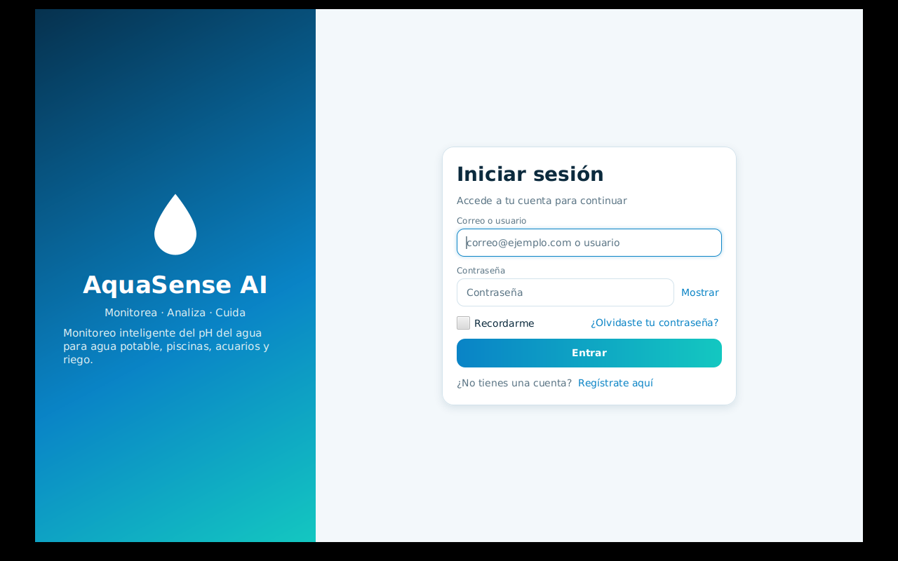
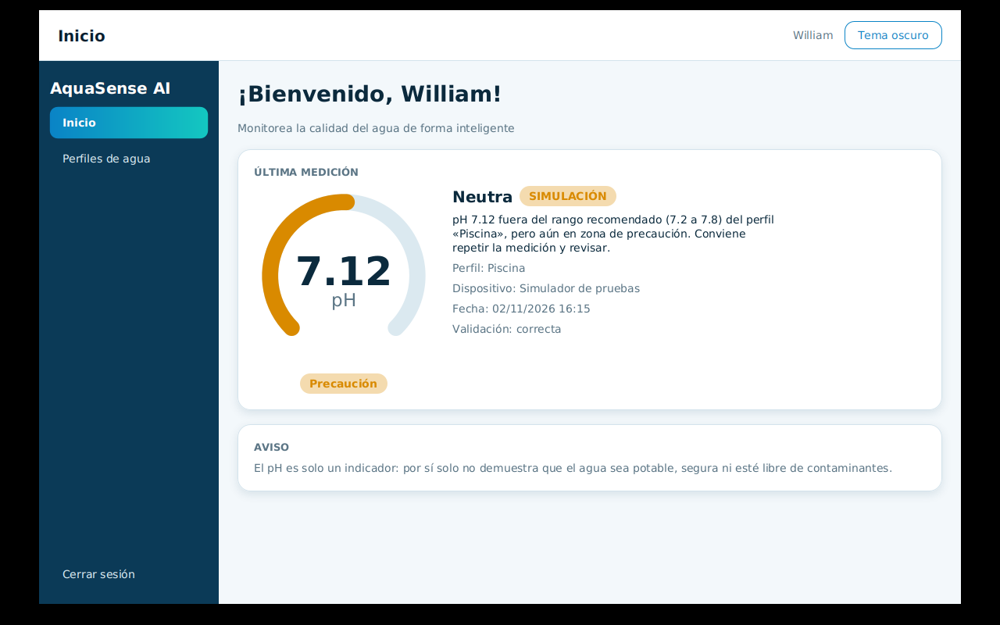
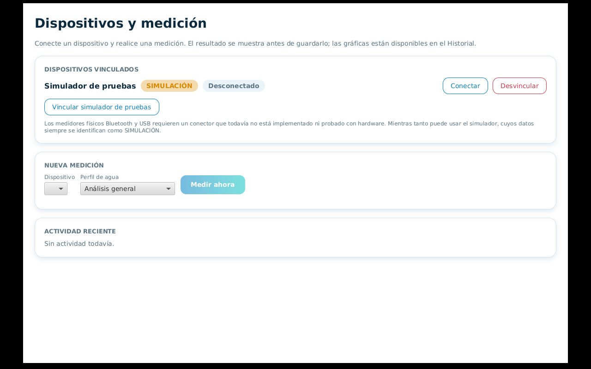
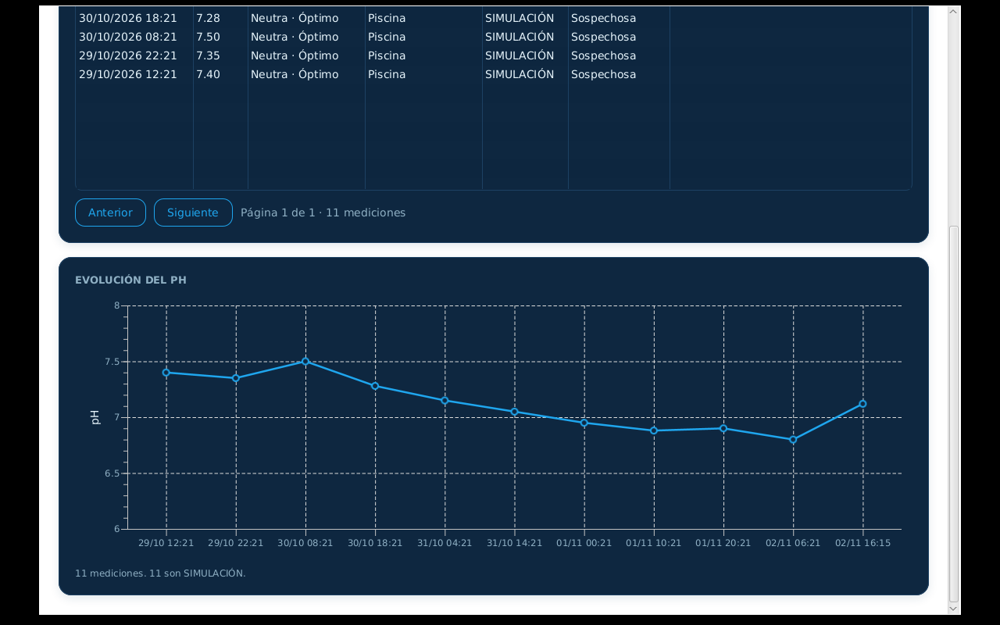
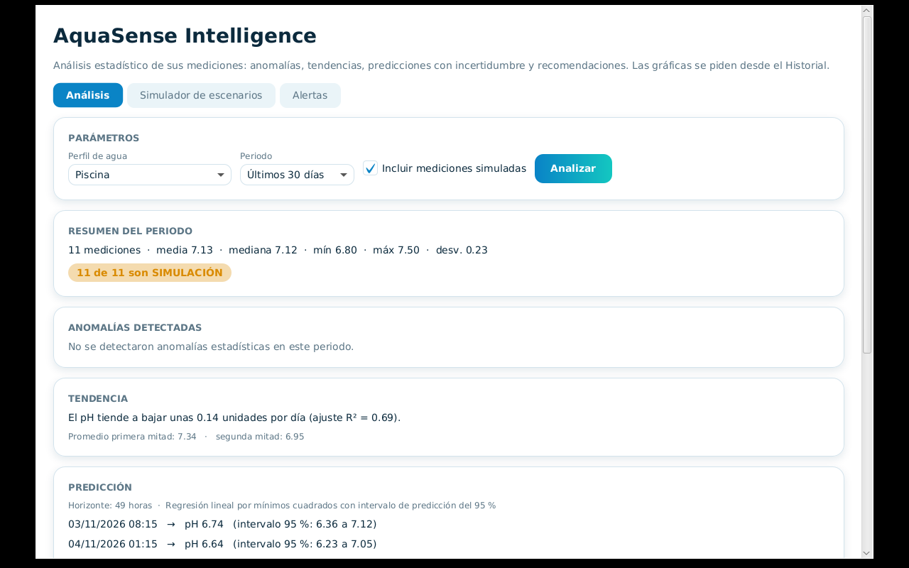

# AquaSense AI — Frontend (aplicación de escritorio JavaFX)

Aplicación de escritorio de **AquaSense AI**, un sistema de monitoreo y análisis del pH del agua (agua potable, piscinas, acuarios, riego y uso general). Se conecta al servidor REST del repositorio [BackendPatSft](https://github.com/WillC372/BackendPatSft).

Proyecto de la asignatura **Patrones de Software**. Todo el código es Java; no hay JavaScript.

> **Aviso sobre el pH.** Una medición de pH, por sí sola, no demuestra que el agua sea potable ni segura. La aplicación muestra este aviso junto a las clasificaciones y los análisis.

## Estado real

| Funcionalidad | Estado |
|---|---|
| Registro, inicio de sesión, "recordarme", recuperación de contraseña, mostrar/ocultar contraseña | Implementado |
| Panel de inicio con indicador circular de pH y última medición | Implementado |
| Perfiles de agua (ver, crear, duplicar, eliminar personalizados) | Implementado |
| Dispositivos y medición con **simulador** (siempre rotulado SIMULACIÓN) | Implementado |
| Historial con filtros, paginación y gráfica **solo bajo demanda** | Implementado |
| AquaSense Intelligence: análisis, simulador de escenarios, alertas | Implementado |
| Tema claro (por defecto) y oscuro, con preferencia guardada | Implementado |
| **Medidor físico (Bluetooth/USB)** | **No implementado**: no hay conector ni hardware |
| Pantalla de **informes** y de **plan/suscripción** | **No implementado** en el cliente (el backend sí las ofrece) |
| Chat con IA | **No implementado** |
| Distribución (instalador, empaquetado) | **No realizada** |
| Android e iOS | **No compilado ni probado** |

Detalle en [docs/limitaciones.md](docs/limitaciones.md).

## Capturas

| Inicio de sesión | Inicio |
|---|---|
|  |  |

| Dispositivos y medición | Historial con gráfica (tema oscuro) |
|---|---|
|  |  |



Las capturas se tomaron ejecutando la aplicación real contra el backend local. Los datos de las mediciones son de **simulador**.

## Arquitectura

Capas: `ui` (vistas JavaFX en código Java y CSS) → `service` (casos de uso del cliente) → `api` (cliente HTTP/JSON). La capa `device` aísla los conectores de medidores. El cliente nunca toca la base de datos. Ver [docs/arquitectura.md](docs/arquitectura.md).

```
src/main/java/com/aquasense/client
├── AquaSenseApp, Launcher, AppContext
├── api        ApiClient, modelos del contrato REST
├── config     AppConfig (URL del servidor, carpeta de datos)
├── device     conectores, estados (State), comandos (Command), fábrica
├── service    Auth, Perfiles, Mediciones, Dispositivos, Intelligence
├── session    Session, sesión recordada
└── ui         Navigator, Ui, componentes (PhGauge), tema, vistas
src/main/resources/css   base.css, light.css, dark.css
docs/                    documentación y capturas
```

## Tecnologías

Java 21 · JavaFX 21.0.5 (`javafx-controls`, incluye gráficas) · Jackson 2.18 · `java.net.http.HttpClient` · JUnit 5 y AssertJ · Maven.

## Requisitos previos

- JDK 21
- Maven 3.9+
- Un entorno gráfico (en Linux, X11/Wayland con las bibliotecas GTK 3)
- El backend en ejecución (ver su README)

## Instalación y ejecución

```bash
git clone https://github.com/WillC372/FrontendPatSft.git
cd FrontendPatSft
mvn javafx:run
```

## Configuración del entorno

| Opción | Cómo se define | Por defecto |
|---|---|---|
| URL del backend | variable `AQUASENSE_API_URL` o propiedad `-Daquasense.api.url=` | `http://localhost:8080` |
| Carpeta de datos locales | propiedad `-Daquasense.data.dir=` | `~/.aquasense` |

Ejemplo apuntando a un servidor remoto:

```bash
AQUASENSE_API_URL=https://mi-servidor.example.com mvn javafx:run
```

Datos locales: `preferences.properties` (tema) y `session.token` (solo si marca "Recordarme"; permisos `rw-------`). Ese token permite reabrir la sesión sin contraseña: no use "Recordarme" en un equipo compartido.

## Conexión con el backend

Todo pasa por la API REST `/api/v1` con JWT. Si el token de acceso caduca, el cliente lo renueva una vez con el refresh token y reintenta; si falla, vuelve al inicio de sesión. Si el servidor no responde, muestra "No se pudo conectar con el servidor de AquaSense".

## Compilar y distribuir

```bash
mvn package        # genera target/aquasense-desktop-0.1.0-SNAPSHOT.jar (sin dependencias)
```

Todavía **no hay** JAR ejecutable con dependencias, ni instalador (`jpackage`), ni versión móvil. JavaFX no se publica como sitio web (no es compatible con Vercel). Ver [docs/plataformas.md](docs/plataformas.md).

## Pruebas

```bash
mvn test
```

Último resultado verificado: **18 pruebas, 0 fallos**. Cubren el cliente REST (renovación de token, errores, servidor caído), la sesión recordada, las validaciones de formulario, la capa de dispositivos (estados, observador, comandos, simulador), la regla de las 3 mediciones para la gráfica y el contrato con respuestas reales del backend. **No hay pruebas automáticas de la interfaz gráfica.** Ver [docs/pruebas.md](docs/pruebas.md).

## Despliegue e instalación en equipos

No existe aún una forma de distribución. Es parte del trabajo pendiente ([docs/plataformas.md](docs/plataformas.md)).

## Solución de problemas

| Síntoma | Solución |
|---|---|
| "No se pudo conectar con el servidor" | Verifique que el backend esté en marcha y `AQUASENSE_API_URL` sea correcta. |
| `JavaFX runtime components are missing` al ejecutar clases sueltas | Use `mvn javafx:run` o el lanzador `Launcher`. |
| La ventana no abre en Linux sin pantalla | Necesita un servidor gráfico; en pruebas se usó Xvfb. |
| Pide iniciar sesión otra vez | La sesión expiró o se cerró en otro lugar. |
| "Conector no disponible" en un dispositivo | Solo el simulador tiene conector; Bluetooth y USB aún no. |

## Documentación

[Arquitectura](docs/arquitectura.md) · [Dispositivos y medidor físico](docs/dispositivos.md) · [Manual de usuario](docs/manual-usuario.md) · [Plataformas](docs/plataformas.md) · [Pruebas](docs/pruebas.md) · [Limitaciones](docs/limitaciones.md) · [Patrones del cliente](docs/patrones.md)

## Licencia

Sin licencia definida (proyecto académico). Pendiente de que el autor elija una.
