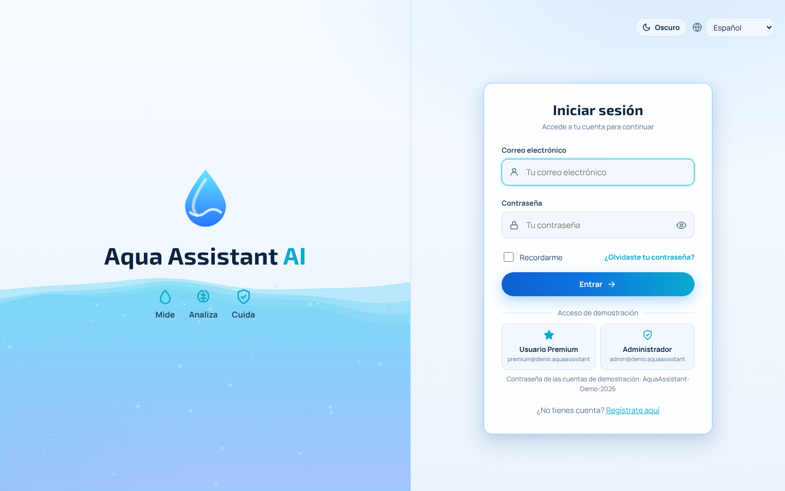
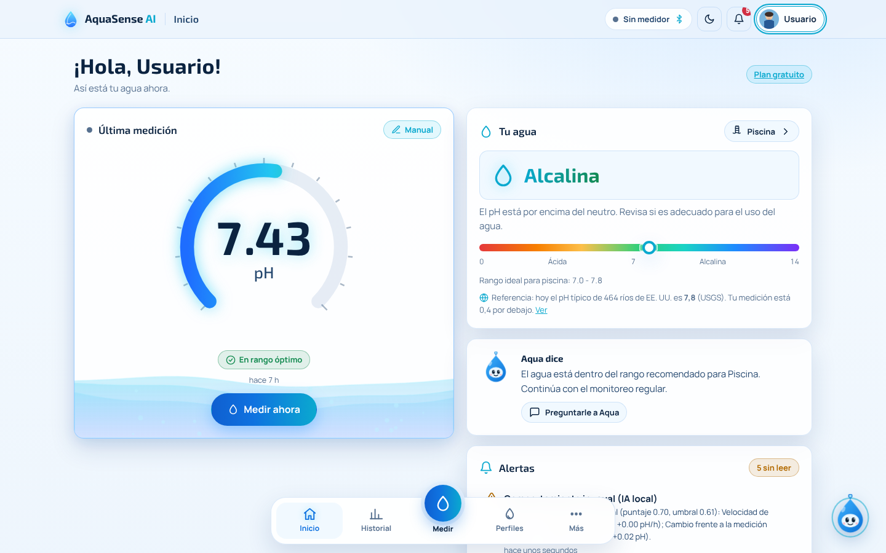
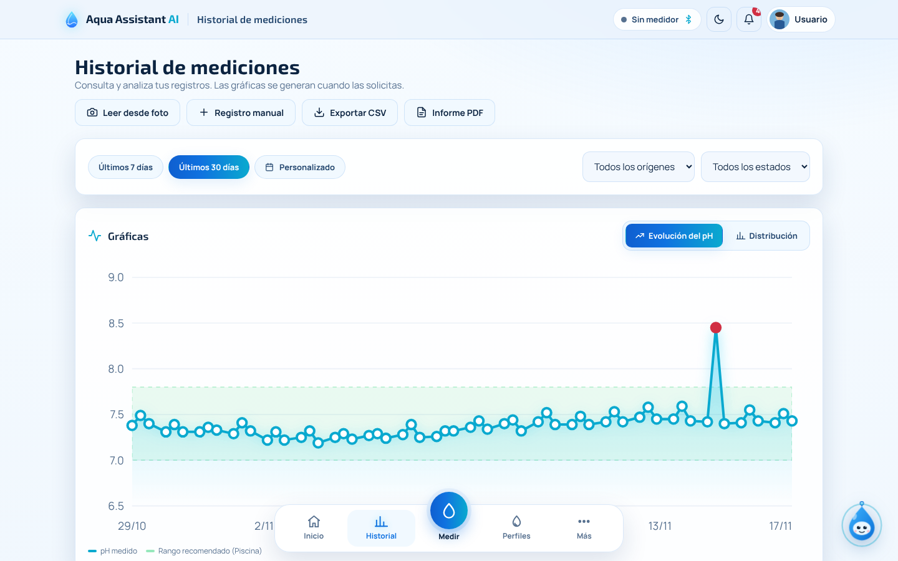
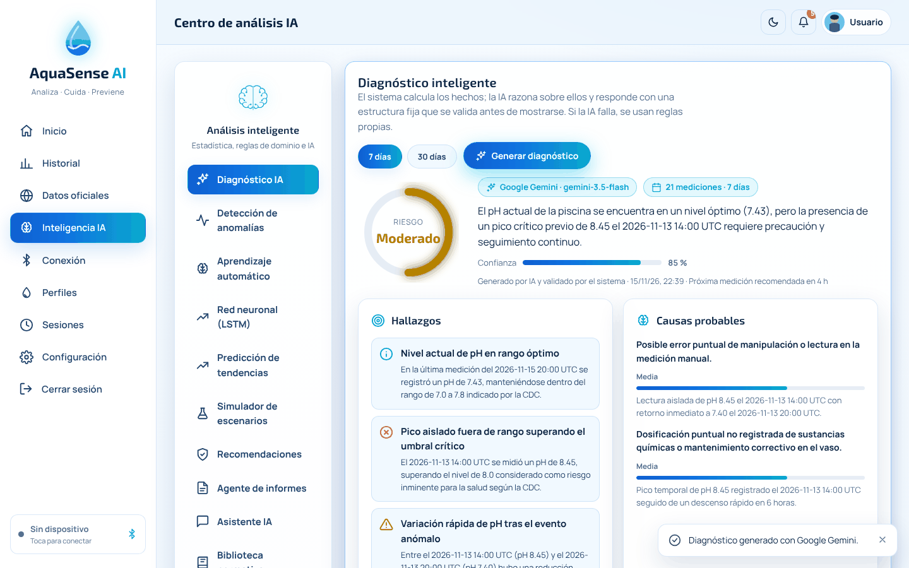
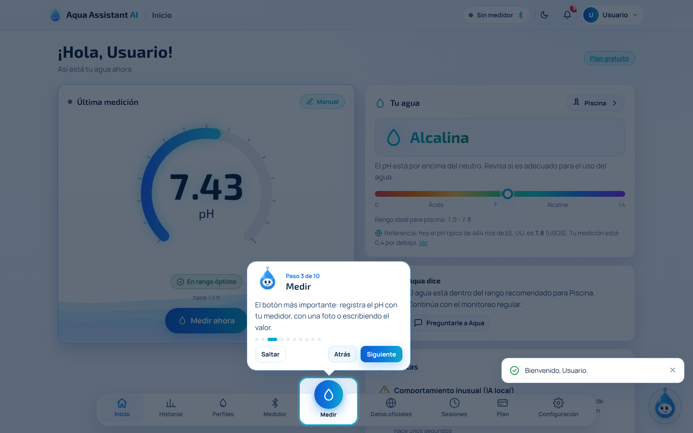
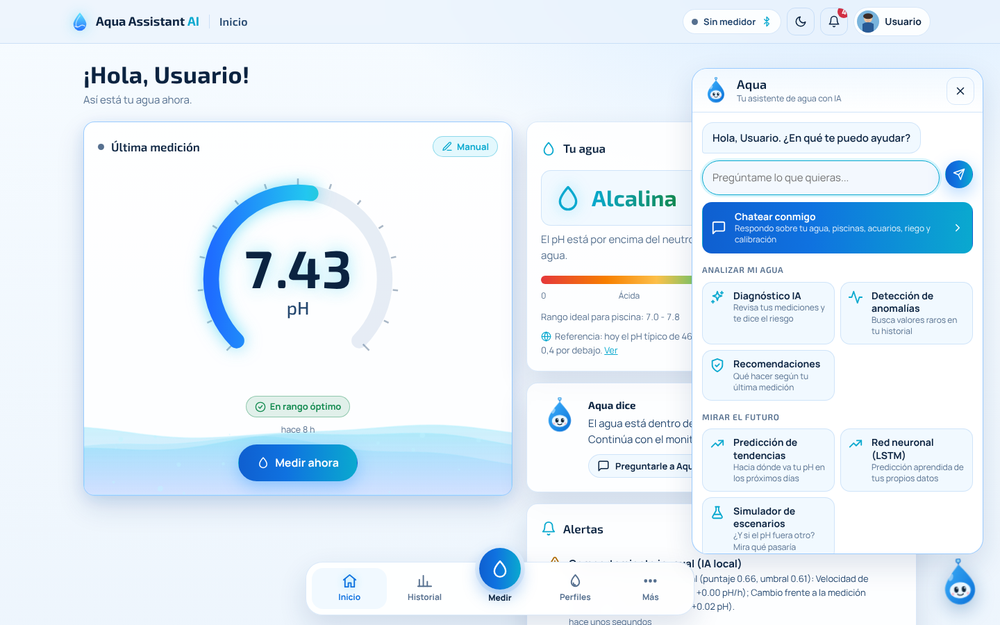

# Aqua Assistant AI · Frontend

Interfaz web de **Aqua Assistant AI** para monitorear el pH del agua. Muestra las mediciones, controla el medidor, presenta los análisis de la IA de Aqua y aplica el diseño de los mockups: tema oscuro con efecto vidrio, indicador circular de pH, ondas de agua animadas y tema claro opcional.

> Backend: carpeta [`../Backend`](../Backend) (repositorio [BackendPatSft](https://github.com/WillC372/BackendPatSft)).

## Objetivo

Presentar la información y recoger las acciones del usuario. **Toda la lógica vive en el backend**: clasificación, validaciones, límites del plan, lectura del hardware e IA. El frontend no accede a la base de datos ni guarda claves.

## Funcionalidades

- **Barra inferior de 4 pestañas** (`js/views/Shell.js`), igual en computador y celular: Inicio, Historial, **Medir** (botón central: medidor, foto o escribir el valor; `MeasureSheet.js`) y Plan, y Admin para administradores. Arriba, el **botón del lugar** («Mi agua ▾») cambia de lugar y abre «Cuidado de este lugar» (calculadora de dosis, tratamientos y recordatorios) y «Crear, editar o compartir lugares» (con los **Perfiles de uso**); el **menú de la cuenta** tiene «Mi cuenta», **Configuración** (con Medidor y Actividad y sesiones) y «Cerrar sesión». Los **Datos oficiales** están junto a las normas, en la Biblioteca normativa de Aqua. Las pantallas agrupadas tienen una fila de enlaces arriba (`js/ui/SubNav.js`).
- **Un solo camino para cada cosa**: medir solo desde «Medir»; los lugares y su cuidado desde el botón del lugar; la configuración, el medidor y la actividad desde el menú de la cuenta; Aqua se abre solo con la gota, y su chat con «Chatear conmigo»; la foto de perfil en «Mi cuenta». El tema se cambia en Configuración › Apariencia y, antes de iniciar sesión, con el botón «Claro / Oscuro» junto al idioma (la elección pasa a la cuenta al entrar). Inicio solo muestra información.
- **Menú del usuario**: la inicial o el nombre (arriba a la derecha) abren "Mi cuenta" y **Cerrar sesión**, el único lugar desde donde se cierra la sesión. Se usa con el teclado (flechas y Esc).
- **Aqua, el robot de la IA** (`js/views/AquaBot.js`, `js/ui/AquaFace.js`): una gota con cara que salta sola en todas las pantallas (se aplasta al caer, deja ondas y a veces da una voltereta) y es la única entrada a la inteligencia artificial. Al tocarlo se abre un panel para chatear (el asistente con memoria y citas), preguntar directamente o abrir sus funciones, en tres grupos: **Analizar mi agua** (diagnóstico y recomendaciones juntos, anomalías y predicción del pH), **Más herramientas** (agente de informes, biblioteca normativa con los datos oficiales, leer el pH de una foto) y **Análisis avanzado** (red neuronal LSTM e Isolation Forest, entrenados con los datos de la persona, y simulador de escenarios). «Consumo y costos» solo aparece para administradores y la lista de conversaciones se abre desde el chat. Al abrir cada pantalla da un consejo corto sobre para qué sirve (se puede desactivar). Está animado: el agua se mueve dentro de la gota y suben burbujas, parpadea, sus ojos siguen el puntero, mueve la boca cuando habla, su antena se enciende mientras la IA trabaja en cualquier pantalla y de vez en cuando salta, guiña o gira (nada se mueve si el sistema pide reducir el movimiento).
- **Voz de Aqua** (`js/core/Voice.js`): al abrirla saluda en voz alta («Hola, Ana. ¿En qué te puedo ayudar?») y lee cada respuesta frase por frase mientras llega, en el idioma de la app, moviendo la boca. Usa las voces del dispositivo y elige la más natural (neuronales de Edge, de Google en Chrome, mejoradas de iPhone y Android). Se apaga con el altavoz del panel de Aqua o en Configuración, donde se elige la voz y la velocidad.
- **Toda la app en 7 idiomas: español, inglés, francés, alemán, italiano, chino y japonés** (`js/core/I18n.js`, `js/core/Locale.js`): selector en Configuración y en la pantalla de inicio de sesión. Un `MutationObserver` traduce cada texto, botón, etiqueta y mensaje de la página, también los que aparecen después. Las traducciones vienen del backend, que traduce cada texto una vez por idioma con la IA y las comparte con todos; el navegador guarda una copia para que la siguiente visita sea inmediata. Las frases con negritas o enlaces viajan con marcadores (`<0>…</0>`) y los números como `{0}`. El servidor mantiene traducidos de antemano todos los textos de la app, así que cambiar de idioma es inmediato. Fechas, números y tiempos relativos usan el formato del idioma. Lo que escribe la persona (nombres, notas, chats) lleva `translate="no"`. Los informes PDF salen en el idioma elegido, también en chino y japonés.
- **Lugares** (`#/places`, `js/views/Places.js`): cada piscina, acuario o tanque con su historial, perfil y volumen. El lugar en uso se ve y se cambia arriba. Se comparte con un código (solo ver, o ver y medir) y se une otra persona escribiéndolo; el dueño ve y quita a quien se unió.
- **Cuidado** (`#/care`, `js/views/Care.js`, `js/core/DoseCalc.js`): calculadora de dosis (pH con el sistema carbonato y la alcalinidad; cloro, alcalinidad, dureza y estabilizador por balance de masa), registro de tratamientos y recordatorios que vencen en Inicio («Para hoy») y llegan al celular (Web Push, `sw.js`, `js/core/PushClient.js`) o por correo.
- **Otros parámetros**: la medición manual acepta cloro libre, alcalinidad, dureza cálcica y ácido cianúrico; Inicio y el Historial los muestran con su rango orientativo.
- **Cuadros «¿Para qué sirve?»** (`js/ui/Help.js`): cada función nueva se explica con ejemplos la primera vez; se cierran con «Entendido» y se reabren tocando su título.
- **Caché que se limpia sola** (`js/core/ApiCache.js`): guarda en memoria las respuestas que cambian poco (datos oficiales, biblioteca, perfiles, configuración, panel) para que volver a una pantalla sea instantáneo. Cada respuesta vence según cuánto cambia (de 30 s a 10 min), se guardan como máximo 40 (sale la menos usada), un barrido cada minuto borra las vencidas y se vacía al guardar cualquier cambio, al cerrar sesión o al cambiar de cuenta. `js/core/StorageJanitor.js` borra al abrir la app lo que el navegador guardó de versiones viejas.
- **Recorrido guiado** (`js/views/Tour.js`): la primera vez que una persona entra, Aqua señala cada botón con un globo de texto (Siguiente, Atrás, Saltar; también con las flechas del teclado y Esc). Se repite desde Aqua → "¿Qué puedo hacer aquí?".
- Inicio de sesión, registro, "Recordarme", mostrar u ocultar contraseña, recuperación y restablecimiento.
- **Foto de perfil** (`js/views/AccountDialog.js`, `js/core/Avatar.js`): el nombre de la barra superior abre "Tu cuenta", donde se sube (en el teléfono, desde la galería o la cámara), cambia o quita la foto; también desde Configuración. El navegador endereza la foto, recorta el cuadrado central y la reduce antes de enviarla; el servidor la vuelve a procesar y la guarda sin metadatos. La foto no es pública: se descarga con la sesión.
- **Acceso de demostración**: en el inicio de sesión hay dos botones, **Usuario Premium** y **Administrador**, con su correo y la contraseña visibles. Son cuentas reales del backend con límites: no se pueden eliminar, recuperar la contraseña ni pagar, y el administrador de demostración solo consulta (ve enmascarados los datos de las cuentas reales). Una franja avisa que la cuenta es compartida.
- **Historial de sesiones** (`#/sessions`, `js/views/Sessions.js`): cada inicio de sesión es una entrada nueva, con inicio, fin, duración, navegador y lo que se hizo (mediciones, preguntas a la IA, descargas...). El detalle muestra cada acción en orden hasta el cierre de sesión. "Cerrar mis otras sesiones" cierra las abiertas en otros equipos. El administrador ve las sesiones de cualquier cuenta.
- **Datos oficiales** (`#/official`, `js/views/OfficialData.js`): datos reales de pH de las estaciones del Servicio Geológico de EE. UU. (USGS) que el backend importa cada 3 horas: estaciones que reportaron en 24 horas, mediana, mínimo, máximo y distribución; ocho estaciones destacadas con su serie de 24 horas, 7 o 30 días; las de pH más bajo y más alto, con enlace a la fuente. Se muestran aparte de las mediciones del usuario e indican si los valores son provisionales.
- **Inicio**: indicador circular de pH animado, estado del agua con escala 0-14, perfil activo y su rango, referencia oficial del USGS, lo que sugiere Aqua, alertas sin leer (solo si hay) y consejo.
- **Medición**: el botón "Medir" de la barra, con el medidor conectado (resultado con clasificación, fecha, dispositivo, perfil, explicación y validación; guardar o descartar), modo en tiempo real por SSE y registro manual.
- **Historial**: 7 o 30 días, rango personalizado, filtros por origen y estado, tabla paginada, borrado con confirmación, exportación CSV. Las gráficas (evolución y distribución) se generan solo cuando el usuario las pide.
- **Diagnóstico IA**: riesgo con anillo animado, hallazgos con evidencia, causas probables, plan de acción priorizado, datos faltantes, confianza, salvaguardas aplicadas e historial. Indica qué proveedor respondió (Gemini, Groq o reglas). El último diagnóstico aparece también en el inicio.
- **Medidor conectado a este equipo** (Conexión, `js/core/BrowserMeter.js`, `js/views/UsbMeter.js`): en Chrome o Edge, la página abre el puerto USB del medidor (o un Bluetooth emparejado como puerto serie) con Web Serial, habla su protocolo (firmware Aqua Assistant, Atlas EZO-pH o medidor de laboratorio que envía texto), mide, calibra y guarda mediciones reales en el backend. Con el medidor conectado, "Medir" (barra inferior) ofrece medir con él.
- **Asistente IA**: responde cualquier pregunta sobre el agua y su pH (piscinas, acuarios, agua potable, riego, corrección del pH, medidores, uso de la app y tus datos) y rechaza con una frase fija los temas ajenos. La respuesta aparece **mientras se escribe** (Server-Sent Events leídos con `fetch`, `js/core/SseParser.js`); el botón **Detener** la corta y **Copiar** la lleva al portapapeles con sus fuentes numeradas. Si el modelo se congela a mitad, el servidor avisa (`restart`) y otro modelo escribe la respuesta de nuevo; si ya no queda otro, lo recibido se conserva con el motivo.
- **Arranque del servidor**: el backend gratuito se apaga cuando nadie lo usa; la app espera a que despierte mostrando "Activando el servidor..." en vez de fallar.
- **Medidor por cámara** (Conexión, `js/views/CameraMeter.js`): para medidores sin cable de datos. La cámara apunta a la pantalla del medidor; el navegador detecta cuándo cambia el número y solo entonces envía un cuadro a la lectura por foto del backend. Las lecturas confiables se guardan solas. Muestra la cuota de IA del día, porque cada lectura usa una consulta.
- **Lectura por foto**: desde Inicio o Historial, toma o sube una foto de la tira reactiva o de la pantalla del medidor. Muestra una animación de escaneo, el valor con su margen sobre la escala de colores, la confianza, si los dos modelos coinciden y las salvaguardas aplicadas. Permite corregir el valor antes de guardarlo con la etiqueta "Foto IA". La foto se convierte a JPEG en el navegador y no se guarda.
- **Agente de informes**: el usuario escribe un objetivo o elige una sugerencia; una línea de tiempo muestra en vivo cada consulta que hace el agente. El informe incluye resumen, cifras clave, secciones con las gráficas que eligió el agente, recomendaciones, limitaciones, el sello "N/N cifras verificadas", el detalle de cómo se elaboró, el historial y la descarga en PDF o .txt.
- **Respaldo normativo y biblioteca**: recomendaciones, diagnósticos, informes y el asistente muestran las citas literales de la EPA, la OMS, la CDC o la FAO que los respaldan. Cada cita trae su sección, un resumen en español rotulado como no oficial, el carácter legal de la fuente y el enlace al documento. En el chat, las referencias son marcas numeradas que abren y resaltan la cita. La vista "Biblioteca normativa" lista las fuentes, la cobertura por uso del agua y permite buscar en los fragmentos (`js/views/Citations.js`, `js/views/Library.js`).
- **Plan y pagos** (`#/billing`): plan actual y vencimiento, comparación con Premium, botón "Pagar con PayU" que envía el formulario firmado por el backend a la página segura de PayU, datos de prueba del sandbox, resultado al volver (verificado por el servidor) e historial de pagos (`js/views/Billing.js`).
- **Asistente con memoria**: lista de conversaciones guardadas, abrir y continuar una conversación, indicador de cuántos mensajes recuerda, y borrar una o todas (`js/views/AssistantPane.js`).
- **Escenarios explicados por IA**: tras simular, "Explicar con IA" muestra el cambio en la concentración de iones H+, cuándo se llegaría con la tendencia actual, efectos por área con su severidad, señales tempranas, prevención, citas y el sello de cifras verificadas.
- **Administración** (solo administradores, `js/views/Admin.js`): cifras del sistema, lista de usuarios con búsqueda, filtros y paginación (en el celular se muestra como tarjetas), y una ventana por cuenta para cambiar el plan, el rol y el estado, con sus pagos y su actividad. Los botones que el servidor no permite (por ejemplo, desactivar la propia cuenta) se reemplazan por el motivo. Las acciones delicadas piden un segundo clic.
- **Consumo y costos**: llamadas, fallos, tokens, costo estimado y cargo real; gráfica diaria animada y desglose por modelo y por función. Los administradores ven también el consumo global (`js/views/UsagePane.js`).
- **Red neuronal (LSTM)**: diagrama animado de la red desplegada en el tiempo, serie de 48 horas con la predicción de 12 horas y su intervalo, comparación del error con las referencias simples, curva de aprendizaje con la época elegida y alerta anticipada. Sin datos suficientes muestra cuánto falta para entrenar (`js/views/DeepPane.js`).
- **Aprendizaje automático**: estado del modelo (mediciones, árboles, umbral, tiempo de entrenamiento), puntaje de rareza de cada medición frente al umbral, patrón de pH por hora del día y mediciones inusuales con las variables que las explican.
- **Centro de análisis IA**: anomalías con gráfica, tendencias, predicción con intervalo de incertidumbre, simulador "¿Qué pasa si...?", recomendaciones, informes descargables y asistente conversacional.
- **Conexión**: medidor USB o Bluetooth del propio equipo (Web Serial) y medidor por cámara. La sección del medidor conectado al servidor solo aparece cuando el backend corre en el mismo computador del medidor.
- **Perfiles**: activar, duplicar, crear, editar y borrar perfiles con rangos y fuente.
- **Configuración**: tema automático, claro u oscuro (persistente), notificaciones, guardado automático, cuenta y plan, actividad.
- Diseño adaptable: la misma barra inferior en escritorio y en móvil, contenido centrado con ancho máximo. Respeta "reducir movimiento".
- **Cuenta**: cambiar el nombre y la contraseña desde Configuración. La contraseña pide la actual, muestra las reglas mientras se escribe y avisa si Bloq Mayús está activado; al cambiarla se cierran las demás sesiones y esta sigue abierta con el token nuevo.
- **Volver donde estabas**: si la sesión vence, o se abre el enlace de una pantalla sin haber iniciado sesión, al entrar se vuelve a esa pantalla.
- **Instalable**: con su manifiesto e íconos, el navegador ofrece "Instalar" o "Agregar a la pantalla de inicio"; la app abre en su propia ventana.
- **Historial**: recuerda el periodo y los filtros durante la sesión; "Exportar CSV" descarga exactamente lo que muestra la tabla, y "Ver detalle" abre todos los datos de la medición.
- **Inicio**: tarjeta "Referencia oficial" con el pH típico de los ríos que midió hoy el USGS y la distancia de tu última medición a ese valor.
- **Formularios**: los rangos de un perfil personalizado, las fechas futuras y las temperaturas imposibles se marcan en su campo antes de enviar.
- **Impresión**: al imprimir una pantalla (Ctrl+P) sale solo su contenido, en negro sobre blanco.
- **Asistente**: "Descargar" guarda la conversación como texto, con las fuentes de cada respuesta.
- **Sesión y conexión**: avisa 5 minutos antes de que venza la sesión y, al vencer, vuelve al inicio de sesión sin esperar a que falle una petición. Sin internet, una franja lo indica hasta que vuelve la conexión.
- **Errores inesperados**: si algo falla sin que la pantalla lo maneje, aparece un aviso en lugar de no pasar nada.
- **Accesibilidad**: enlace "Saltar al contenido" como primera parada del teclado; revisada con axe-core en 16 pantallas, en tema claro y oscuro, en computador y en teléfono, sin hallazgos (11 nov 2026). Incluye:
  - región principal y encabezado en cada pantalla, también en el teléfono, donde el título de la barra superior queda oculto a la vista pero se lee;
  - niveles de encabezado en orden y foco atrapado dentro de los diálogos (Escape cierra solo el de arriba);
  - selectores de periodo anunciados como grupos de botones con su opción marcada;
  - tablas que no caben, alcanzables con el teclado;
  - avisos que se pueden cerrar, y el foco pasa al contenido al cambiar de pantalla.
- **Gráficas legibles en el teléfono**: las gráficas de líneas se dibujan al ancho real de la pantalla, así el texto conserva su tamaño; en series densas solo se marcan los puntos fuera de rango. La distribución de los datos oficiales es una barra dividida con su leyenda.

Los datos simulados siempre llevan la etiqueta **SIMULADO**.

## Tecnologías y arquitectura

HTML5, CSS3 (variables, grid y animaciones) y JavaScript moderno con módulos ES, sin frameworks ni paso de compilación. Gráficas en SVG e indicador en SVG, ambos propios; ondas en Canvas 2D.

```
Frontend/
├── index.html              Punto de entrada
├── Config.js               URL del backend (apiBaseUrl) y del servicio de IA (aiBaseUrl)
├── Server.mjs              Servidor estático de desarrollo (Node, sin dependencias)
├── vercel.json             Rutas y cabeceras de seguridad del sitio publicado
├── assets/
│   ├── css/                tokens (temas), base, layout, components, views, animations
│   └── img/Favicon.svg
├── js/
│   ├── App.js              Arranque y registro de rutas (cada pantalla se descarga al abrirla)
│   ├── ThemeBoot.js        Aplica el tema guardado antes de pintar la página
│   ├── core/               Api (REST y respuestas en vivo), SseParser, Session, SessionTimer, Router (hash), LazyView,
│   │                       EventBus, Theme, LiveStream, BrowserMeter y MeterProtocols (Web Serial), Format
│   ├── ui/                 icons, components (toast, modal, insignias), gauge, charts, water, illustrations
│   └── views/              Una vista por pantalla (Auth, Shell, Dashboard, History, OfficialData, Sessions,
│                           Intelligence, AssistantPane, Devices, Admin...), Aqua (AquaBot, Tour, AiFunctions),
│                           MeasureSheet y textos sin DOM (AnswerText, SessionText,
│                           OfficialText)
├── tests/                  Pruebas unitarias (node:test)
├── scripts/CheckSyntax.mjs
├── .github/workflows/      Revisión automática en cada push
└── docs/
    ├── Requerimientos.md    Requerimientos funcionales y no funcionales (historias de usuario)
    ├── mockups/             MockUp1 ... MockUp32 (capturas de la app publicada, tema claro)
    └── issues/              Un archivo por Issue y los scripts que los crean en GitHub
```

Patrones en el cliente: **Observer** (`EventBus`: lecturas en vivo, sesión, alertas), **Singleton** (`api`, `session`, `liveStream`, `browserMeter`), **Proxy virtual** (`LazyView`: la pantalla se descarga la primera vez que se abre, o antes si el puntero pasa sobre su enlace) y un router que asocia cada ruta con su vista.

## Convenciones de código

- **Inglés:** nombres de funciones y variables, comentarios del código y de los estilos.
- **Español:** solo los textos que ve el usuario en la interfaz.
- **Nombres de archivo en inglés y en PascalCase**, como `js/views/AgentReport.js`, `js/core/Api.js`, `assets/css/Tokens.css` o `Server.mjs`.
- **Excepciones por convención de las herramientas:** `index.html` (página que sirven por defecto los navegadores y Vercel), `package.json`, `vercel.json`, `README.md` y `.gitignore`. Las carpetas van en minúsculas.

## Requisitos previos

- Un navegador moderno (Chrome, Edge, Firefox o Safari recientes).
- Node.js 22 o superior para el servidor de desarrollo y las pruebas (o cualquier servidor estático para solo abrir la app).
- El backend en ejecución (por defecto en `http://localhost:8080`).

## Instalación y ejecución

No hay dependencias que instalar.

```bash
cd Frontend
npm start
```

Abre `http://localhost:5500`. Como alternativa, sin Node:

```bash
python3 -m http.server 5500
```

## Configuración de conexión con el backend

El frontend habla con dos servicios por su API REST (`/api/v1`, con el mismo token JWT en la cabecera): el **backend** ([BackendPatSft](https://github.com/WillC372/BackendPatSft): cuentas, mediciones, lugares, cuidado, alertas, pagos, datos oficiales) y el **servicio de IA** ([AIPatSft](https://github.com/WillC372/AIPatSft): Aqua, análisis, informes, lectura de fotos y traducciones). `js/core/Api.js` envía al servicio de IA las rutas `/intelligence`, `/vision`, `/knowledge`, `/reports`, `/i18n` y `/admin/ai-usage`, y todo lo demás al backend. `Config.js` elige las direcciones según dónde corre la página:

- Local (`localhost`): backend en `http://localhost:8080/api/v1` y servicio de IA en `http://localhost:8081/api/v1`.
- Publicado (Vercel): `https://aquasense-backend-willc372.onrender.com/api/v1` y `https://aquasense-ai-willc372.onrender.com/api/v1`.

El servicio de IA duerme cuando nadie lo usa (el plan gratuito de Render no alcanza para tener los dos despiertos todo el mes): la app lo despierta apenas se abre (`wakeAiService` en `js/core/ServerWake.js`), así que suele estar listo cuando se toca a Aqua. La base de datos y su esquema están en [DBPatSft](https://github.com/WillC372/DBPatSft).

El origen del frontend debe estar en la variable `CORS_ORIGINS` del backend y del servicio de IA: `http://localhost:5500` en desarrollo y `https://aquaassistantai.vercel.app` en producción.

## Despliegue

Vercel publica la carpeta tal cual (sin compilación) en **https://aquaassistantai.vercel.app**. `vercel.json` envía cualquier ruta a `index.html` y agrega cabeceras de seguridad:

- `Content-Security-Policy`: solo el código del propio sitio (sin scripts en línea), Google Fonts, la API de Aqua Assistant en Render y el formulario de pago de PayU.
- `X-Frame-Options: DENY`: la página no puede incrustarse en otros sitios.
- `X-Content-Type-Options` y `Referrer-Policy`.
- `Permissions-Policy`: solo la cámara y el puerto serie, y solo para este sitio.

Con el proyecto conectado al repositorio, cada `git push` publica una versión nueva. La guía completa (Neon, Render y Vercel) está en `docs/Deployment.md` del repositorio BackendPatSft.

## Compilar y distribuir

No hay compilación: la carpeta completa es el sitio. Para publicarla en un hosting estático (GitHub Pages, Netlify, Vercel, Nginx):

1. Cambia `apiBaseUrl` en `Config.js` por la URL HTTPS del backend desplegado.
2. Agrega la URL del sitio a `CORS_ORIGINS` del backend.
3. Sube la carpeta tal cual.

**Estado:** publicado en https://aquaassistantai.vercel.app, conectado al backend de Render.

## Pruebas

```bash
npm run check   # sintaxis de los 54 archivos JS
npm test        # 53 pruebas unitarias con node:test
```

Las pruebas unitarias (`tests/`) cubren:

- La lectura de respuestas en vivo (eventos partidos entre fragmentos de red, finales de línea `\r\n` partidos, comentarios).
- Los lectores de medidores, con los mismos casos que la prueba del backend.
- El texto de las respuestas del asistente (en vivo y al copiar).
- Los formatos y el escapado de HTML.
- Los textos del historial de sesiones y de los datos oficiales.
- Las reglas de la contraseña y de los rangos de un perfil.

GitHub Actions ejecuta las dos órdenes en cada push (`.github/workflows/Checks.yml`).

Además, la app publicada se revisa de punta a punta con Playwright. El recorrido incluye:

- Los botones de demostración, los datos oficiales y el historial de sesiones.
- Registro, registro manual, medidor USB simulado en el navegador (firmware y medidor de texto) y lectura por foto con una cámara simulada.
- El asistente: pregunta general, repregunta, datos propios, fuera de tema, Detener y Copiar.
- Las 18 pantallas y la vista móvil.

Se registran los errores de consola y las peticiones fallidas. La accesibilidad se revisa con axe-core en tema claro y oscuro. Ese recorrido se ejecuta aparte y no forma parte del repositorio.

## Requerimientos y MockUps

Los requerimientos funcionales (RF-01 a RF-22) y no funcionales (RNF-01 a RNF-07) están en [`docs/Requerimientos.md`](docs/Requerimientos.md), cada uno como historia de usuario (**Como**… **quiero**… **para**…), con descripción, criterios de aceptación y su MockUp. Los mismos textos están en [`docs/issues/`](docs/issues/) para crear los Issues del repositorio (instrucciones abajo).

| | |
|---|---|
|  |  |
|  |  |
|  |  |

Los MockUps son capturas de la aplicación publicada en tema claro (el predeterminado), con la navegación por barra inferior y el robot Aqua. Las mediciones que aparecen son registros manuales de prueba de una cuenta temporal; no son mediciones de agua real.

### Issues

Los 29 requerimientos están creados como Issues del repositorio ([#1 a #29](https://github.com/WillC372/FrontendPatSft/issues); RF-22 es el #29 porque se agregó después), con las etiquetas *requerimiento funcional* o *requerimiento no funcional*, *historia de usuario* y su estado. Los scripts de [`docs/issues/`](docs/issues/) (`crear-issues.ps1` para Windows y `crear-issues.sh` para Mac o Linux) sirven para crearlos en otro repositorio con `gh`; saltan los que ya existen.

## Solución de problemas

| Síntoma | Solución |
|---|---|
| "No se pudo conectar con el servidor" | Arranca el backend y revisa `apiBaseUrl` en `Config.js` |
| Errores CORS en la consola | Agrega el origen del frontend a `CORS_ORIGINS` en el backend |
| La página queda en blanco al abrir `index.html` con doble clic | Los módulos ES necesitan un servidor: usa `npm start` |
| No llegan lecturas en tiempo real | Conecta un medidor o el simulador y pulsa "Tiempo real" |
| La sesión se cierra sola | El token venció (8 h, o 30 días con "Recordarme"); inicia sesión de nuevo. La app avisa 5 minutos antes |
| "No se pudo abrir esta pantalla" | Se perdió la conexión o se publicó una versión nueva mientras la app estaba abierta: pulsa "Recargar" |
| Una respuesta del asistente dice "Respuesta incompleta" | El modelo dejó de responder a mitad; vuelve a preguntar (el servidor prueba otro modelo si uno no empieza a responder) |

## Licencia

Proyecto académico de Patrones de Software. Sin licencia de uso definida por el autor.
