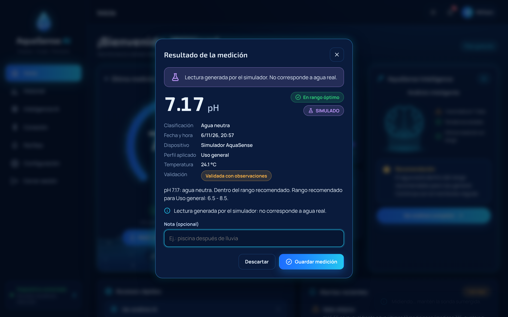
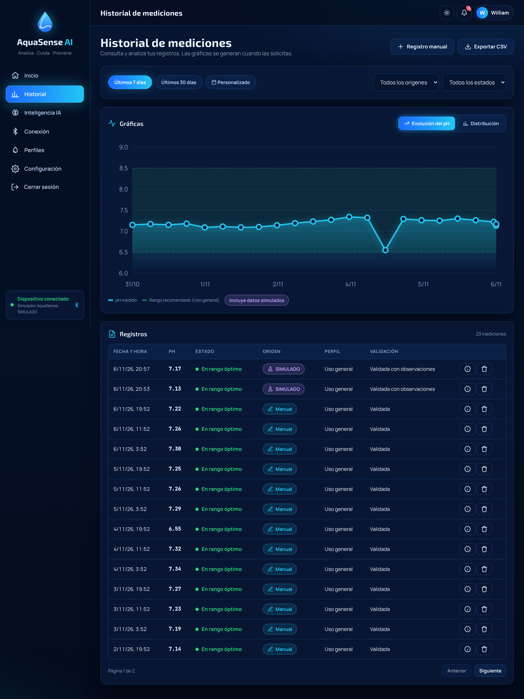
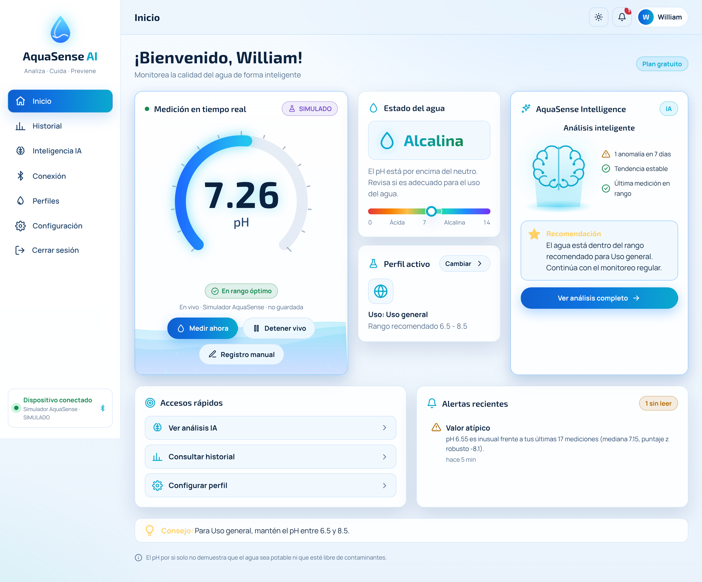
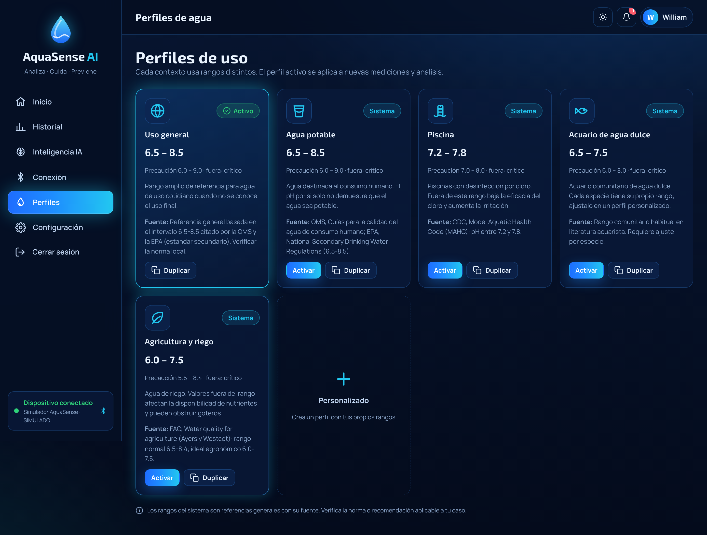
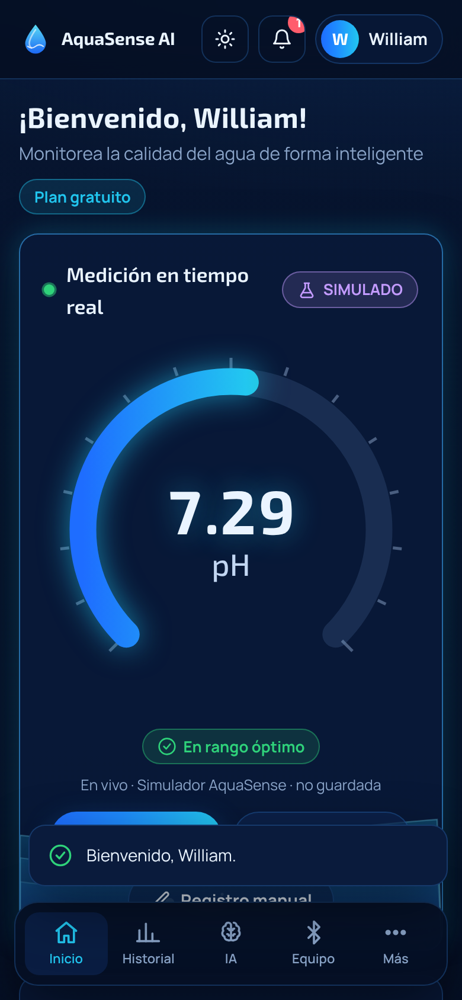

# AquaSense AI · Frontend

Interfaz web de **AquaSense AI** para monitorear el pH del agua. Muestra las mediciones, controla el medidor, presenta los análisis de AquaSense Intelligence y aplica el diseño de los mockups: tema oscuro con efecto vidrio, indicador circular de pH, ondas de agua animadas y tema claro opcional.

> Backend: carpeta [`../Backend`](../Backend) (repositorio [BackendPatSft](https://github.com/WillC372/BackendPatSft)).

## Objetivo

Presentar la información y recoger las acciones del usuario. **Toda la lógica vive en el backend**: clasificación, validaciones, límites del plan, lectura del hardware e IA. El frontend no accede a la base de datos ni guarda claves.

## Funcionalidades

- Inicio de sesión, registro, "Recordarme", mostrar u ocultar contraseña, recuperación y restablecimiento.
- **Dashboard**: indicador circular de pH animado, estado del agua con escala 0-14 y rango del perfil, perfil activo, panel de AquaSense Intelligence, alertas, accesos rápidos y consejo.
- **Medición**: "Medir ahora" con el medidor conectado (resultado con clasificación, fecha, dispositivo, perfil, explicación y validación; guardar o descartar), modo en tiempo real por SSE y registro manual.
- **Historial**: 7 o 30 días, rango personalizado, filtros por origen y estado, tabla paginada, borrado con confirmación, exportación CSV. Las gráficas (evolución y distribución) se generan solo cuando el usuario las pide.
- **Diagnóstico IA**: riesgo con anillo animado, hallazgos con evidencia, causas probables, plan de acción priorizado, datos faltantes, confianza, salvaguardas aplicadas e historial. Indica qué proveedor respondió (Gemini, Groq o reglas). El último diagnóstico aparece también en el inicio.
- **Lectura por foto**: desde Inicio o Historial, toma o sube una foto de la tira reactiva o de la pantalla del medidor. Muestra una animación de escaneo, el valor con su margen sobre la escala de colores, la confianza, si los dos modelos coinciden y las salvaguardas aplicadas. Permite corregir el valor antes de guardarlo con la etiqueta "Foto IA". La foto se convierte a JPEG en el navegador y no se guarda.
- **Agente de informes**: el usuario escribe un objetivo o elige una sugerencia; una línea de tiempo muestra en vivo cada consulta que hace el agente. El informe incluye resumen, cifras clave, secciones con las gráficas que eligió el agente, recomendaciones, limitaciones, el sello "N/N cifras verificadas", el detalle de cómo se elaboró, el historial y la descarga en PDF o .txt.
- **Respaldo normativo y biblioteca**: recomendaciones, diagnósticos, informes y el asistente muestran las citas literales de la EPA, la OMS, la CDC o la FAO que los respaldan. Cada cita trae su sección, un resumen en español rotulado como no oficial, el carácter legal de la fuente y el enlace al documento. En el chat, las referencias son marcas numeradas que abren y resaltan la cita. La vista "Biblioteca normativa" lista las fuentes, la cobertura por uso del agua y permite buscar en los fragmentos (`js/views/citations.js`, `js/views/library.js`).
- **Plan y pagos** (`#/billing`): plan actual y vencimiento, comparación con Premium, botón "Pagar con PayU" que envía el formulario firmado por el backend a la página segura de PayU, datos de prueba del sandbox, resultado al volver (verificado por el servidor) e historial de pagos (`js/views/billing.js`).
- **Asistente con memoria**: lista de conversaciones guardadas, abrir y continuar una conversación, indicador de cuántos mensajes recuerda, y borrar una o todas (`js/views/assistant-pane.js`).
- **Escenarios explicados por IA**: tras simular, "Explicar con IA" muestra el cambio en la concentración de iones H+, cuándo se llegaría con la tendencia actual, efectos por área con su severidad, señales tempranas, prevención, citas y el sello de cifras verificadas.
- **Administración** (solo administradores, `js/views/admin.js`): cifras del sistema, lista de usuarios con búsqueda, filtros y paginación (en el celular se muestra como tarjetas), y una ventana por cuenta para cambiar el plan, el rol y el estado, con sus pagos y su actividad. Los botones que el servidor no permite (por ejemplo, desactivar la propia cuenta) se reemplazan por el motivo. Las acciones delicadas piden un segundo clic.
- **Consumo y costos**: llamadas, fallos, tokens, costo estimado y cargo real; gráfica diaria animada y desglose por modelo y por función. Los administradores ven también el consumo global (`js/views/usage-pane.js`).
- **Red neuronal (LSTM)**: diagrama animado de la red desplegada en el tiempo, serie de 48 horas con la predicción de 12 horas y su intervalo, comparación del error con las referencias simples, curva de aprendizaje con la época elegida y alerta anticipada. Sin datos suficientes muestra cuánto falta para entrenar (`js/views/deep-pane.js`).
- **Aprendizaje automático**: estado del modelo (mediciones, árboles, umbral, tiempo de entrenamiento), puntaje de rareza de cada medición frente al umbral, patrón de pH por hora del día y mediciones inusuales con las variables que las explican. Un interruptor permite incluir datos simulados, solo para pruebas.
- **Centro de análisis IA**: anomalías con gráfica, tendencias, predicción con intervalo de incertidumbre, simulador "¿Qué pasa si...?", recomendaciones, informes descargables y asistente conversacional.
- **Conexión**: búsqueda con animación de radar, conexión a simulador, USB o Bluetooth SPP, estado, calibración y desconexión.
- **Perfiles**: activar, duplicar, crear, editar y borrar perfiles con rangos y fuente.
- **Configuración**: tema automático, claro u oscuro (persistente), notificaciones, guardado automático, cuenta y plan, actividad.
- Diseño adaptable: barra lateral en escritorio y navegación inferior en móvil. Respeta "reducir movimiento".

Los datos simulados siempre llevan la etiqueta **SIMULADO**.

## Tecnologías y arquitectura

HTML5, CSS3 (variables, grid y animaciones) y JavaScript moderno con módulos ES, sin frameworks ni paso de compilación. Gráficas en SVG e indicador en SVG, ambos propios; ondas en Canvas 2D.

```
Frontend/
├── index.html              Punto de entrada
├── config.js               URL del backend (apiBaseUrl)
├── server.mjs              Servidor estático de desarrollo (Node, sin dependencias)
├── assets/
│   ├── css/                tokens (temas), base, layout, components, views, animations
│   └── img/favicon.svg
├── js/
│   ├── app.js              Arranque y registro de rutas
│   ├── core/               api (cliente REST), session, router (hash), event-bus, theme, live-stream (SSE), format
│   ├── ui/                 icons, components (toast, modal, insignias), gauge, charts, water, illustrations
│   └── views/              auth, shell, dashboard, measure-flow, history, intelligence, devices, profiles, settings
├── scripts/check-syntax.mjs
└── docs/screenshots/
```

Patrones en el cliente: **Observer** (`event-bus`: lecturas en vivo, sesión, alertas), **Singleton** (`api`, `session`, `liveStream`) y un router que asocia cada ruta con su vista.

## Requisitos previos

- Un navegador moderno (Chrome, Edge, Firefox o Safari recientes).
- Node.js 18 o superior para el servidor de desarrollo (o cualquier servidor estático).
- El backend en ejecución (por defecto en `http://localhost:8080`).

## Instalación y ejecución

No hay dependencias que instalar.

```bash
cd Frontend
npm start
```

Abre `http://localhost:5500`. Como alternativa, sin Node:

```bash
python3 -m http.server 5500
```

## Configuración de conexión con el backend

Edita `config.js`:

```js
window.AQUASENSE_CONFIG = { apiBaseUrl: "http://localhost:8080/api/v1" };
```

El origen del frontend debe estar en la variable `CORS_ORIGINS` del backend (por defecto `http://localhost:5500`).

## Compilar y distribuir

No hay compilación: la carpeta completa es el sitio. Para publicarla en un hosting estático (GitHub Pages, Netlify, Vercel, Nginx):

1. Cambia `apiBaseUrl` en `config.js` por la URL HTTPS del backend desplegado.
2. Agrega la URL del sitio a `CORS_ORIGINS` del backend.
3. Sube la carpeta tal cual.

**Estado:** el frontend todavía no está publicado.

## Pruebas

```bash
npm run check
```

Verifica la sintaxis de los 28 archivos JS (26 módulos, el servidor y la configuración). La interfaz se probó de punta a punta con Playwright contra el backend y PostgreSQL. Se recorrieron inicio de sesión, dashboard, conexión del simulador, medir y guardar, tiempo real, historial con gráfica, todas las secciones de IA, perfiles, cambio de tema y la vista móvil (390 px, sin desbordamiento horizontal), sin errores en consola. Ese recorrido es manual y no queda como prueba automatizada del repositorio.

## Capturas

| | |
|---|---|
|  |  |
|  |  |
|  |  |
|  |  |
|  |  |

Las capturas usan registros manuales de prueba y el simulador; no son mediciones de agua real.

## Solución de problemas

| Síntoma | Solución |
|---|---|
| "No se pudo conectar con el servidor" | Arranca el backend y revisa `apiBaseUrl` en `config.js` |
| Errores CORS en la consola | Agrega el origen del frontend a `CORS_ORIGINS` en el backend |
| La página queda en blanco al abrir `index.html` con doble clic | Los módulos ES necesitan un servidor: usa `npm start` |
| No llegan lecturas en tiempo real | Conecta un medidor o el simulador y pulsa "Tiempo real" |
| La sesión se cierra sola | El token venció (8 h, o 30 días con "Recordarme"); inicia sesión de nuevo |

## Licencia

Proyecto académico de Patrones de Software. Sin licencia de uso definida por el autor.
