# Requerimientos de Aqua Assistant AI

Requerimientos funcionales (RF) y no funcionales (RNF) de la aplicación, escritos como historias de usuario con su descripción,
criterios de aceptación y MockUp. Cada uno está también como Issue del repositorio (ver [`issues/`](issues/)).

Los MockUps son capturas de la aplicación publicada (https://frontendpatsft.vercel.app) en tema claro, tomadas el 18 de noviembre de 2026 con la navegación por barra inferior y el robot Aqua.
Las mediciones que aparecen son registros manuales de prueba de una cuenta temporal, borrada después; en las capturas de
administración se difuminaron las cuentas reales.

Estado: **Hecho** = implementado y probado en la aplicación publicada; **Parcial** = implementado con una limitación que se indica.

## Requerimientos funcionales

| ID | Requerimiento | Historia de usuario | Estado | MockUp |
|---|---|---|---|---|
| [RF-01](#rf-01) | Registro, inicio y cierre de sesión | Como visitante, quiero crear una cuenta e iniciar sesión con mi correo y contraseña, con la opción «Recordarme», para guardar mis mediciones y verlas desde cualquier equipo. | Hecho | [MockUp1](mockups/MockUp1.png), [MockUp2](mockups/MockUp2.png) |
| [RF-02](#rf-02) | Recuperación de contraseña por correo | Como usuario que olvidó su contraseña, quiero recibir un enlace por correo para crear una nueva, para recuperar el acceso sin perder mis datos. | Hecho | [MockUp3](mockups/MockUp3.png) |
| [RF-03](#rf-03) | Acceso de demostración por rol | Como profesor o evaluador, quiero entrar con un botón como Usuario Premium o como Administrador, para revisar la aplicación sin crear una cuenta. | Hecho | [MockUp4](mockups/MockUp4.png) |
| [RF-04](#rf-04) | Inicio (panel principal) | Como usuario, quiero ver en una pantalla el último pH, su estado, mi perfil activo y las alertas, para saber de un vistazo si mi agua está bien. | Hecho | [MockUp5](mockups/MockUp5.png), [MockUp36](mockups/MockUp36.png) |
| [RF-05](#rf-05) | Registrar una medición y ver su resultado | Como usuario, quiero registrar un valor de pH (y opcionalmente la temperatura), para saber si está en rango y guardarlo en mi historial. | Hecho | [MockUp6](mockups/MockUp6.png) |
| [RF-06](#rf-06) | Historial, gráficas y exportación | Como usuario, quiero filtrar mis mediciones por periodo, origen y estado, verlas en gráfica y exportarlas, para analizar cómo cambia mi agua con el tiempo. | Hecho | [MockUp7](mockups/MockUp7.png) |
| [RF-07](#rf-07) | Conectar y calibrar un medidor de pH | Como usuario con un medidor, quiero conectarlo al computador por USB o Bluetooth y calibrarlo desde la app, para que las mediciones lleguen solas y sean exactas. | Parcial | [MockUp8](mockups/MockUp8.png) |
| [RF-08](#rf-08) | Perfiles de agua con rangos | Como usuario, quiero elegir el tipo de agua (piscina, acuario, potable, hidroponía…) o crear un perfil propio, para que el estado de cada medición use los rangos correctos. | Hecho | [MockUp9](mockups/MockUp9.png) |
| [RF-09](#rf-09) | Alertas y detección de anomalías | Como usuario, quiero recibir alertas cuando una medición se sale de rango o es inusual, para actuar antes de que el problema crezca. | Hecho | [MockUp10](mockups/MockUp10.png), [MockUp11](mockups/MockUp11.png) |
| [RF-10](#rf-10) | Tendencias y predicción del pH | Como usuario, quiero ver hacia dónde va el pH en las próximas horas o días, para anticipar correcciones. | Parcial | [MockUp12](mockups/MockUp12.png), [MockUp13](mockups/MockUp13.png) |
| [RF-11](#rf-11) | Diagnóstico y recomendaciones con IA y fuentes | Como usuario, quiero un diagnóstico de mi agua con recomendaciones respaldadas por normas, para saber qué hacer y en qué se basa. | Hecho | [MockUp14](mockups/MockUp14.png), [MockUp15](mockups/MockUp15.png) |
| [RF-12](#rf-12) | Simulador de escenarios | Como usuario, quiero probar qué pasaría con el pH si cambio una condición, para decidir una corrección antes de aplicarla. | Hecho | [MockUp16](mockups/MockUp16.png) |
| [RF-13](#rf-13) | Informes inteligentes y PDF | Como usuario, quiero pedir un informe del estado de mi agua en un periodo y descargarlo en PDF, para compartirlo o guardarlo. | Hecho | [MockUp17](mockups/MockUp17.png) |
| [RF-14](#rf-14) | Asistente IA con respuesta en vivo | Como usuario, quiero hacer preguntas sobre el pH y el cuidado del agua y ver la respuesta mientras se escribe, para resolver dudas sin esperar. | Hecho | [MockUp18](mockups/MockUp18.png), [MockUp35](mockups/MockUp35.png) |
| [RF-15](#rf-15) | Lectura de pH por foto | Como usuario sin medidor electrónico, quiero tomar una foto de una tira reactiva o de la pantalla de mi medidor, para registrar el pH sin escribirlo. | Parcial | [MockUp19](mockups/MockUp19.png) |
| [RF-16](#rf-16) | Planes Gratuito y Premium con pagos | Como usuario, quiero pasar a Premium pagando en línea, para tener más días de análisis y más consultas de IA. | Parcial | [MockUp20](mockups/MockUp20.png) |
| [RF-17](#rf-17) | Configuración de la cuenta | Como usuario, quiero elegir el tema (claro, oscuro o automático) y las notificaciones, para usar la app a mi gusto. | Hecho | [MockUp21](mockups/MockUp21.png) |
| [RF-18](#rf-18) | Foto de perfil, nombre y contraseña | Como usuario, quiero poner mi foto, cambiar mi nombre y mi contraseña, para personalizar y proteger mi cuenta. | Hecho | [MockUp22](mockups/MockUp22.png) |
| [RF-19](#rf-19) | Historial de sesiones y de operaciones | Como usuario, quiero ver mis sesiones (inicio, fin, duración, navegador) y lo que hice en cada una, para detectar accesos que no reconozco. | Hecho | [MockUp23](mockups/MockUp23.png) |
| [RF-20](#rf-20) | Datos oficiales de referencia (USGS) | Como usuario, quiero comparar mi pH con mediciones oficiales de estaciones de agua, para tener una referencia real. | Hecho | [MockUp24](mockups/MockUp24.png) |
| [RF-21](#rf-21) | Administración de usuarios y consumo de IA | Como administrador, quiero gestionar cuentas (plan, rol, estado) y ver el consumo y costo de la IA, para controlar el sistema y sus gastos. | Hecho | [MockUp25](mockups/MockUp25.png), [MockUp26](mockups/MockUp26.png) |
| [RF-22](#rf-22) | Aqua: robot de la IA y recorrido guiado | Como usuario nuevo, quiero que un asistente me explique para qué sirve cada parte y me deje usar la IA desde cualquier pantalla, para aprender a usar la app sin manual y encontrar las funciones de IA en un solo lugar. | Hecho | [MockUp33](mockups/MockUp33.png), [MockUp34](mockups/MockUp34.png) |

## Requerimientos no funcionales

| ID | Requerimiento | Historia de usuario | Estado | MockUp |
|---|---|---|---|---|
| [RNF-01](#rnf-01) | Seguridad | Como usuario, quiero que mi contraseña y mi sesión estén protegidas, para que nadie más vea ni cambie mis datos. | Hecho | [MockUp27](mockups/MockUp27.png) |
| [RNF-02](#rnf-02) | Rendimiento | Como usuario, quiero que la app y el asistente respondan rápido, para no quedarme esperando. | Hecho | [MockUp28](mockups/MockUp28.png) |
| [RNF-03](#rnf-03) | Disponibilidad | Como usuario, quiero que la app esté disponible cuando la abra, para no esperar a que el servidor arranque. | Parcial | [MockUp29](mockups/MockUp29.png) |
| [RNF-04](#rnf-04) | Usabilidad, accesibilidad y diseño adaptable | Como usuario de computador o celular, quiero una interfaz clara que funcione en cualquier pantalla, para usarla cómodamente donde esté. | Hecho | [MockUp30](mockups/MockUp30.png), [MockUp37](mockups/MockUp37.png) |
| [RNF-05](#rnf-05) | Privacidad de los datos | Como usuario, quiero que mis datos personales no salgan del sistema, para confiar en la app. | Hecho | [MockUp31](mockups/MockUp31.png) |
| [RNF-06](#rnf-06) | Mantenibilidad y calidad del código | Como desarrollador del proyecto, quiero un código organizado, documentado y con pruebas automáticas, para cambiarlo sin romper lo que funciona. | Hecho | — |
| [RNF-07](#rnf-07) | Compatibilidad e instalación | Como usuario, quiero usar la app en mi navegador o instalarla como aplicación, para tenerla a mano. | Hecho | [MockUp32](mockups/MockUp32.png) |

## Detalle

### RF-01

**Registro, inicio y cierre de sesión** · Funcional · Estado: Hecho

**Como** visitante, **quiero** crear una cuenta e iniciar sesión con mi correo y contraseña, con la opción «Recordarme», **para** guardar mis mediciones y verlas desde cualquier equipo.

**Descripción.** Pantallas de registro e inicio de sesión. La contraseña se valida (mínimo 8 caracteres, letras y números) y se puede mostrar u ocultar. «Recordarme» mantiene la sesión al cerrar el navegador. Cerrar sesión termina solo la sesión actual.

**Criterios de aceptación**

- [x] Con datos válidos se crea la cuenta y se entra al Inicio.
- [x] Un correo ya registrado o una contraseña débil muestran el error junto al campo.
- [x] Con «Recordarme» la sesión sigue al reabrir el navegador; sin él, termina al cerrarlo.
- [x] «Cerrar sesión» invalida el token de esa sesión y vuelve a la pantalla de inicio de sesión.

**MockUp1** · Inicio de sesión

**MockUp2** · Crear cuenta

### RF-02

**Recuperación de contraseña por correo** · Funcional · Estado: Hecho

**Como** usuario que olvidó su contraseña, **quiero** recibir un enlace por correo para crear una nueva, **para** recuperar el acceso sin perder mis datos.

**Descripción.** Se pide el correo; si existe, se envía un enlace de un solo uso que vence en 30 minutos. La respuesta es la misma exista o no la cuenta, para no revelar qué correos están registrados.

**Criterios de aceptación**

- [x] El mensaje en pantalla es el mismo para correos registrados y no registrados.
- [x] El enlace sirve una sola vez y vence a los 30 minutos.
- [x] Al cambiar la contraseña se cierran las sesiones abiertas de la cuenta.

**MockUp3** · Recuperar contraseña

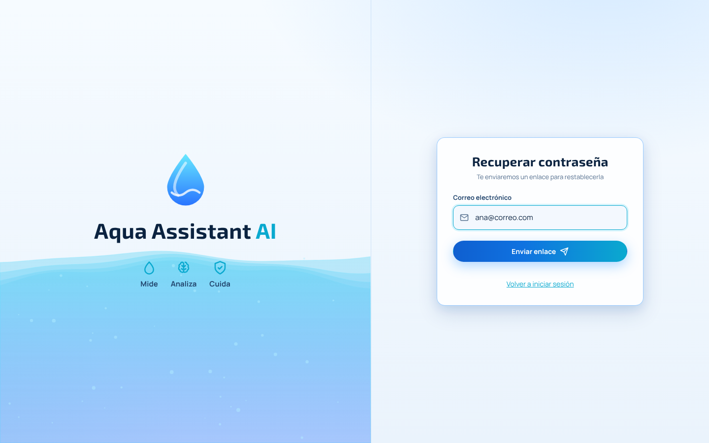

### RF-03

**Acceso de demostración por rol** · Funcional · Estado: Hecho

**Como** profesor o evaluador, **quiero** entrar con un botón como Usuario Premium o como Administrador, **para** revisar la aplicación sin crear una cuenta.

**Descripción.** El inicio de sesión muestra dos botones con su correo y la contraseña visible. Son cuentas reales con límites: no se pueden eliminar, recuperar la contraseña ni pagar; el administrador de demostración solo consulta y ve enmascarados los datos de las cuentas reales.

**Criterios de aceptación**

- [x] Cada botón inicia sesión con su cuenta en un clic.
- [x] La cuenta de demostración no puede borrarse, cambiar su nombre ni su foto, ni pagar.
- [x] El administrador de demostración ve correos y nombres enmascarados y no puede modificar cuentas.

**MockUp4** · Botones de acceso de demostración

### RF-04

**Inicio (panel principal)** · Funcional · Estado: Hecho

**Como** usuario, **quiero** ver en una pantalla el último pH, su estado, mi perfil activo y las alertas, **para** saber de un vistazo si mi agua está bien.

**Descripción.** Pantalla sin saturar: indicador de pH con color por estado, qué significa el valor (ácida, neutra o alcalina) en la escala 0–14, perfil activo y su rango, referencia oficial del USGS, la sugerencia de Aqua con el último diagnóstico y las alertas sin leer (solo si hay). El botón «Medir» de la barra inferior y «Medir ahora» abren las tres formas de medir.

**Criterios de aceptación**

- [x] El indicador muestra la última medición y su estado según el perfil activo.
- [x] Si no hay mediciones, se muestra cómo registrar la primera.
- [x] «Medir» ofrece medir con el medidor, por foto o escribiendo el valor.
- [x] Al guardar una medición, el Inicio se actualiza sin recargar la página.

**MockUp5** · Inicio (panel principal) con la barra inferior y Aqua

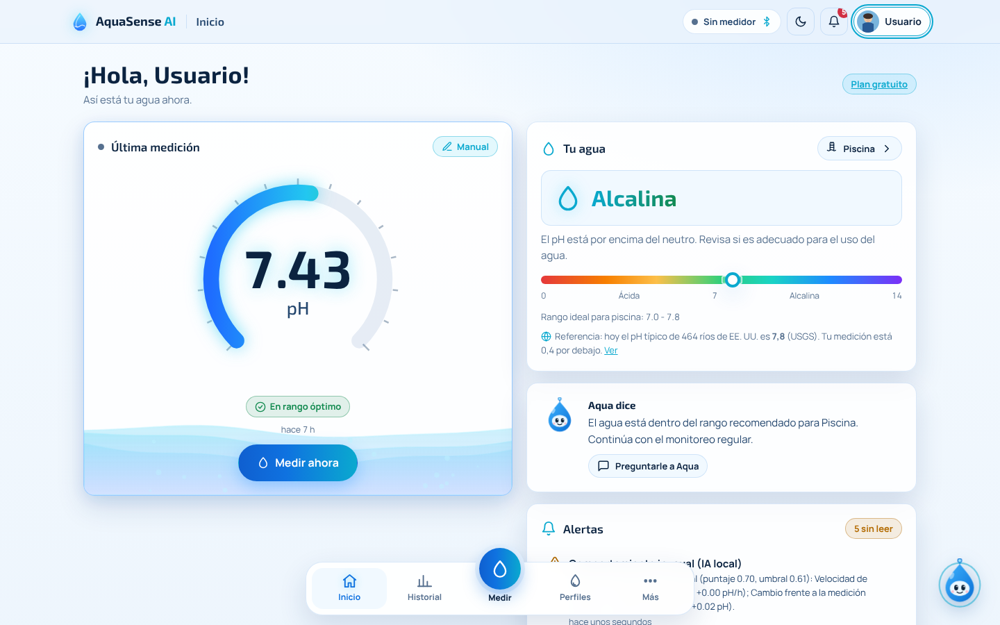

**MockUp36** · Medir: las tres formas de registrar el pH

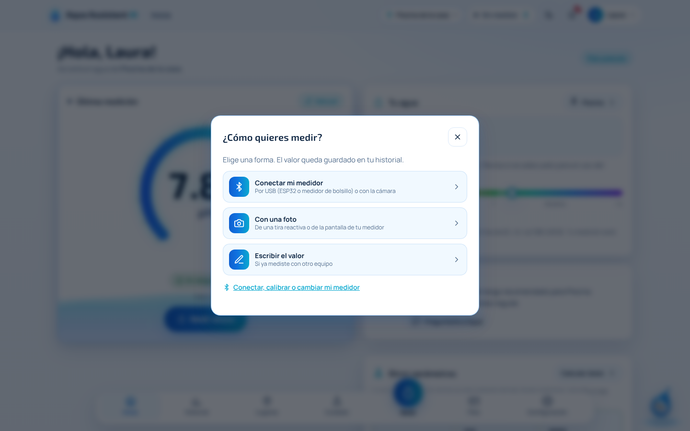

### RF-05

**Registrar una medición y ver su resultado** · Funcional · Estado: Hecho

**Como** usuario, **quiero** registrar un valor de pH (y opcionalmente la temperatura), **para** saber si está en rango y guardarlo en mi historial.

**Descripción.** El registro manual pide pH, fecha y hora y temperatura opcional, y se guarda con origen «manual». Al medir con el medidor, el resultado muestra la clasificación según el perfil, una explicación y la validación del valor, y el usuario decide guardarlo o descartarlo.

**Criterios de aceptación**

- [x] Valores fuera de 0–14 o fechas futuras se rechazan con un mensaje claro.
- [x] El resultado indica el estado (óptimo, precaución o crítico) y por qué.
- [x] Lo guardado aparece en el historial con su origen (manual, medidor o foto).

**MockUp6** · Registro manual de una medición

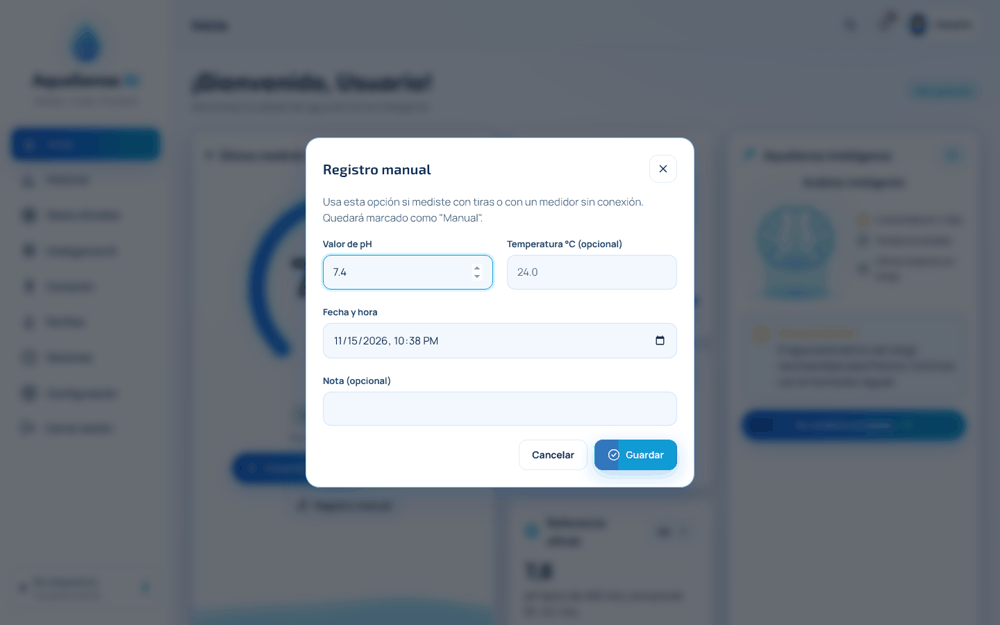

### RF-06

**Historial, gráficas y exportación** · Funcional · Estado: Hecho

**Como** usuario, **quiero** filtrar mis mediciones por periodo, origen y estado, verlas en gráfica y exportarlas, **para** analizar cómo cambia mi agua con el tiempo.

**Descripción.** Tabla paginada con filtros (últimos 7 o 30 días o un rango personalizado, origen y estado), gráficas de línea a petición, detalle de cada medición y exportación a CSV de lo que muestra la tabla. Recuerda el periodo y los filtros al volver.

**Criterios de aceptación**

- [x] Los filtros cambian la tabla, la gráfica y el CSV de la misma forma.
- [x] Con pocos datos, la gráfica avisa que no son suficientes.
- [x] El CSV descargado contiene exactamente las filas filtradas.

**MockUp7** · Historial con gráfica (30 días)

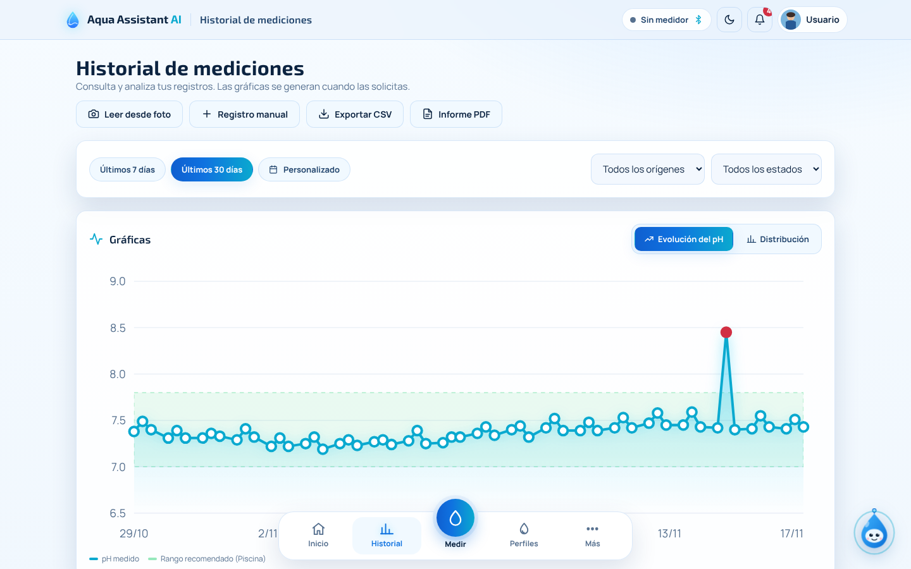

### RF-07

**Conectar y calibrar un medidor de pH** · Funcional · Estado: Parcial

**Como** usuario con un medidor, **quiero** conectarlo al computador por USB o Bluetooth y calibrarlo desde la app, **para** que las mediciones lleguen solas y sean exactas.

**Descripción.** Desde Chrome o Edge (Web Serial) la app abre el puerto del medidor y admite tres protocolos: firmware Aqua Assistant (ESP32), Atlas Scientific EZO-pH y medidores de laboratorio que envían texto. La calibración usa el valor de cada solución buffer (por ejemplo 6.86 y 4.00). Para medidores sin cable, la lectura por cámara.

**Criterios de aceptación**

- [x] La app detecta si el navegador no admite puertos serie y lo explica.
- [x] Con el medidor conectado, «Medir ahora» guarda la lectura con origen REAL.
- [x] La calibración envía el punto y el valor del buffer y muestra la respuesta del medidor.
- [ ] Pendiente: probarlo con un medidor físico (hasta ahora con puerto simulado).

**MockUp8** · Conexión del medidor

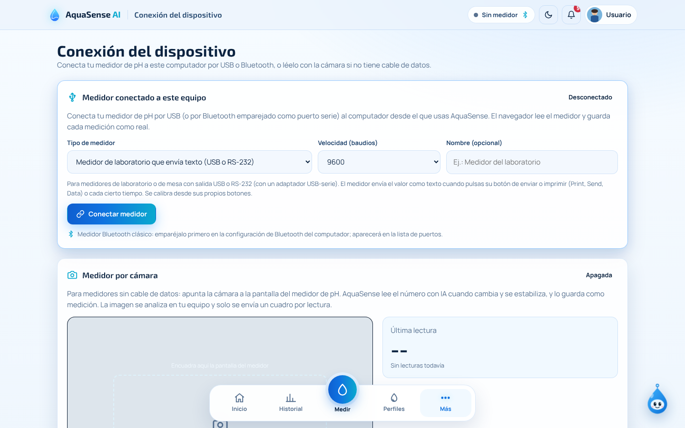

### RF-08

**Perfiles de agua con rangos** · Funcional · Estado: Hecho

**Como** usuario, **quiero** elegir el tipo de agua (piscina, acuario, potable, hidroponía…) o crear un perfil propio, **para** que el estado de cada medición use los rangos correctos.

**Descripción.** Perfiles predefinidos con su fuente y rangos ideal y crítico; perfiles personalizados (crear, duplicar, editar) con validación de los rangos. Aviso de que el pH por sí solo no demuestra potabilidad.

**Criterios de aceptación**

- [x] Solo hay un perfil activo y el Inicio lo muestra.
- [x] El formulario rechaza rangos incoherentes (mínimo mayor que máximo, fuera de 0–14).
- [x] Los perfiles predefinidos muestran la fuente de sus rangos.

**MockUp9** · Perfiles de agua

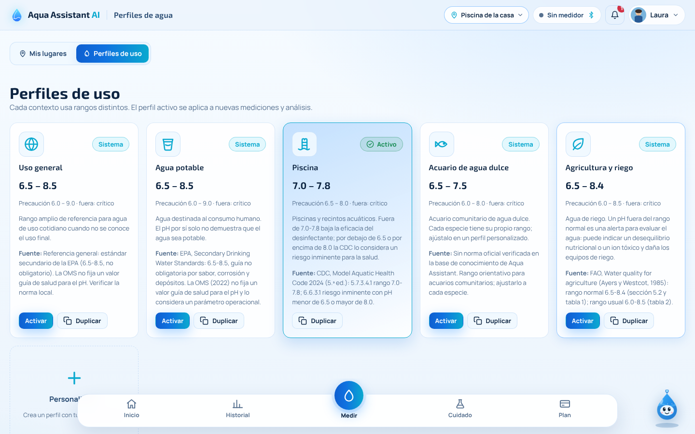

### RF-09

**Alertas y detección de anomalías** · Funcional · Estado: Hecho

**Como** usuario, **quiero** recibir alertas cuando una medición se sale de rango o es inusual, **para** actuar antes de que el problema crezca.

**Descripción.** Tres reglas (fuera de rango, cambio brusco, valor atípico estadístico) y un modelo de aprendizaje automático (Isolation Forest por usuario) explicado por variable.

**Criterios de aceptación**

- [x] Una medición fuera del rango crítico genera una alerta visible en el Inicio.
- [x] Cada anomalía indica qué regla o variable la produjo.
- [x] El modelo se reentrena cuando llegan mediciones nuevas.

**MockUp10** · Detección de anomalías

**MockUp11** · Aprendizaje automático (Isolation Forest)

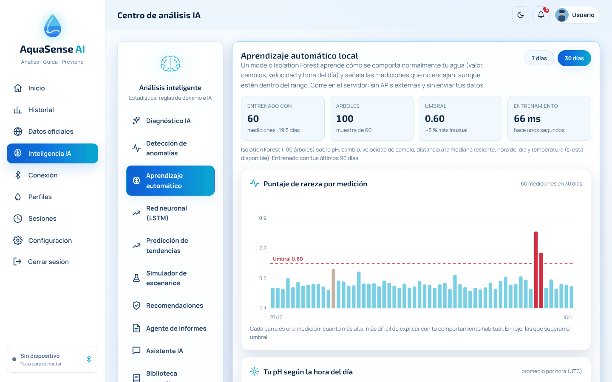

### RF-10

**Tendencias y predicción del pH** · Funcional · Estado: Parcial

**Como** usuario, **quiero** ver hacia dónde va el pH en las próximas horas o días, **para** anticipar correcciones.

**Descripción.** Regresión con intervalo de confianza del 95 % y red neuronal LSTM a 12 horas, que se compara con métodos simples y solo se usa si los supera. Con pocos datos, la app lo dice en lugar de inventar una predicción.

**Criterios de aceptación**

- [x] La predicción muestra el intervalo de incertidumbre.
- [x] Sin datos suficientes (unos 8 días de mediciones frecuentes para la LSTM) se muestra el aviso.
- [x] El horizonte depende del plan (Gratuito o Premium).

**MockUp12** · Predicción de tendencias

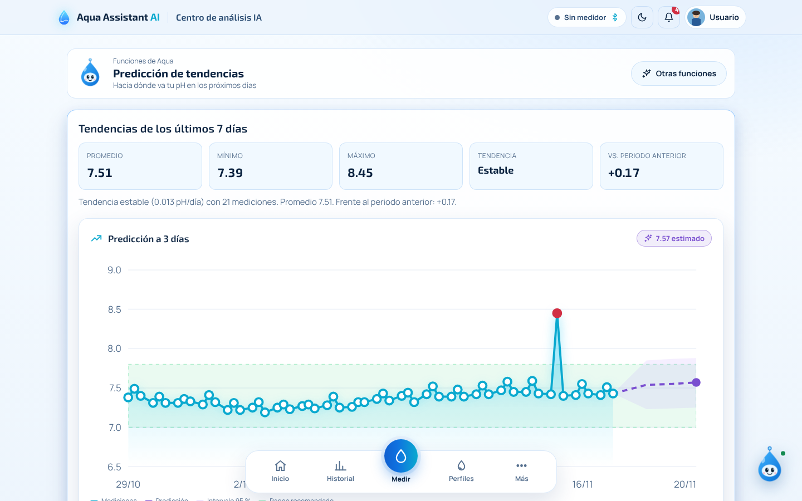

**MockUp13** · Red neuronal LSTM (sin datos suficientes)

### RF-11

**Diagnóstico y recomendaciones con IA y fuentes** · Funcional · Estado: Hecho

**Como** usuario, **quiero** un diagnóstico de mi agua con recomendaciones respaldadas por normas, **para** saber qué hacer y en qué se basa.

**Descripción.** Diagnóstico estructurado (JSON validado) con causas, acciones y citas literales de la EPA, la OMS, la CDC y la FAO tomadas de una biblioteca normativa. El servidor descarta citas que no entregó. Si la IA falla, se usa un diagnóstico por reglas y se indica.

**Criterios de aceptación**

- [x] Cada recomendación muestra su cita y la fuente.
- [x] No aparecen citas que no estén en la biblioteca normativa.
- [x] Si la IA no responde, el diagnóstico por reglas se marca como tal.

**MockUp14** · Diagnóstico IA con fuentes

**MockUp15** · Biblioteca normativa

### RF-12

**Simulador de escenarios** · Funcional · Estado: Hecho

**Como** usuario, **quiero** probar qué pasaría con el pH si cambio una condición, **para** decidir una corrección antes de aplicarla.

**Descripción.** Escenarios hipotéticos sobre el historial del usuario, con su explicación. Los resultados se muestran como simulación, nunca como mediciones.

**Criterios de aceptación**

- [x] El resultado se identifica como escenario simulado.
- [x] Los escenarios no se guardan como mediciones.

**MockUp16** · Simulador de escenarios

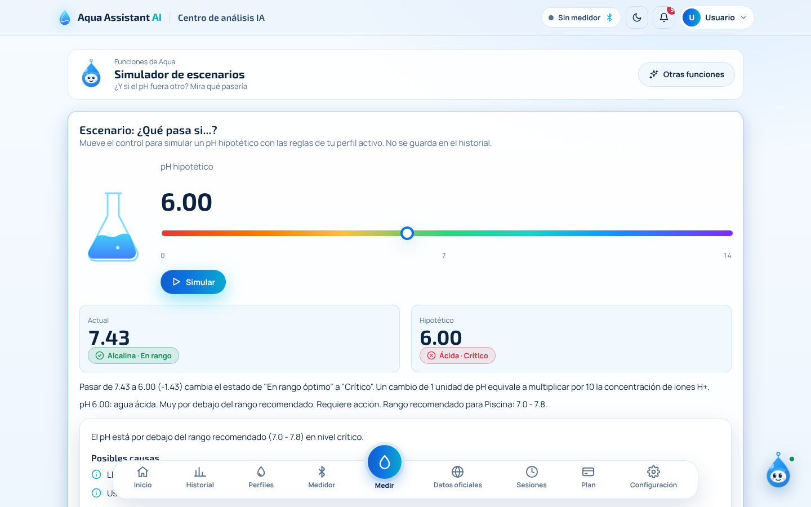

### RF-13

**Informes inteligentes y PDF** · Funcional · Estado: Hecho

**Como** usuario, **quiero** pedir un informe del estado de mi agua en un periodo y descargarlo en PDF, **para** compartirlo o guardarlo.

**Descripción.** Un agente de IA consulta el sistema con herramientas (sin acceso directo a la base de datos) y redacta el informe con cifras verificadas; el PDF incluye gráficas y fuentes.

**Criterios de aceptación**

- [x] El informe se elabora en segundo plano y muestra su avance.
- [x] Las cifras del informe coinciden con las del historial.
- [x] El PDF se descarga con gráficas y fuentes.

**MockUp17** · Agente de informes

### RF-14

**Asistente IA con respuesta en vivo** · Funcional · Estado: Hecho

**Como** usuario, **quiero** hacer preguntas sobre el pH y el cuidado del agua y ver la respuesta mientras se escribe, **para** resolver dudas sin esperar.

**Descripción.** Se abre desde Aqua, el robot, en cualquier pantalla (chat dentro de su panel) o en pantalla completa con la lista de conversaciones. Chat con memoria por conversación, citas, botones Detener, Copiar y Descargar, y respuesta en vivo (Server-Sent Events). Si un modelo no empieza o se congela, otro reescribe la respuesta. Rechaza temas ajenos al agua.

**Criterios de aceptación**

- [x] El texto empieza a aparecer mientras el modelo escribe.
- [x] «Detener» corta la respuesta; «Copiar» y «Descargar» funcionan.
- [x] Una pregunta ajena al tema se rechaza con un mensaje amable.
- [x] Se respeta la cuota diaria de consultas del plan.

**MockUp18** · Asistente IA (respuesta completa)

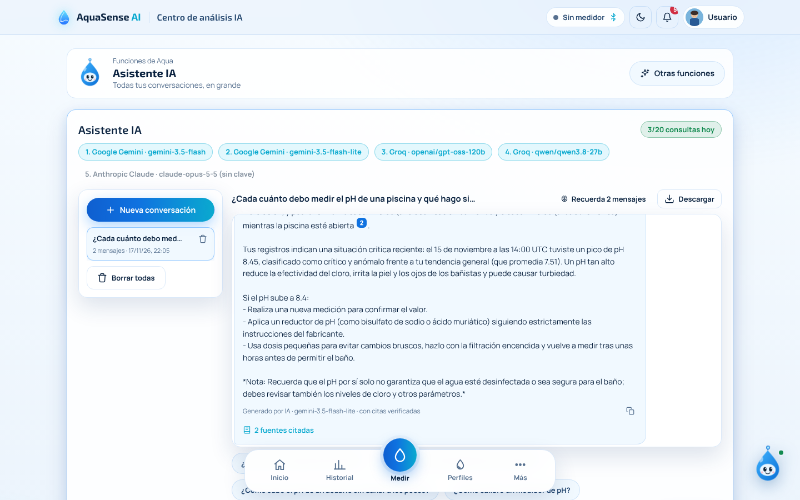

**MockUp35** · Chat con Aqua dentro de su panel (celular)

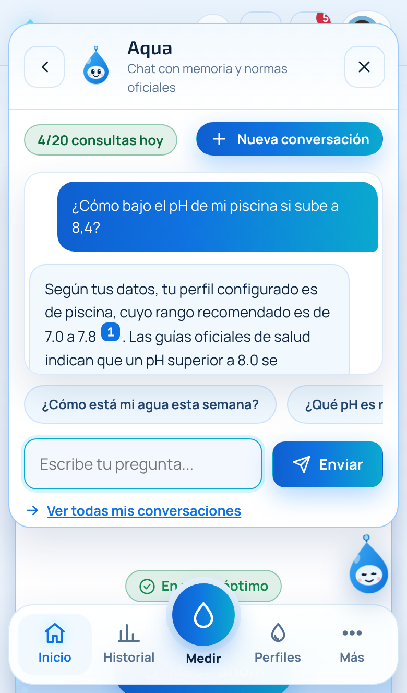

### RF-15

**Lectura de pH por foto** · Funcional · Estado: Parcial

**Como** usuario sin medidor electrónico, **quiero** tomar una foto de una tira reactiva o de la pantalla de mi medidor, **para** registrar el pH sin escribirlo.

**Descripción.** La IA con visión lee la foto, da un valor o un rango con su confianza y una segunda opinión de otro modelo; el usuario confirma antes de guardar.

**Criterios de aceptación**

- [x] Fotos borrosas o sin carta de colores se rechazan con la causa.
- [x] El resultado muestra el valor, la confianza y el acuerdo entre modelos.
- [x] Nada se guarda sin confirmación del usuario.
- [ ] Pendiente: medir la precisión con fotos reales de tiras.

**MockUp19** · Lectura de pH por foto

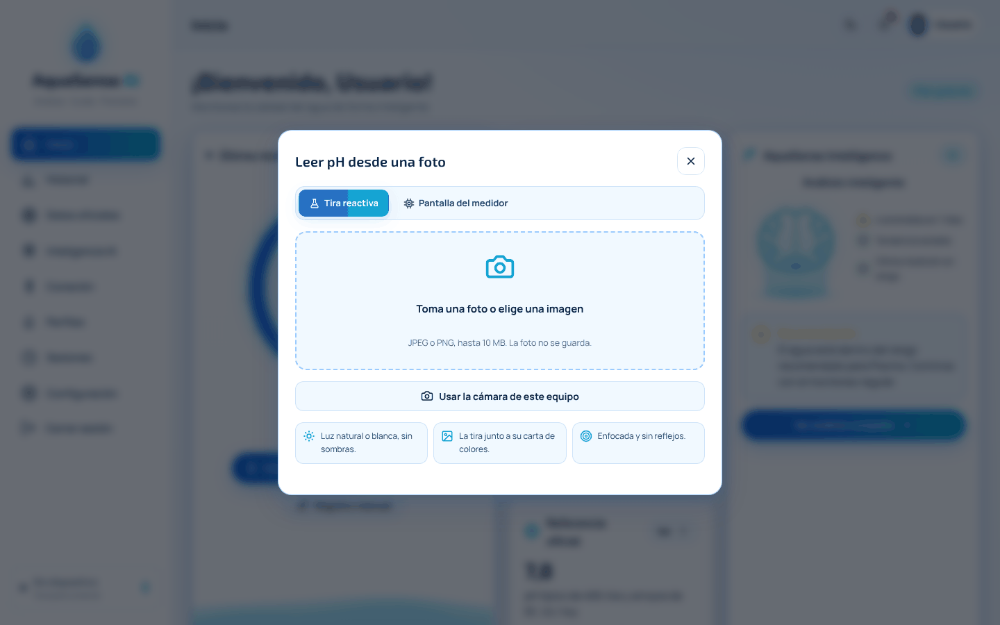

### RF-16

**Planes Gratuito y Premium con pagos** · Funcional · Estado: Parcial

**Como** usuario, **quiero** pasar a Premium pagando en línea, **para** tener más días de análisis y más consultas de IA.

**Descripción.** Gratuito: 30 días de análisis y 20 consultas de IA al día. Premium: 365 días y 200 consultas. Pago por periodo con PayU (COP 49.900 por 30 días) en modo de pruebas; el servidor verifica la orden en PayU antes de activar Premium.

**Criterios de aceptación**

- [x] Los límites se aplican en el servidor, no solo en la pantalla.
- [x] Premium se activa una sola vez por pago aprobado, aunque se verifique varias veces.
- [x] Un pago rechazado no cambia el plan.
- [ ] Pendiente: cobrar dinero real exige registrar un comercio en PayU.

**MockUp20** · Plan y pagos (PayU en modo de pruebas)

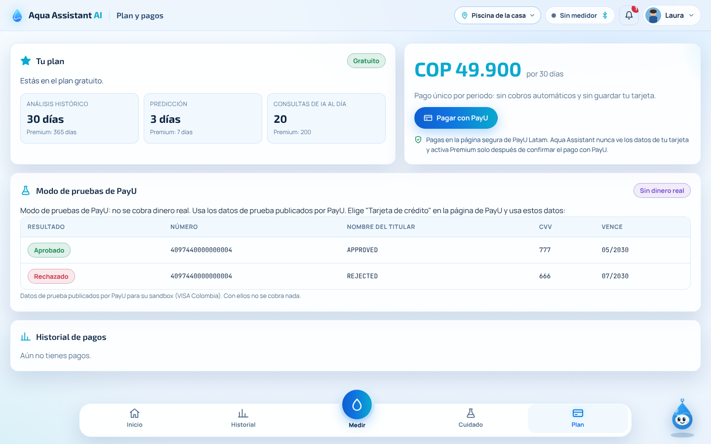

### RF-17

**Configuración de la cuenta** · Funcional · Estado: Hecho

**Como** usuario, **quiero** elegir el tema (claro, oscuro o automático) y las notificaciones, **para** usar la app a mi gusto.

**Descripción.** Preferencias guardadas en el servidor. El tema claro es el predeterminado. La app está en español.

**Criterios de aceptación**

- [x] El tema claro es el predeterminado para cuentas nuevas y para quien no ha iniciado sesión.
- [x] El cambio de tema se aplica al instante y se conserva al volver a entrar.

**MockUp21** · Configuración (tema claro activo)

### RF-18

**Foto de perfil, nombre y contraseña** · Funcional · Estado: Hecho

**Como** usuario, **quiero** poner mi foto, cambiar mi nombre y mi contraseña, **para** personalizar y proteger mi cuenta.

**Descripción.** Foto privada reducida a 256 px y sin metadatos (como la ubicación). Al cambiar la contraseña se cierran las demás sesiones y la actual sigue abierta.

**Criterios de aceptación**

- [x] La foto aparece en la barra superior y solo la ve su dueño.
- [x] Con la contraseña actual incorrecta, el cambio se rechaza junto al campo.
- [x] Tras cambiar la contraseña, las otras sesiones quedan cerradas.

**MockUp22** · Foto de perfil

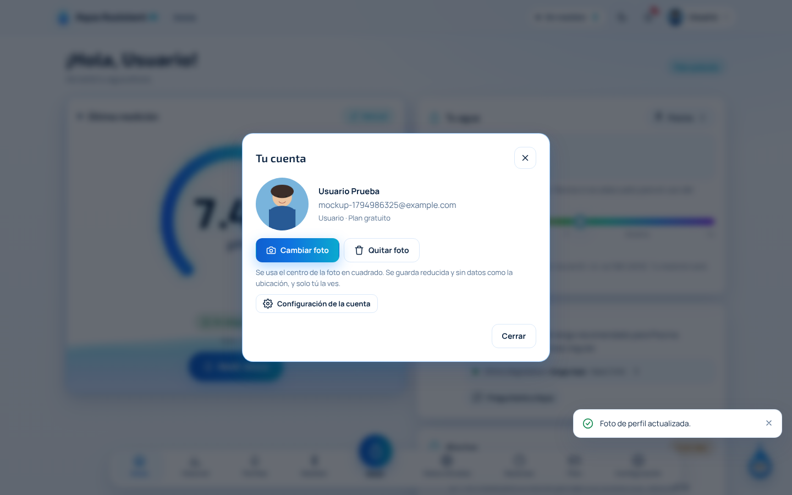

### RF-19

**Historial de sesiones y de operaciones** · Funcional · Estado: Hecho

**Como** usuario, **quiero** ver mis sesiones (inicio, fin, duración, navegador) y lo que hice en cada una, **para** detectar accesos que no reconozco.

**Descripción.** Lista de sesiones con su estado y acciones; «Cerrar mis otras sesiones» las termina. Cada operación queda ligada a la sesión en que se hizo. El administrador puede ver las de cualquier cuenta.

**Criterios de aceptación**

- [x] La sesión actual se identifica y no puede cerrarse desde la lista.
- [x] «Cerrar mis otras sesiones» invalida los demás tokens al instante.
- [x] El detalle de una sesión muestra sus acciones en orden.

**MockUp23** · Historial de sesiones

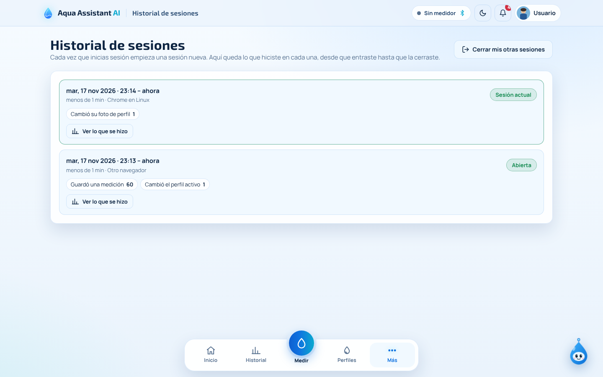

### RF-20

**Datos oficiales de referencia (USGS)** · Funcional · Estado: Hecho

**Como** usuario, **quiero** comparar mi pH con mediciones oficiales de estaciones de agua, **para** tener una referencia real.

**Descripción.** Importación periódica (cada 3 horas) de datos de pH del Servicio Geológico de EE. UU. (USGS), guardados aparte de las mediciones del usuario, con estaciones y series.

**Criterios de aceptación**

- [x] Los datos oficiales nunca se mezclan con las mediciones del usuario.
- [x] Se muestra la fecha de la última importación terminada.
- [x] Si el USGS no responde, se conservan los datos anteriores y se reintenta.

**MockUp24** · Datos oficiales del USGS

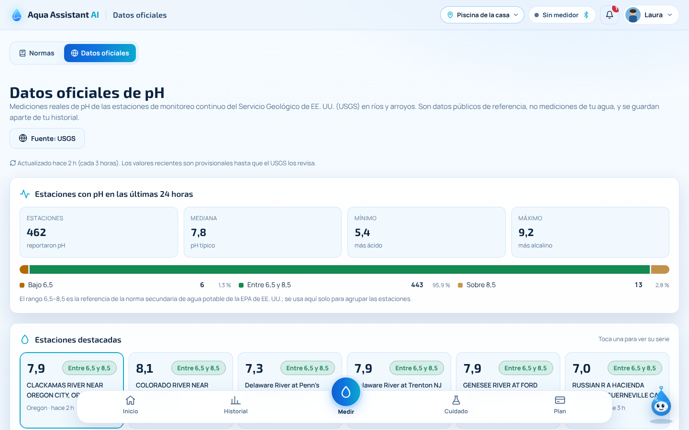

### RF-21

**Administración de usuarios y consumo de IA** · Funcional · Estado: Hecho

**Como** administrador, **quiero** gestionar cuentas (plan, rol, estado) y ver el consumo y costo de la IA, **para** controlar el sistema y sus gastos.

**Descripción.** Búsqueda y filtros de usuarios, detalle con pagos, actividad y sesiones, cambios de plan, rol y estado con aviso por correo, y reporte de consumo de IA por modelo, función y día con costo estimado.

**Criterios de aceptación**

- [x] Solo el rol administrador entra a Administración.
- [x] No se puede dejar el sistema sin administradores activos.
- [x] El consumo muestra llamadas, tokens y costo estimado por modelo.
- [x] Los precios estimados vienen de fuentes de terceros y deben confirmarse en las páginas oficiales.

**MockUp25** · Administración (cuentas reales difuminadas)

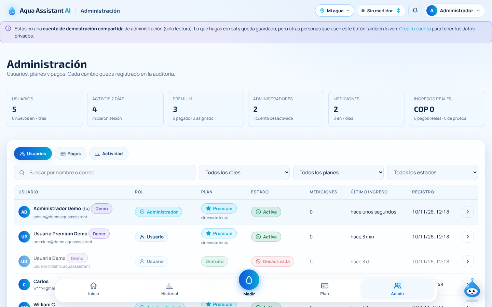

**MockUp26** · Consumo y costos de IA

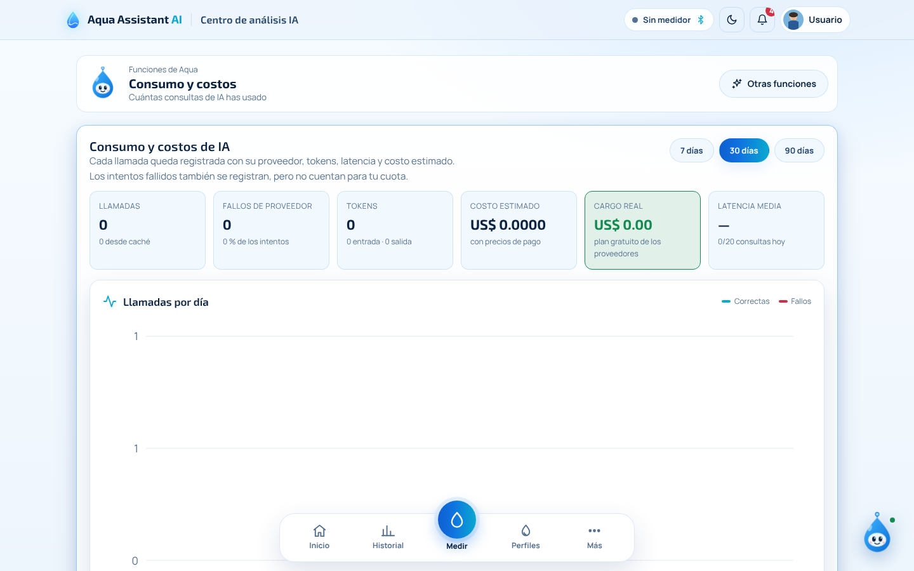

### RF-22

**Aqua: robot de la IA y recorrido guiado** · Funcional · Estado: Hecho

**Como** usuario nuevo, **quiero** que un asistente me explique para qué sirve cada parte y me deje usar la IA desde cualquier pantalla, **para** aprender a usar la app sin manual y encontrar las funciones de IA en un solo lugar.

**Descripción.** Aqua, un robot con forma de gota, flota en todas las pantallas y es la única entrada a la inteligencia artificial: su panel permite preguntar, chatear y abrir el diagnóstico, las anomalías, las recomendaciones, la predicción, la red neuronal, los escenarios, el aprendizaje automático, los informes, la biblioteca normativa, el consumo y la lectura por foto. La primera vez que una persona entra, Aqua hace un recorrido guiado señalando cada botón con un globo de texto, y al abrir cada pantalla dice en una frase para qué sirve.

**Criterios de aceptación**

- [x] Aqua aparece en todas las pantallas de la sesión y la IA no aparece en el menú.
- [x] Desde el panel de Aqua se abre cada función de IA y el chat.
- [x] El recorrido sale solo la primera vez, se puede saltar y se repite desde Aqua o desde «Más».
- [x] El recorrido y el panel se usan con teclado (flechas, Tab y Esc) y con lector de pantalla.
- [x] Los consejos de Aqua al cambiar de pantalla se pueden desactivar.

**MockUp33** · Recorrido guiado: Aqua señala el botón Medir

**MockUp34** · Panel de Aqua con el chat y las funciones de IA

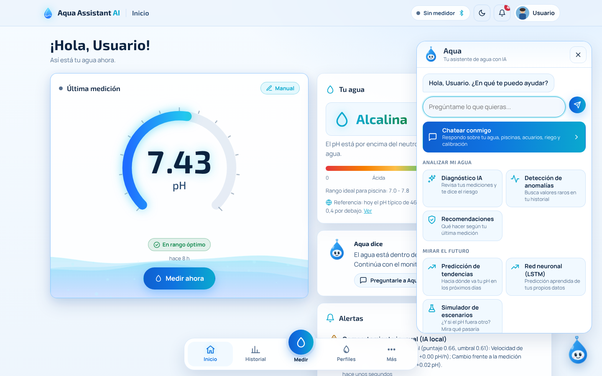

### RNF-01

**Seguridad** · No funcional · Estado: Hecho

**Como** usuario, **quiero** que mi contraseña y mi sesión estén protegidas, **para** que nadie más vea ni cambie mis datos.

**Descripción.** Contraseñas con Argon2id; tokens JWT ligados a una sesión que se puede revocar; límite de 10 intentos por minuto por dirección y bloqueo de una cuenta por 15 minutos tras 5 inicios fallidos; CORS solo para el dominio de la app; cabeceras de seguridad (política de contenido, sin incrustación en otros sitios); documentación de la API desactivada en producción; cada usuario solo accede a sus datos.

**Criterios de aceptación**

- [x] Tras 5 contraseñas incorrectas la cuenta responde «Demasiados intentos» durante 15 minutos.
- [x] Un token de una sesión cerrada responde 401.
- [x] Un usuario no puede leer ni modificar datos de otro (403/404).
- [x] /v3/api-docs y /swagger-ui.html no están publicados en producción.

**MockUp27** · Bloqueo tras 5 intentos fallidos

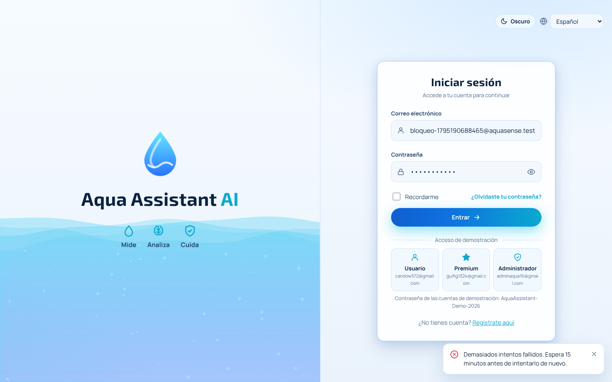

### RNF-02

**Rendimiento** · No funcional · Estado: Hecho

**Como** usuario, **quiero** que la app y el asistente respondan rápido, **para** no quedarme esperando.

**Descripción.** Respuestas de IA en vivo; cambio automático de modelo si uno no empieza en 8–12 s o se congela 6 s; caché de respuestas de IA; memoria que se limpia sola (modelos y cachés con vencimiento). En pruebas del asistente publicado, 12 preguntas respondieron completas en 10,8 s o menos.

**Criterios de aceptación**

- [x] El asistente muestra texto antes de terminar la respuesta completa.
- [x] Una pregunta repetida se responde desde la caché sin gastar cuota.
- [x] Los modelos y cachés en memoria se liberan cuando no se usan.

**MockUp28** · Asistente escribiendo la respuesta en vivo

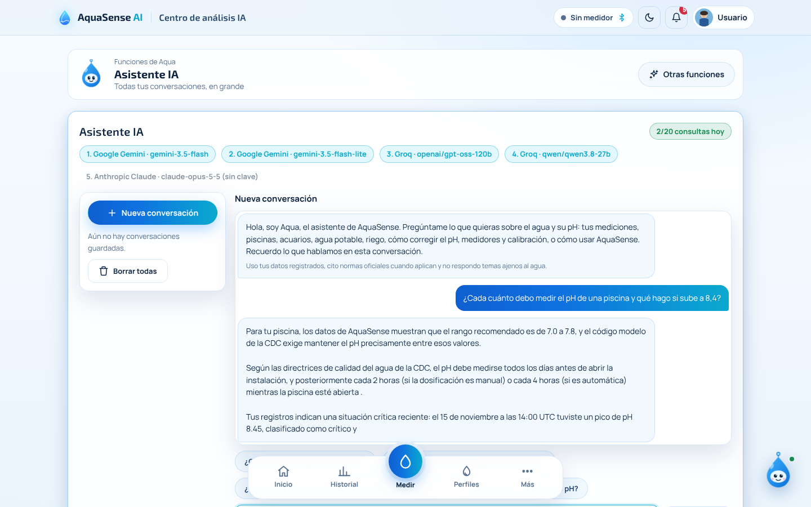

### RNF-03

**Disponibilidad** · No funcional · Estado: Parcial

**Como** usuario, **quiero** que la app esté disponible cuando la abra, **para** no esperar a que el servidor arranque.

**Descripción.** Frontend en Vercel, API en Render y base PostgreSQL en Neon. Un monitor de UptimeRobot consulta /actuator/health/liveness cada 5 minutos para que el servidor gratuito no se apague; esa dirección no consulta la base de datos. Si el servidor estaba apagado, la app muestra «Activando el servidor…» mientras arranca.

**Criterios de aceptación**

- [x] /actuator/health/liveness responde 200 sin iniciar sesión.
- [x] Tras 20 minutos sin uso, la API responde en menos de 2 segundos.
- [x] Si el servidor tarda, la app avisa en lugar de mostrar un error.
- [ ] Pendiente: confirmar que el monitor de UptimeRobot está activo (la prueba del 15 de noviembre encontró el servidor apagado).

**MockUp29** · Aviso mientras el servidor arranca

### RNF-04

**Usabilidad, accesibilidad y diseño adaptable** · No funcional · Estado: Hecho

**Como** usuario de computador o celular, **quiero** una interfaz clara que funcione en cualquier pantalla, **para** usarla cómodamente donde esté.

**Descripción.** Navegación con barra inferior de cinco botones (Inicio, Historial, Medir, Perfiles y Más), igual en celular y computador, para que cada función esté a un toque sin saturar la pantalla. Tema claro predeterminado y oscuro opcional, navegación por teclado y lector de pantalla. Revisión con axe-core: 0 hallazgos en 18 pantallas, el recorrido, el panel de Aqua y las hojas «Medir» y «Más», en tema claro y oscuro, en computador y teléfono.

**Criterios de aceptación**

- [x] Todas las pantallas se usan en un celular sin desplazamiento horizontal.
- [x] Cada control tiene nombre accesible y foco visible.
- [x] El contraste cumple en ambos temas.

**MockUp30** · Inicio en un celular

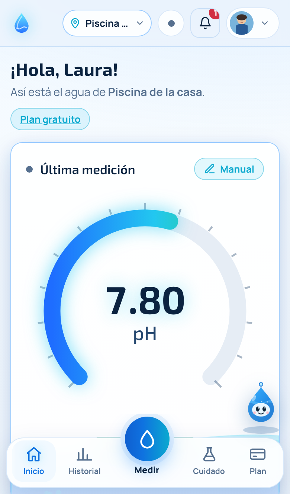

**MockUp37** · Más: el resto de las funciones

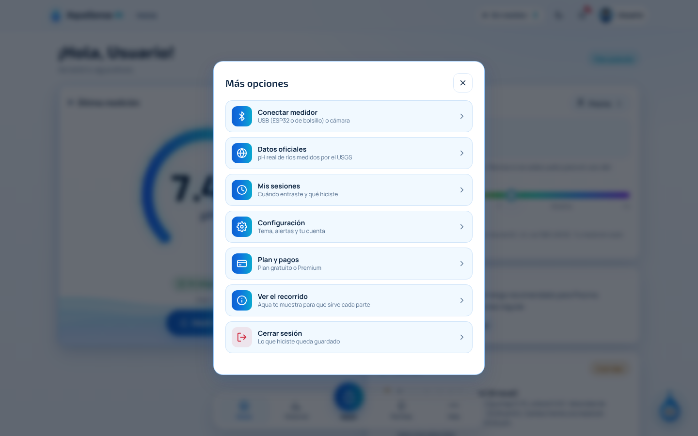

### RNF-05

**Privacidad de los datos** · No funcional · Estado: Hecho

**Como** usuario, **quiero** que mis datos personales no salgan del sistema, **para** confiar en la app.

**Descripción.** A los modelos de IA solo se envían valores de pH, fechas y datos del perfil de agua, nunca nombres ni correos. La foto de perfil es privada y sin metadatos. El administrador de demostración ve enmascarados los datos de las cuentas reales. Los datos simulados nunca se presentan como mediciones reales.

**Criterios de aceptación**

- [x] Las solicitudes a la IA no incluyen nombre ni correo del usuario.
- [x] Las cuentas reales aparecen enmascaradas para el administrador de demostración.
- [x] Cada medición indica su origen (manual, medidor, foto).

**MockUp31** · Datos enmascarados para el administrador de demostración

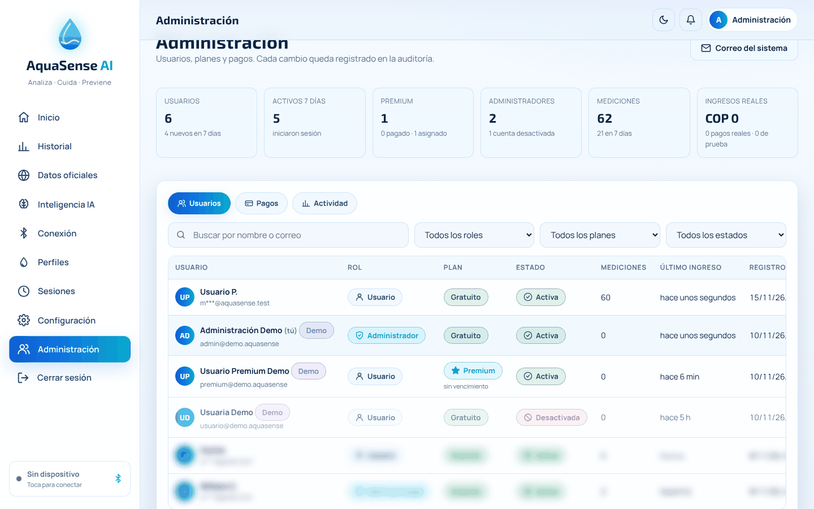

### RNF-06

**Mantenibilidad y calidad del código** · No funcional · Estado: Hecho

**Como** desarrollador del proyecto, **quiero** un código organizado, documentado y con pruebas automáticas, **para** cambiarlo sin romper lo que funciona.

**Descripción.** Backend Spring Boot en capas (controlador, servicio, repositorio) organizado por módulo, con catálogo de patrones de diseño (docs/DesignPatterns.md) y migraciones Flyway. Pruebas automáticas: backend con JUnit (H2), frontend con node:test, y el firmware del medidor con pruebas en el computador; GitHub Actions las ejecuta.

**Criterios de aceptación**

- [x] Las pruebas automáticas pasan antes de publicar.
- [x] Cada patrón de diseño documentado indica su función y su prueba.
- [x] El README explica cómo instalar, configurar y desplegar.

_Requerimiento sin pantalla propia: se comprueba con las pruebas automáticas y la documentación del repositorio._

### RNF-07

**Compatibilidad e instalación** · No funcional · Estado: Hecho

**Como** usuario, **quiero** usar la app en mi navegador o instalarla como aplicación, **para** tenerla a mano.

**Descripción.** Aplicación web progresiva (instalable en computador y celular). El medidor por cable o Bluetooth requiere Chrome o Edge (Web Serial); el resto funciona en navegadores actuales. Interfaz en español.

**Criterios de aceptación**

- [x] El navegador ofrece instalar la app (manifiesto con íconos).
- [x] En navegadores sin Web Serial, la app explica qué navegador usar para el medidor.

**MockUp32** · Inicio de sesión en un celular

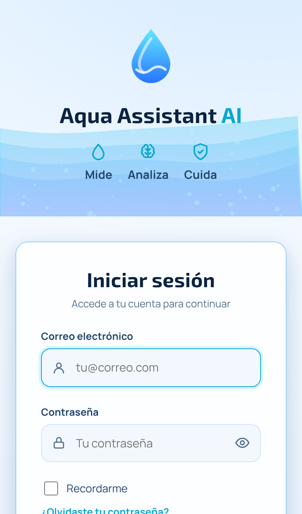

## Índice de MockUps

| MockUp | Pantalla | Requerimiento |
|---|---|---|
| [MockUp1](mockups/MockUp1.png) | Inicio de sesión | RF-01 |
| [MockUp2](mockups/MockUp2.png) | Crear cuenta | RF-01 |
| [MockUp3](mockups/MockUp3.png) | Recuperar contraseña | RF-02 |
| [MockUp4](mockups/MockUp4.png) | Botones de acceso de demostración | RF-03 |
| [MockUp5](mockups/MockUp5.png) | Inicio (panel principal) con la barra inferior y Aqua | RF-04 |
| [MockUp6](mockups/MockUp6.png) | Registro manual de una medición | RF-05 |
| [MockUp7](mockups/MockUp7.png) | Historial con gráfica (30 días) | RF-06 |
| [MockUp8](mockups/MockUp8.png) | Conexión del medidor | RF-07 |
| [MockUp9](mockups/MockUp9.png) | Perfiles de agua | RF-08 |
| [MockUp10](mockups/MockUp10.png) | Detección de anomalías | RF-09 |
| [MockUp11](mockups/MockUp11.png) | Aprendizaje automático (Isolation Forest) | RF-09 |
| [MockUp12](mockups/MockUp12.png) | Predicción de tendencias | RF-10 |
| [MockUp13](mockups/MockUp13.png) | Red neuronal LSTM (sin datos suficientes) | RF-10 |
| [MockUp14](mockups/MockUp14.png) | Diagnóstico IA con fuentes | RF-11 |
| [MockUp15](mockups/MockUp15.png) | Biblioteca normativa | RF-11 |
| [MockUp16](mockups/MockUp16.png) | Simulador de escenarios | RF-12 |
| [MockUp17](mockups/MockUp17.png) | Agente de informes | RF-13 |
| [MockUp18](mockups/MockUp18.png) | Asistente IA (respuesta completa) | RF-14 |
| [MockUp19](mockups/MockUp19.png) | Lectura de pH por foto | RF-15 |
| [MockUp20](mockups/MockUp20.png) | Plan y pagos (PayU en modo de pruebas) | RF-16 |
| [MockUp21](mockups/MockUp21.png) | Configuración (tema claro activo) | RF-17 |
| [MockUp22](mockups/MockUp22.png) | Foto de perfil | RF-18 |
| [MockUp23](mockups/MockUp23.png) | Historial de sesiones | RF-19 |
| [MockUp24](mockups/MockUp24.png) | Datos oficiales del USGS | RF-20 |
| [MockUp25](mockups/MockUp25.png) | Administración (cuentas reales difuminadas) | RF-21 |
| [MockUp26](mockups/MockUp26.png) | Consumo y costos de IA | RF-21 |
| [MockUp27](mockups/MockUp27.png) | Bloqueo tras 5 intentos fallidos | RNF-01 |
| [MockUp28](mockups/MockUp28.png) | Asistente escribiendo la respuesta en vivo | RNF-02 |
| [MockUp29](mockups/MockUp29.png) | Aviso mientras el servidor arranca | RNF-03 |
| [MockUp30](mockups/MockUp30.png) | Inicio en un celular | RNF-04 |
| [MockUp31](mockups/MockUp31.png) | Datos enmascarados para el administrador de demostración | RNF-05 |
| [MockUp32](mockups/MockUp32.png) | Inicio de sesión en un celular | RNF-07 |
| [MockUp33](mockups/MockUp33.png) | Recorrido guiado: Aqua señala el botón Medir | RF-22 |
| [MockUp34](mockups/MockUp34.png) | Panel de Aqua con el chat y las funciones de IA | RF-22 |
| [MockUp35](mockups/MockUp35.png) | Chat con Aqua dentro de su panel (celular) | RF-14 |
| [MockUp36](mockups/MockUp36.png) | Medir: las tres formas de registrar el pH | RF-04 |
| [MockUp37](mockups/MockUp37.png) | Más: el resto de las funciones | RNF-04 |
