# Requerimientos de Aqua Assistant AI

Requerimientos funcionales (RF) y no funcionales (RNF) de la aplicación, escritos como historias de usuario con su descripción,
criterios de aceptación y MockUp. Cada uno está también como Issue del repositorio (ver [`issues/`](issues/)).

Los MockUps son capturas de la aplicación publicada (https://aquaassistantai.vercel.app) en tema claro, tomadas el 18 de noviembre de 2026 con la navegación por barra inferior y el robot Aqua.
Las mediciones que aparecen son registros manuales de prueba de una cuenta temporal, borrada después; en las capturas de
administración se difuminaron las cuentas reales.

Estado: **Hecho** = implementado y probado en la aplicación publicada; **Parcial** = implementado con una limitación que se indica.

## Requerimientos funcionales

| ID | Requerimiento | Historia de usuario | Estado | MockUp |
|---|---|---|---|---|
| [RF-01](#rf-01) | Registro, inicio y cierre de sesión | Como visitante, quiero crear una cuenta e iniciar sesión con mi correo y contraseña, con la opción «Recordarme», para guardar mis mediciones y verlas desde cualquier equipo. | Hecho | [MockUp1](mockups/MockUp1.png), [MockUp2](mockups/MockUp2.png) |
| [RF-02](#rf-02) | Recuperación de contraseña por correo | Como usuario que olvidó su contraseña, quiero recibir un enlace por correo para crear una nueva, para recuperar el acceso sin perder mis datos. | Hecho | [MockUp3](mockups/MockUp3.png) |
| [RF-03](#rf-03) | Acceso de demostración por rol | Como profesor o evaluador, quiero entrar con un botón como Usuario Premium o como Administrador, para revisar la aplicación sin crear una cuenta. | Hecho | [MockUp4](mockups/MockUp4.png) |
| [RF-04](#rf-04) | Inicio (panel principal) | Como usuario, quiero ver en una pantalla el último pH, su estado, mi perfil activo y las alertas, para saber de un vistazo si mi agua está bien. | Hecho | [MockUp5](mockups/MockUp5.png), [MockUp36](mockups/MockUp36.png) |
| [RF-05](#rf-05) | Registrar una medición y ver su resultado | Como usuario, quiero registrar un valor de pH (y opcionalmente la temperatura), para saber si está en rango y guardarlo en mi historial. | Hecho | [MockUp6](mockups/MockUp6.png) |
| [RF-06](#rf-06) | Historial, gráficas y exportación | Como usuario, quiero filtrar mis mediciones por periodo, origen y estado, verlas en gráfica y exportarlas, para analizar cómo cambia mi agua con el tiempo. | Hecho | [MockUp7](mockups/MockUp7.png) |
| [RF-07](#rf-07) | Conectar y calibrar un medidor de pH | Como usuario con un medidor, quiero conectarlo al computador por USB o Bluetooth y calibrarlo desde la app, para que las mediciones lleguen solas y sean exactas. | Parcial | [MockUp8](mockups/MockUp8.png) |
| [RF-08](#rf-08) | Perfiles de agua con rangos | Como usuario, quiero elegir el tipo de agua (piscina, acuario, potable, hidroponía…) o crear un perfil propio, para que el estado de cada medición use los rangos correctos. | Hecho | [MockUp9](mockups/MockUp9.png) |
| [RF-09](#rf-09) | Alertas y detección de anomalías | Como usuario, quiero recibir alertas cuando una medición se sale de rango o es inusual, para actuar antes de que el problema crezca. | Hecho | [MockUp10](mockups/MockUp10.png), [MockUp11](mockups/MockUp11.png) |
| [RF-10](#rf-10) | Tendencias y predicción del pH | Como usuario, quiero ver hacia dónde va el pH en las próximas horas o días, para anticipar correcciones. | Parcial | [MockUp12](mockups/MockUp12.png), [MockUp13](mockups/MockUp13.png) |
| [RF-11](#rf-11) | Diagnóstico y recomendaciones con IA y fuentes | Como usuario, quiero un diagnóstico de mi agua con recomendaciones respaldadas por normas, para saber qué hacer y en qué se basa. | Hecho | [MockUp14](mockups/MockUp14.png), [MockUp15](mockups/MockUp15.png) |
| [RF-12](#rf-12) | Simulador de escenarios | Como usuario, quiero probar qué pasaría con el pH si cambio una condición, para decidir una corrección antes de aplicarla. | Hecho | [MockUp16](mockups/MockUp16.png) |
| [RF-13](#rf-13) | Informes inteligentes y PDF | Como usuario, quiero pedir un informe del estado de mi agua en un periodo y descargarlo en PDF, para compartirlo o guardarlo. | Hecho | [MockUp17](mockups/MockUp17.png) |
| [RF-14](#rf-14) | Asistente IA con respuesta en vivo | Como usuario, quiero hacer preguntas sobre el pH y el cuidado del agua y ver la respuesta mientras se escribe, para resolver dudas sin esperar. | Hecho | [MockUp18](mockups/MockUp18.png), [MockUp35](mockups/MockUp35.png) |
| [RF-15](#rf-15) | Lectura de pH por foto | Como usuario sin medidor electrónico, quiero tomar una foto de una tira reactiva o de la pantalla de mi medidor, para registrar el pH sin escribirlo. | Parcial | [MockUp19](mockups/MockUp19.png) |
| [RF-16](#rf-16) | Planes Gratuito y Premium con pagos | Como usuario, quiero pasar a Premium pagando en línea, para tener más días de análisis y más consultas de IA. | Parcial | [MockUp20](mockups/MockUp20.png) |
| [RF-17](#rf-17) | Configuración de la cuenta | Como usuario, quiero elegir el tema (claro, oscuro o automático) y las notificaciones, para usar la app a mi gusto. | Hecho | [MockUp21](mockups/MockUp21.png) |
| [RF-18](#rf-18) | Foto de perfil, nombre y contraseña | Como usuario, quiero poner mi foto, cambiar mi nombre y mi contraseña, para personalizar y proteger mi cuenta. | Hecho | [MockUp22](mockups/MockUp22.png) |
| [RF-19](#rf-19) | Historial de sesiones y de operaciones | Como usuario, quiero ver mis sesiones (inicio, fin, duración, navegador) y lo que hice en cada una, para detectar accesos que no reconozco. | Hecho | [MockUp23](mockups/MockUp23.png) |
| [RF-20](#rf-20) | Datos oficiales de referencia (USGS) | Como usuario, quiero comparar mi pH con mediciones oficiales de estaciones de agua, para tener una referencia real. | Hecho | [MockUp24](mockups/MockUp24.png) |
| [RF-21](#rf-21) | Administración de usuarios y consumo de IA | Como administrador, quiero gestionar cuentas (plan, rol, estado) y ver el consumo y costo de la IA, para controlar el sistema y sus gastos. | Hecho | [MockUp25](mockups/MockUp25.png), [MockUp26](mockups/MockUp26.png) |
| [RF-22](#rf-22) | Aqua: robot de la IA y recorrido guiado | Como usuario nuevo, quiero que un asistente me explique para qué sirve cada parte y me deje usar la IA desde cualquier pantalla, para aprender a usar la app sin manual y encontrar las funciones de IA en un solo lugar. | Hecho | [MockUp33](mockups/MockUp33.png), [MockUp34](mockups/MockUp34.png) |
| [RF-23](#rf-23) | Varios lugares y otros parámetros del agua | Como persona con piscina y acuario, quiero llevar cada agua por separado y anotar también cloro, alcalinidad, dureza y ácido cianúrico, para que sus mediciones no se mezclen y ver el estado completo del agua. | Hecho | [MockUp38](mockups/MockUp38.png), [MockUp42](mockups/MockUp42.png) |
| [RF-24](#rf-24) | Calculadora de dosis y registro de tratamientos | Como dueño de una piscina o acuario, quiero saber cuánto producto echar y anotar lo que le hago al agua, para corregirla sin pasarme y recordar qué hice. | Hecho | [MockUp40](mockups/MockUp40.png), [MockUp41](mockups/MockUp41.png) |
| [RF-25](#rf-25) | Recordatorios y avisos fuera de la app | Como usuario, quiero que la app me recuerde medir o limpiar el filtro y me avise si el agua sale de rango aunque no la tenga abierta, para no olvidar el mantenimiento ni enterarme tarde de un problema. | Parcial | [MockUp41](mockups/MockUp41.png) |
| [RF-26](#rf-26) | Compartir un lugar con un código | Como dueño de un lugar, quiero compartirlo con mi familia o mi técnico mediante un código, para que lo vean o midan desde su propia cuenta. | Hecho | [MockUp39](mockups/MockUp39.png) |
| [RF-27](#rf-27) | Historial de calibraciones | Como usuario con medidor, quiero ver cada calibración que hice, para saber cuándo recalibrar o cambiar la sonda. | Hecho | [MockUp43](mockups/MockUp43.png) |
| [RF-28](#rf-28) | Toda la app en el idioma elegido | Como usuario que no habla español, quiero elegir mi idioma (español, inglés, francés, alemán, italiano, chino o japonés) y ver toda la app en él, para entender y usar todas las funciones. | Hecho | [MockUp44](mockups/MockUp44.png), [MockUp45](mockups/MockUp45.png) |
| [RF-29](#rf-29) | Voz de Aqua | Como usuario, quiero que Aqua me salude y me lea sus respuestas con una voz natural, y poder apagarla, para usar el asistente sin tener que leer todo. | Hecho | [MockUp44](mockups/MockUp44.png) |
| [RF-30](#rf-30) | Alarma por alteración del pH | Como dueño de una piscina, un acuario u otra agua con un medidor dentro, quiero que la app me avise de inmediato con sonido y que Aqua me diga si el cambio es peligroso cuando el pH se altera, para sacar a las personas del agua o proteger a los peces a tiempo. | Hecho | [MockUp48](mockups/MockUp48.png) |

## Requerimientos no funcionales

| ID | Requerimiento | Historia de usuario | Estado | MockUp |
|---|---|---|---|---|
| [RNF-01](#rnf-01) | Seguridad | Como usuario, quiero que mi contraseña y mi sesión estén protegidas, para que nadie más vea ni cambie mis datos. | Hecho | [MockUp27](mockups/MockUp27.png) |
| [RNF-02](#rnf-02) | Rendimiento | Como usuario, quiero que la app y el asistente respondan rápido, para no quedarme esperando. | Hecho | [MockUp28](mockups/MockUp28.png) |
| [RNF-03](#rnf-03) | Disponibilidad | Como usuario, quiero que la app esté disponible cuando la abra, para no esperar a que el servidor arranque. | Hecho | [MockUp29](mockups/MockUp29.png) |
| [RNF-04](#rnf-04) | Usabilidad, accesibilidad y diseño adaptable | Como usuario de computador o celular, quiero una interfaz clara que funcione en cualquier pantalla, para usarla cómodamente donde esté. | Hecho | [MockUp30](mockups/MockUp30.png), [MockUp37](mockups/MockUp37.png), [MockUp46](mockups/MockUp46.png), [MockUp47](mockups/MockUp47.png) |
| [RNF-05](#rnf-05) | Privacidad de los datos | Como usuario, quiero que mis datos personales no salgan del sistema, para confiar en la app. | Hecho | [MockUp31](mockups/MockUp31.png) |
| [RNF-06](#rnf-06) | Mantenibilidad y calidad del código | Como desarrollador del proyecto, quiero un código organizado, documentado y con pruebas automáticas, para cambiarlo sin romper lo que funciona. | Hecho | — |
| [RNF-07](#rnf-07) | Compatibilidad e instalación | Como usuario, quiero usar la app en mi navegador o instalarla como aplicación, para tenerla a mano. | Hecho | [MockUp32](mockups/MockUp32.png) |

## Detalle

### RF-01

**Registro, inicio y cierre de sesión** · Funcional · Estado: Hecho

**Como** visitante, **quiero** crear una cuenta e iniciar sesión con mi correo y contraseña, con la opción «Recordarme», **para** guardar mis mediciones y verlas desde cualquier equipo.

**Descripción.** Pantallas de registro e inicio de sesión. La contraseña se valida (mínimo 8 caracteres, letras y números) y se puede mostrar u ocultar. «Recordarme» mantiene la sesión al cerrar el navegador. Cerrar sesión termina solo la sesión actual.

**Criterios de aceptación**

- [x] Con datos válidos se crea la cuenta y se entra al Inicio.
- [x] Un correo ya registrado o una contraseña débil muestran el error junto al campo.
- [x] Con «Recordarme» la sesión sigue al reabrir el navegador; sin él, termina al cerrarlo.
- [x] «Cerrar sesión» está solo en el menú del usuario (la inicial o el nombre, arriba a la derecha), invalida el token de esa sesión y vuelve a la pantalla de inicio de sesión.

**MockUp1** · Inicio de sesión

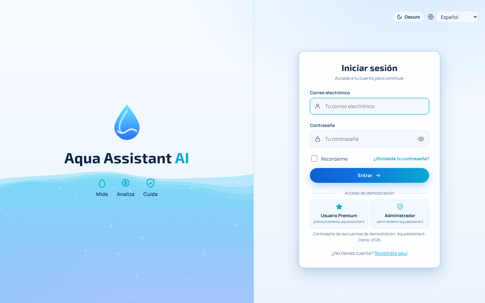

**MockUp2** · Crear cuenta

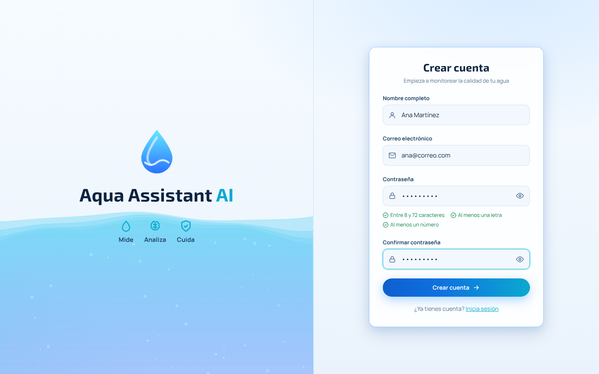

### RF-02

**Recuperación de contraseña por correo** · Funcional · Estado: Hecho

**Como** usuario que olvidó su contraseña, **quiero** recibir un enlace por correo para crear una nueva, **para** recuperar el acceso sin perder mis datos.

**Descripción.** Se pide el correo; si existe, se envía un enlace de un solo uso que vence en 30 minutos. La respuesta es la misma exista o no la cuenta, para no revelar qué correos están registrados.

**Criterios de aceptación**

- [x] El mensaje en pantalla es el mismo para correos registrados y no registrados.
- [x] El enlace sirve una sola vez y vence a los 30 minutos.
- [x] Al cambiar la contraseña se cierran las sesiones abiertas de la cuenta.

**MockUp3** · Recuperar contraseña

### RF-03

**Acceso de demostración por rol** · Funcional · Estado: Hecho

**Como** profesor o evaluador, **quiero** entrar con un botón como Usuario Premium o como Administrador, **para** revisar la aplicación sin crear una cuenta.

**Descripción.** El inicio de sesión muestra dos botones con su correo y la contraseña visible. Son cuentas reales con límites: no se pueden eliminar, recuperar la contraseña ni pagar; el administrador de demostración solo consulta y ve enmascarados los datos de las cuentas reales.

**Criterios de aceptación**

- [x] Cada botón inicia sesión con su cuenta en un clic.
- [x] La cuenta de demostración no puede borrarse, cambiar su nombre ni su foto, ni pagar.
- [x] El administrador de demostración ve correos y nombres enmascarados y no puede modificar cuentas.

**MockUp4** · Botones de acceso de demostración

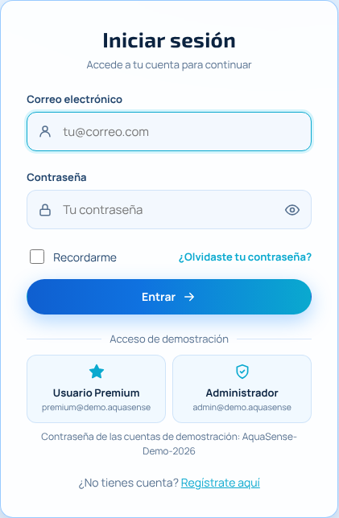

### RF-04

**Inicio (panel principal)** · Funcional · Estado: Hecho

**Como** usuario, **quiero** ver en una pantalla el último pH, su estado, mi perfil activo y las alertas, **para** saber de un vistazo si mi agua está bien.

**Descripción.** Pantalla sin saturar: indicador de pH con color por estado, qué significa el valor (ácida, neutra o alcalina) en la escala 0–14, perfil activo y su rango, referencia oficial del USGS, la sugerencia de Aqua con el último diagnóstico y las alertas sin leer (solo si hay). El botón «Medir» de la barra inferior abre las tres formas de medir; Inicio solo muestra información.

**Criterios de aceptación**

- [x] El indicador muestra la última medición y su estado según el perfil activo.
- [x] Si no hay mediciones, se muestra cómo registrar la primera.
- [x] «Medir» ofrece medir con el medidor, por foto o escribiendo el valor.
- [x] Al guardar una medición, el Inicio se actualiza sin recargar la página.

**MockUp5** · Inicio (panel principal) con la barra inferior y Aqua

**MockUp36** · Medir: las tres formas de registrar el pH

### RF-05

**Registrar una medición y ver su resultado** · Funcional · Estado: Hecho

**Como** usuario, **quiero** registrar un valor de pH (y opcionalmente la temperatura), **para** saber si está en rango y guardarlo en mi historial.

**Descripción.** El registro manual pide pH, fecha y hora y temperatura opcional, y se guarda con origen «manual». Al medir con el medidor, el resultado muestra la clasificación según el perfil, una explicación y la validación del valor, y el usuario decide guardarlo o descartarlo.

**Criterios de aceptación**

- [x] Valores fuera de 0–14 o fechas futuras se rechazan con un mensaje claro.
- [x] El resultado indica el estado (óptimo, precaución o crítico) y por qué.
- [x] Lo guardado aparece en el historial con su origen (manual, medidor o foto).

**MockUp6** · Registro manual de una medición

### RF-06

**Historial, gráficas y exportación** · Funcional · Estado: Hecho

**Como** usuario, **quiero** filtrar mis mediciones por periodo, origen y estado, verlas en gráfica y exportarlas, **para** analizar cómo cambia mi agua con el tiempo.

**Descripción.** Tabla paginada con filtros (últimos 7 o 30 días o un rango personalizado, origen y estado), gráficas de línea a petición, detalle de cada medición y exportación a CSV de lo que muestra la tabla. Recuerda el periodo y los filtros al volver.

**Criterios de aceptación**

- [x] Los filtros cambian la tabla, la gráfica y el CSV de la misma forma.
- [x] Con pocos datos, la gráfica avisa que no son suficientes.
- [x] El CSV descargado contiene exactamente las filas filtradas.

**MockUp7** · Historial con gráfica (30 días)

### RF-07

**Conectar y calibrar un medidor de pH** · Funcional · Estado: Parcial

**Como** usuario con un medidor, **quiero** conectarlo al computador por USB o Bluetooth y calibrarlo desde la app, **para** que las mediciones lleguen solas y sean exactas.

**Descripción.** Desde Chrome o Edge (Web Serial) la app abre el puerto del medidor y admite tres protocolos: firmware Aqua Assistant (ESP32), Atlas Scientific EZO-pH y medidores de laboratorio que envían texto. La calibración usa el valor de cada solución buffer (por ejemplo 6.86 y 4.00). Para medidores sin cable, la lectura por cámara.

**Criterios de aceptación**

- [x] La app detecta si el navegador no admite puertos serie y lo explica.
- [x] Con el medidor conectado, «Medir» → «Con mi medidor» guarda la lectura con origen REAL.
- [x] La calibración envía el punto y el valor del buffer y muestra la respuesta del medidor.
- [ ] Pendiente: probarlo con un medidor físico (hasta ahora con puerto simulado).

**MockUp8** · Medidor, dentro de Configuración

### RF-08

**Perfiles de agua con rangos** · Funcional · Estado: Hecho

**Como** usuario, **quiero** elegir el tipo de agua (piscina, acuario, potable, hidroponía…) o crear un perfil propio, **para** que el estado de cada medición use los rangos correctos.

**Descripción.** Perfiles predefinidos con su fuente y rangos ideal y crítico; perfiles personalizados (crear, duplicar, editar) con validación de los rangos. Aviso de que el pH por sí solo no demuestra potabilidad.

**Criterios de aceptación**

- [x] Solo hay un perfil activo y el Inicio lo muestra.
- [x] El formulario rechaza rangos incoherentes (mínimo mayor que máximo, fuera de 0–14).
- [x] Los perfiles predefinidos muestran la fuente de sus rangos.

**MockUp9** · Perfiles de uso, dentro de Lugares

### RF-09

**Alertas y detección de anomalías** · Funcional · Estado: Hecho

**Como** usuario, **quiero** recibir alertas cuando una medición se sale de rango o es inusual, **para** actuar antes de que el problema crezca.

**Descripción.** Tres reglas (fuera de rango, cambio brusco, valor atípico estadístico) y un modelo de aprendizaje automático (Isolation Forest por usuario) explicado por variable.

**Criterios de aceptación**

- [x] Una medición fuera del rango crítico genera una alerta visible en el Inicio.
- [x] Cada anomalía indica qué regla o variable la produjo.
- [x] El modelo se reentrena cuando llegan mediciones nuevas.

**MockUp10** · Detección de anomalías

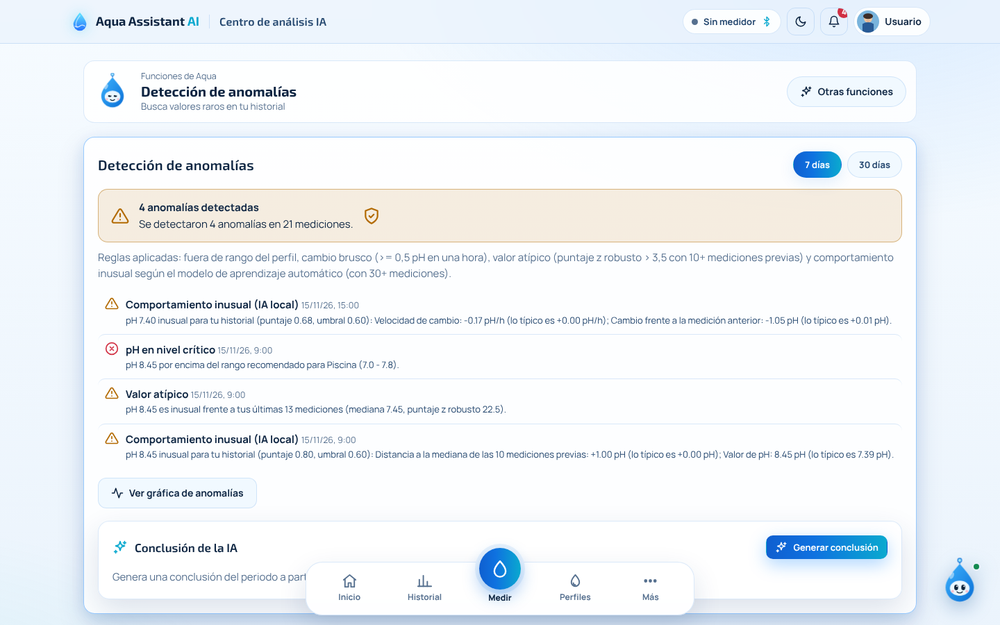

**MockUp11** · Aprendizaje automático (Isolation Forest)

### RF-10

**Tendencias y predicción del pH** · Funcional · Estado: Parcial

**Como** usuario, **quiero** ver hacia dónde va el pH en las próximas horas o días, **para** anticipar correcciones.

**Descripción.** Regresión con intervalo de confianza del 95 % y red neuronal LSTM a 12 horas, que se compara con métodos simples y solo se usa si los supera. Con pocos datos, la app lo dice en lugar de inventar una predicción.

**Criterios de aceptación**

- [x] La predicción muestra el intervalo de incertidumbre.
- [x] Sin datos suficientes (unos 8 días de mediciones frecuentes para la LSTM) se muestra el aviso.
- [x] El horizonte depende del plan (Gratuito o Premium).

**MockUp12** · Predicción de tendencias

**MockUp13** · Red neuronal LSTM (sin datos suficientes)

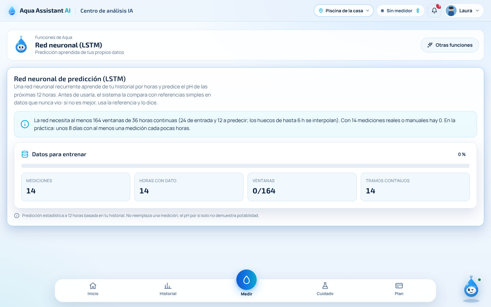

### RF-11

**Diagnóstico y recomendaciones con IA y fuentes** · Funcional · Estado: Hecho

**Como** usuario, **quiero** un diagnóstico de mi agua con recomendaciones respaldadas por normas, **para** saber qué hacer y en qué se basa.

**Descripción.** Diagnóstico estructurado (JSON validado) con causas, acciones y citas literales de la EPA, la OMS, la CDC y la FAO tomadas de una biblioteca normativa. El servidor descarta citas que no entregó. Si la IA falla, se usa un diagnóstico por reglas y se indica.

**Criterios de aceptación**

- [x] Cada recomendación muestra su cita y la fuente.
- [x] No aparecen citas que no estén en la biblioteca normativa.
- [x] Si la IA no responde, el diagnóstico por reglas se marca como tal.

**MockUp14** · Diagnóstico y recomendaciones con fuentes

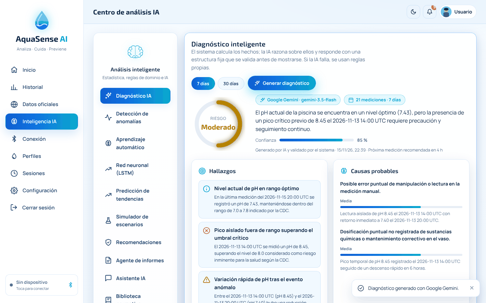

**MockUp15** · Biblioteca normativa (Normas y Datos oficiales)

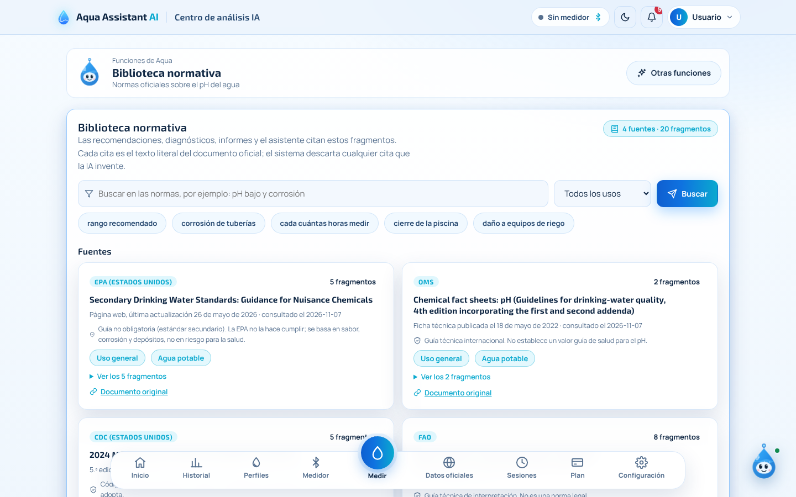

### RF-12

**Simulador de escenarios** · Funcional · Estado: Hecho

**Como** usuario, **quiero** probar qué pasaría con el pH si cambio una condición, **para** decidir una corrección antes de aplicarla.

**Descripción.** Escenarios hipotéticos sobre el historial del usuario, con su explicación. Los resultados se muestran como simulación, nunca como mediciones.

**Criterios de aceptación**

- [x] El resultado se identifica como escenario simulado.
- [x] Los escenarios no se guardan como mediciones.

**MockUp16** · Simulador de escenarios

### RF-13

**Informes inteligentes y PDF** · Funcional · Estado: Hecho

**Como** usuario, **quiero** pedir un informe del estado de mi agua en un periodo y descargarlo en PDF, **para** compartirlo o guardarlo.

**Descripción.** Un agente de IA consulta el sistema con herramientas (sin acceso directo a la base de datos) y redacta el informe con cifras verificadas; el PDF incluye gráficas y fuentes.

**Criterios de aceptación**

- [x] El informe se elabora en segundo plano y muestra su avance.
- [x] Las cifras del informe coinciden con las del historial.
- [x] El PDF se descarga con gráficas y fuentes.

**MockUp17** · Agente de informes

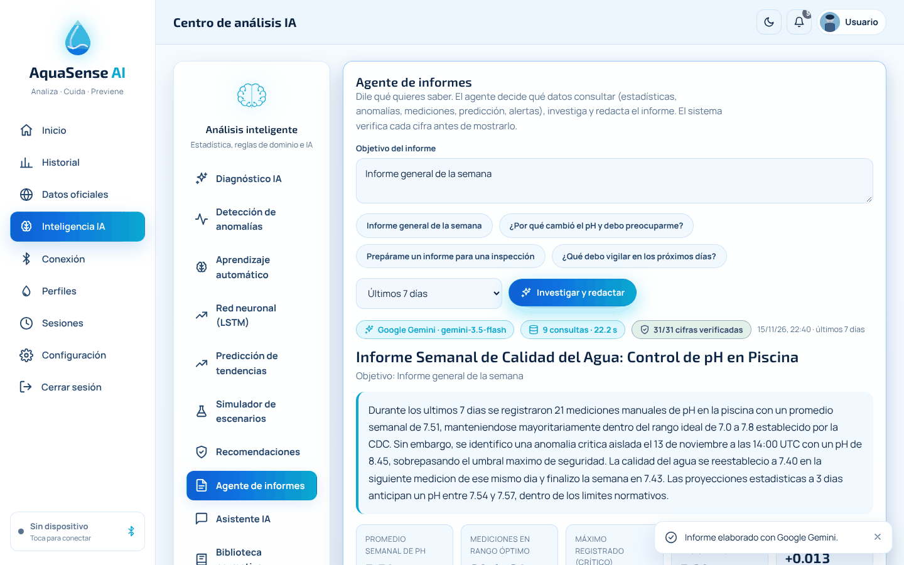

### RF-14

**Asistente IA con respuesta en vivo** · Funcional · Estado: Hecho

**Como** usuario, **quiero** hacer preguntas sobre el pH y el cuidado del agua y ver la respuesta mientras se escribe, **para** resolver dudas sin esperar.

**Descripción.** Se abre desde Aqua, el robot, en cualquier pantalla (chat dentro de su panel) o en pantalla completa con la lista de conversaciones. Chat con memoria por conversación, citas, botones Detener, Copiar y Descargar, y respuesta en vivo (Server-Sent Events). Si un modelo no empieza o se congela, otro reescribe la respuesta. Rechaza temas ajenos al agua.

**Criterios de aceptación**

- [x] El texto empieza a aparecer mientras el modelo escribe.
- [x] «Detener» corta la respuesta; «Copiar» y «Descargar» funcionan.
- [x] Una pregunta ajena al tema se rechaza con un mensaje amable.
- [x] Se respeta la cuota diaria de consultas del plan.

**MockUp18** · Asistente IA (respuesta completa)

**MockUp35** · Chat con Aqua dentro de su panel (celular)

### RF-15

**Lectura de pH por foto** · Funcional · Estado: Parcial

**Como** usuario sin medidor electrónico, **quiero** tomar una foto de una tira reactiva o de la pantalla de mi medidor, **para** registrar el pH sin escribirlo.

**Descripción.** La IA con visión lee la foto, da un valor o un rango con su confianza y una segunda opinión de otro modelo; el usuario confirma antes de guardar.

**Criterios de aceptación**

- [x] Fotos borrosas o sin carta de colores se rechazan con la causa.
- [x] El resultado muestra el valor, la confianza y el acuerdo entre modelos.
- [x] Nada se guarda sin confirmación del usuario.
- [ ] Pendiente: medir la precisión con fotos reales de tiras.

**MockUp19** · Lectura de pH por foto

### RF-16

**Planes Gratuito y Premium con pagos** · Funcional · Estado: Parcial

**Como** usuario, **quiero** pasar a Premium pagando en línea, **para** tener más días de análisis y más consultas de IA.

**Descripción.** Gratuito: 30 días de análisis y 20 consultas de IA al día. Premium: 365 días y 200 consultas. Pago por periodo con PayU (COP 49.900 por 30 días) en modo de pruebas; el servidor verifica la orden en PayU antes de activar Premium.

**Criterios de aceptación**

- [x] Los límites se aplican en el servidor, no solo en la pantalla.
- [x] Premium se activa una sola vez por pago aprobado, aunque se verifique varias veces.
- [x] Un pago rechazado no cambia el plan.
- [ ] Pendiente: cobrar dinero real exige registrar un comercio en PayU.

**MockUp20** · Plan y pagos (PayU en modo de pruebas)

### RF-17

**Configuración de la cuenta** · Funcional · Estado: Hecho

**Como** usuario, **quiero** elegir el tema (claro, oscuro o automático) y las notificaciones, **para** usar la app a mi gusto.

**Descripción.** Preferencias guardadas en el servidor. El tema claro es el predeterminado. La app está en español.

**Criterios de aceptación**

- [x] El tema claro es el predeterminado para cuentas nuevas y para quien no ha iniciado sesión.
- [x] El cambio de tema se aplica al instante y se conserva al volver a entrar.

**MockUp21** · Configuración con sus secciones: Ajustes, Medidor y Actividad

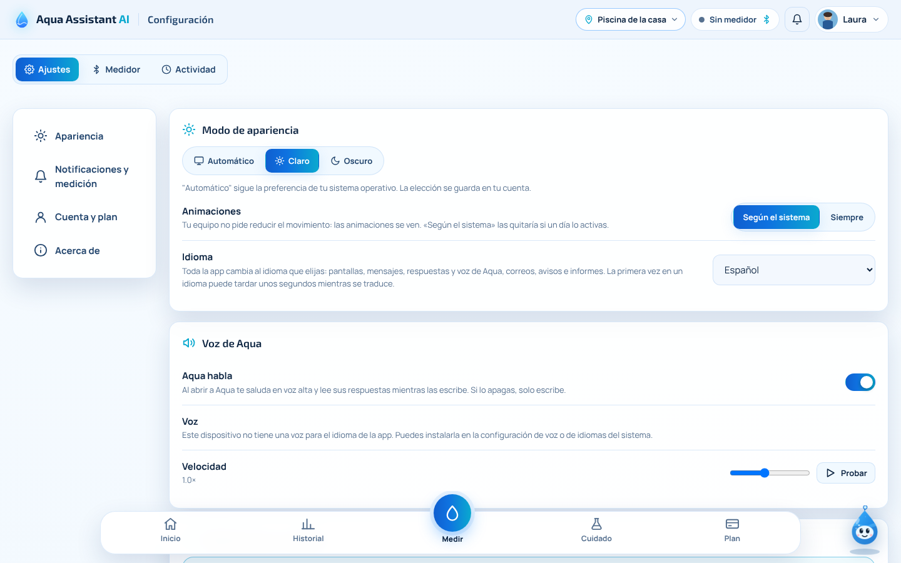

### RF-18

**Foto de perfil, nombre y contraseña** · Funcional · Estado: Hecho

**Como** usuario, **quiero** poner mi foto, cambiar mi nombre y mi contraseña, **para** personalizar y proteger mi cuenta.

**Descripción.** Foto privada reducida a 256 px y sin metadatos (como la ubicación). Al cambiar la contraseña se cierran las demás sesiones y la actual sigue abierta.

**Criterios de aceptación**

- [x] La foto aparece en la barra superior y solo la ve su dueño.
- [x] Con la contraseña actual incorrecta, el cambio se rechaza junto al campo.
- [x] Tras cambiar la contraseña, las otras sesiones quedan cerradas.

**MockUp22** · Foto de perfil

### RF-19

**Historial de sesiones y de operaciones** · Funcional · Estado: Hecho

**Como** usuario, **quiero** ver mis sesiones (inicio, fin, duración, navegador) y lo que hice en cada una, **para** detectar accesos que no reconozco.

**Descripción.** Lista de sesiones con su estado y acciones; «Cerrar mis otras sesiones» las termina. Cada operación queda ligada a la sesión en que se hizo. El administrador puede ver las de cualquier cuenta.

**Criterios de aceptación**

- [x] La sesión actual se identifica y no puede cerrarse desde la lista.
- [x] «Cerrar mis otras sesiones» invalida los demás tokens al instante.
- [x] El detalle de una sesión muestra sus acciones en orden.

**MockUp23** · Actividad y sesiones, dentro de Configuración

### RF-20

**Datos oficiales de referencia (USGS)** · Funcional · Estado: Hecho

**Como** usuario, **quiero** comparar mi pH con mediciones oficiales de estaciones de agua, **para** tener una referencia real.

**Descripción.** Importación periódica (cada 3 horas) de datos de pH del Servicio Geológico de EE. UU. (USGS), guardados aparte de las mediciones del usuario, con estaciones y series.

**Criterios de aceptación**

- [x] Los datos oficiales nunca se mezclan con las mediciones del usuario.
- [x] Se muestra la fecha de la última importación terminada.
- [x] Si el USGS no responde, se conservan los datos anteriores y se reintenta.

**MockUp24** · Datos oficiales del USGS, dentro de la Biblioteca

### RF-21

**Administración de usuarios y consumo de IA** · Funcional · Estado: Hecho

**Como** administrador, **quiero** gestionar cuentas (plan, rol, estado) y ver el consumo y costo de la IA, **para** controlar el sistema y sus gastos.

**Descripción.** Búsqueda y filtros de usuarios, detalle con pagos, actividad y sesiones, cambios de plan, rol y estado con aviso por correo, y reporte de consumo de IA por modelo, función y día con costo estimado.

**Criterios de aceptación**

- [x] Solo el rol administrador entra a Administración.
- [x] No se puede dejar el sistema sin administradores activos.
- [x] El consumo muestra llamadas, tokens y costo estimado por modelo.
- [x] Los precios estimados vienen de fuentes de terceros y deben confirmarse en las páginas oficiales.

**MockUp25** · Administración (cuentas reales difuminadas)

**MockUp26** · Consumo y costos de IA

### RF-22

**Aqua: robot de la IA y recorrido guiado** · Funcional · Estado: Hecho

**Como** usuario nuevo, **quiero** que un asistente me explique para qué sirve cada parte y me deje usar la IA desde cualquier pantalla, **para** aprender a usar la app sin manual y encontrar las funciones de IA en un solo lugar.

**Descripción.** Aqua, un robot con forma de gota, salta solo en todas las pantallas (se aplasta al caer, deja ondas y a veces da una voltereta) y es la única entrada a la inteligencia artificial: su panel permite preguntar, chatear y abrir el diagnóstico, las anomalías, las recomendaciones, la predicción, la red neuronal, los escenarios, el aprendizaje automático, los informes, la biblioteca normativa, el consumo y la lectura por foto. La primera vez que una persona entra, Aqua hace un recorrido guiado señalando cada botón con un globo de texto, y al abrir cada pantalla dice en una frase para qué sirve.

**Criterios de aceptación**

- [x] Aqua aparece en todas las pantallas de la sesión y la IA no aparece en el menú.
- [x] Desde el panel de Aqua se abre cada función de IA y el chat.
- [x] El recorrido sale solo la primera vez, se puede saltar y se repite desde Aqua («¿Qué puedo hacer aquí?»).
- [x] El recorrido y el panel se usan con teclado (flechas, Tab y Esc) y con lector de pantalla.
- [x] Los consejos de Aqua al cambiar de pantalla se pueden desactivar.

**MockUp33** · Recorrido guiado: Aqua señala el botón Medir

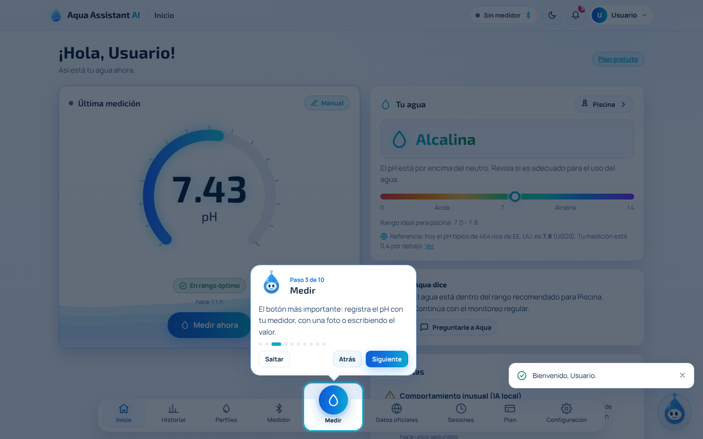

**MockUp34** · Panel de Aqua con el chat y las funciones agrupadas

### RF-23

**Varios lugares y otros parámetros del agua** · Funcional · Estado: Hecho

**Como** persona con piscina y acuario, **quiero** llevar cada agua por separado y anotar también cloro, alcalinidad, dureza y ácido cianúrico, **para** que sus mediciones no se mezclen y ver el estado completo del agua.

**Descripción.** Cada lugar (piscina, acuario, estanque, tanque, agua potable, riego, hidroponía u otro) tiene su historial, su perfil y su volumen. «Mi agua» se crea sola al registrarse. Arriba, junto al nombre, se ve el lugar en uso y se cambia con un toque; Inicio, Historial, Medir, Cuidado y la IA pasan a ese lugar. La medición manual tiene una sección opcional «Otros parámetros» (cloro libre, alcalinidad total, dureza cálcica y ácido cianúrico) con rangos orientativos según el tipo de lugar. Cada pantalla nueva explica en un cuadro «¿Para qué sirve?» con ejemplos.

**Criterios de aceptación**

- [x] Las mediciones de un lugar no aparecen en otro.
- [x] Al cambiar de lugar arriba, toda la app muestra ese lugar sin recargar.
- [x] Los otros parámetros se guardan con la medición y el Inicio los muestra con su estado (bien, bajo o alto).
- [x] Un lugar se puede crear, renombrar, cambiar de volumen y borrar (con sus datos) por su dueño.

**MockUp38** · Lugares con el cuadro «¿Para qué sirven?»

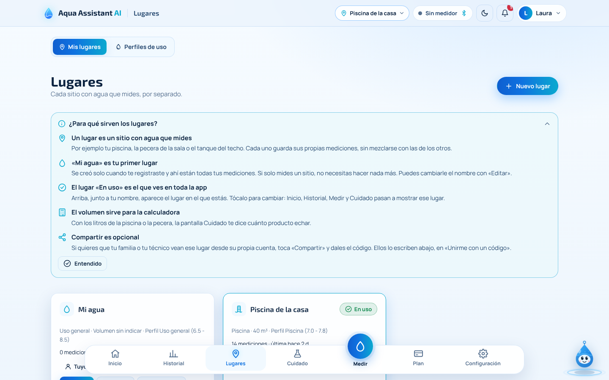

**MockUp42** · Otros parámetros del agua en Inicio

### RF-24

**Calculadora de dosis y registro de tratamientos** · Funcional · Estado: Hecho

**Como** dueño de una piscina o acuario, **quiero** saber cuánto producto echar y anotar lo que le hago al agua, **para** corregirla sin pasarme y recordar qué hice.

**Descripción.** La calculadora usa el volumen del lugar y las últimas mediciones: para el pH aplica el sistema carbonato del agua con la alcalinidad (corregida por el ácido cianúrico); para cloro, alcalinidad, dureza y estabilizador, balances de masa según la concentración del producto. Indica la cantidad total, pide agregar primero la mitad y avisa de los efectos secundarios. El resultado se registra con un toque como tratamiento; el registro guarda producto, cantidad, fecha, quién lo hizo y una nota.

**Criterios de aceptación**

- [x] Bajar una piscina de 40 000 L de pH 7,9 a 7,5 con alcalinidad 90 mg/L indica unos 270 mL de ácido muriático al 31,45 %.
- [x] Sin alcalinidad, la calculadora pide el dato en lugar de inventar un resultado.
- [x] El resultado se presenta como estimación y recomienda medir antes de agregar el resto.
- [x] Los tratamientos se ven por lugar y quien solo puede ver el lugar no puede registrarlos.

**MockUp40** · Calculadora de dosis con resultado

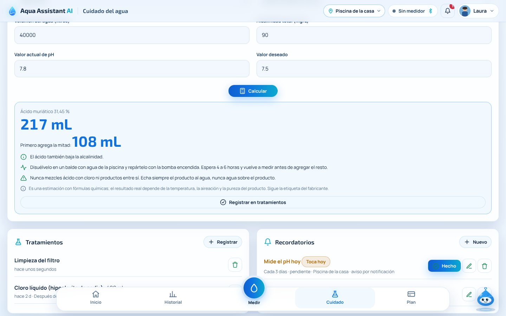

**MockUp41** · Tratamientos y recordatorios

### RF-25

**Recordatorios y avisos fuera de la app** · Funcional · Estado: Parcial

**Como** usuario, **quiero** que la app me recuerde medir o limpiar el filtro y me avise si el agua sale de rango aunque no la tenga abierta, **para** no olvidar el mantenimiento ni enterarme tarde de un problema.

**Descripción.** Recordatorios que se repiten cada cierto número de días («Mide el pH hoy», «Limpia el filtro», cambio de agua, calibración o uno propio). Cuando toca, aparecen en Inicio en «Para hoy» con el botón «Hecho» y llegan como notificación al celular o computador (Web Push, cifrado según RFC 8291 y firmado con VAPID) y, si se marca, por correo. Las alertas de mediciones fuera de rango también llegan por notificación y por correo (como mucho uno por hora). Configuración permite activar los avisos en cada dispositivo y probarlos.

**Criterios de aceptación**

- [x] Un recordatorio vencido aparece en «Para hoy» y se notifica una sola vez por vencimiento.
- [x] «Hecho» lo pasa a la siguiente fecha.
- [x] Con los avisos activos en un dispositivo, «Probar» muestra una notificación en él.
- [ ] Pendiente: confirmar la recepción en un celular real (el navegador de pruebas no tiene servicio de notificaciones).

**MockUp41** · Tratamientos y recordatorios

### RF-26

**Compartir un lugar con un código** · Funcional · Estado: Hecho

**Como** dueño de un lugar, **quiero** compartirlo con mi familia o mi técnico mediante un código, **para** que lo vean o midan desde su propia cuenta.

**Descripción.** El dueño genera un código de 8 caracteres y elige si quien se una solo puede ver o también medir y registrar. La otra persona lo escribe en «Unirme con un código». El dueño ve quién se unió, puede quitarlo o desactivar el código; quien se unió puede salir. Las alertas del lugar llegan a todas las personas con acceso.

**Criterios de aceptación**

- [x] Con un código válido el lugar aparece en la otra cuenta con su rol.
- [x] Quien solo puede ver no puede medir ni registrar: el servidor lo rechaza.
- [x] Un código desactivado o inexistente muestra un mensaje claro.
- [x] Las cuentas de demostración no pueden compartir ni unirse.

**MockUp39** · Compartir un lugar con un código

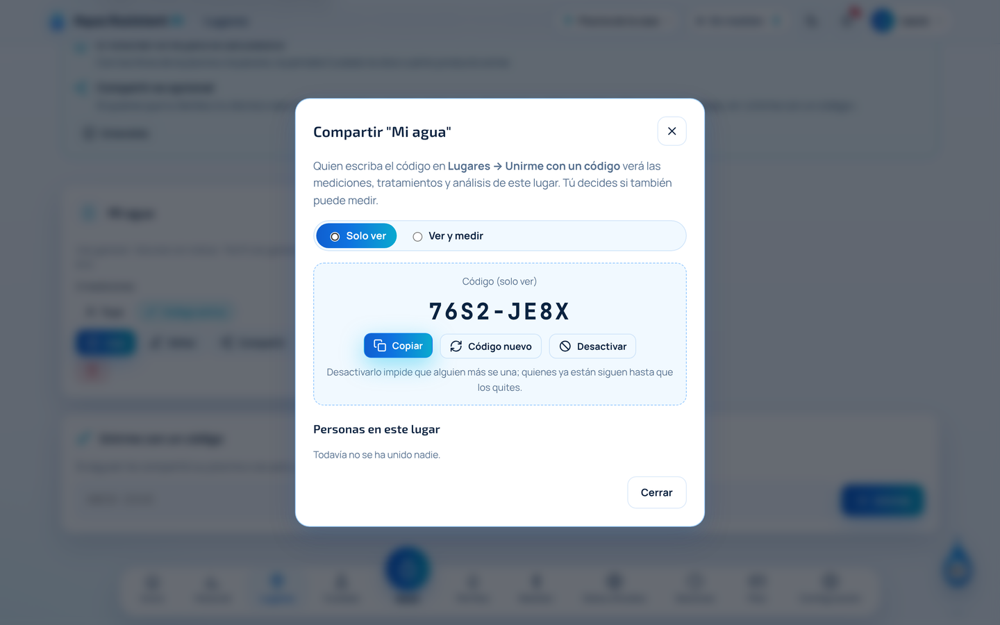

### RF-27

**Historial de calibraciones** · Funcional · Estado: Hecho

**Como** usuario con medidor, **quiero** ver cada calibración que hice, **para** saber cuándo recalibrar o cambiar la sonda.

**Descripción.** Cada punto calibrado (por USB o desde el ESP32) queda registrado con el medidor, la solución buffer, lo que marcaba antes, la diferencia y si el medidor lo aceptó. Se ve en la pantalla Medidor.

**Criterios de aceptación**

- [x] Al calibrar un punto aparece una fila nueva con fecha, solución y lectura.
- [x] Los intentos fallidos también quedan registrados.

**MockUp43** · Historial de calibraciones

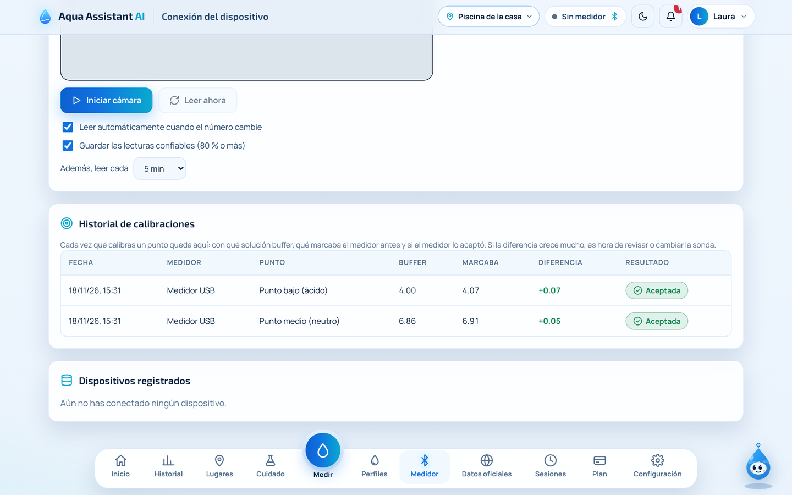

### RF-28

**Toda la app en el idioma elegido** · Funcional · Estado: Hecho

**Como** usuario que no habla español, **quiero** elegir mi idioma (español, inglés, francés, alemán, italiano, chino o japonés) y ver toda la app en él, **para** entender y usar todas las funciones.

**Descripción.** Selector en Configuración y en la pantalla de inicio de sesión. Un traductor cambia cada texto, botón, etiqueta, mensaje y aviso de la pantalla, incluidos los que aparecen después. Los 2130 textos de la app y de los mensajes del servidor se extraen del código y el servidor los mantiene traducidos de antemano con la IA, con el mismo tono en cada idioma (tuteo en francés, alemán e italiano; forma cortés en japonés), así que cambiar de idioma es inmediato; lo que aún no esté traducido se traduce al aparecer y queda guardado para todos; las negritas y los enlaces dentro de una frase se conservan con marcadores y los números viajan como {0}. Fechas, números y tiempos relativos usan el formato del idioma. Las respuestas de la IA, los diagnósticos, los informes del agente, los correos y las notificaciones también salen en el idioma de la persona; el PDF del servidor también, con una fuente propia para el chino y el japonés. Lo que escribe la persona (nombres, notas, chats) no se traduce.

**Criterios de aceptación**

- [x] Al elegir un idioma la app se recarga en él y la elección queda en la cuenta.
- [x] En cada idioma, las pantallas y los diálogos principales no muestran textos en español (prueba automática).
- [x] Si la traducción de un texto falla, se muestra en español y se reintenta.
- [x] Las cuentas de demostración guardan el idioma solo en el navegador.
- [x] Un idioma que ya no se ofrece vuelve a español sin errores.
- [x] El PDF en chino y japonés muestra los caracteres (sin signos «?»).

**MockUp44** · Idioma y voz de Aqua en Configuración

**MockUp45** · La app en inglés

### RF-29

**Voz de Aqua** · Funcional · Estado: Hecho

**Como** usuario, **quiero** que Aqua me salude y me lea sus respuestas con una voz natural, y poder apagarla, **para** usar el asistente sin tener que leer todo.

**Descripción.** Al abrir a Aqua dice «Hola, (nombre). ¿En qué te puedo ayudar?» y lee cada respuesta frase por frase mientras la escribe, en el idioma de la app. Usa las voces del dispositivo y elige la más natural (voces neuronales de Edge, de Google en Chrome o mejoradas de iPhone y Android). Se apaga con el botón de altavoz del panel de Aqua o en Configuración, donde también se elige la voz y la velocidad; apagada, Aqua solo escribe. Mientras habla, mueve la boca.

**Criterios de aceptación**

- [x] Con la voz activa, abrir a Aqua dice el saludo con el nombre de la persona.
- [x] Las respuestas se leen mientras llegan y se detienen al cerrar el panel.
- [x] Con la voz apagada no se dice nada y la elección queda en la cuenta.
- [x] La calidad de la voz depende de las voces instaladas en el dispositivo.

**MockUp44** · Idioma y voz de Aqua en Configuración

### RF-30

**Alarma por alteración del pH** · Funcional · Estado: Hecho

**Como** dueño de una piscina, un acuario u otra agua con un medidor dentro, **quiero** que la app me avise de inmediato con sonido y que Aqua me diga si el cambio es peligroso cuando el pH se altera, **para** sacar a las personas del agua o proteger a los peces a tiempo.

**Descripción.** Con el medidor en el agua («Medir cada 10 s», que sigue aunque se cambie de pantalla), cada medición se compara con las de la última hora. Si el pH cambia 0,5 o más (por ejemplo, algo cayó al agua), o si entra en nivel crítico, se crea la alerta «Alteración del pH en el agua». Dice si es peligroso según los rangos del perfil (nivel crítico = peligroso) y qué hacer según el tipo de agua: en una piscina, que nadie se bañe y salgan del agua; en un acuario, que los peces corren peligro; en agua potable, no tomarla; en riego, no regar. Funciona con cualquier perfil. En la app suena una alarma (al volumen del equipo), aparece una ventana que no se cierra sola y Aqua lo dice en voz alta; la alarma se repite cada pocos segundos hasta pulsar «Entendido». En el celular o computador llega un aviso urgente que queda en pantalla y vibra, aunque la app esté cerrada (si se activaron los avisos). La misma alerta no se repite en ese lugar durante 30 minutos, salvo que se vuelva peligrosa. En Configuración se puede apagar el sonido en cada dispositivo y probar la alarma. Si la app está abierta en otro equipo, revisa las alertas cada 15 segundos. Con el medidor conectado al mismo equipo, el aviso es inmediato.

**Criterios de aceptación**

- [x] Una caída o subida de 0,5 o más en la última hora, o la entrada en nivel crítico, crea una sola alerta «Alteración del pH en el agua».
- [x] El mensaje dice si es peligroso según el perfil y qué hacer según el tipo de agua.
- [x] En la app suena la alarma, aparece la ventana y Aqua lee el mensaje; «Entendido» la detiene y marca la alerta como leída.
- [x] El aviso del celular o computador es urgente y queda en pantalla hasta tocarlo.
- [x] Los navegadores solo dejan sonar una página después de tocarla una vez; si no, la ventana lo indica.

**MockUp48** · Alarma en una piscina: el pH bajó de 7,50 a 5,20

### RNF-01

**Seguridad** · No funcional · Estado: Hecho

**Como** usuario, **quiero** que mi contraseña y mi sesión estén protegidas, **para** que nadie más vea ni cambie mis datos.

**Descripción.** Contraseñas con Argon2id; tokens JWT ligados a una sesión que se puede revocar; límite de 10 intentos por minuto por dirección y bloqueo de una cuenta por 15 minutos tras 5 inicios fallidos; CORS solo para el dominio de la app; cabeceras de seguridad (política de contenido, sin incrustación en otros sitios); documentación de la API desactivada en producción; cada usuario solo accede a sus datos.

**Criterios de aceptación**

- [x] Tras 5 contraseñas incorrectas la cuenta responde «Demasiados intentos» durante 15 minutos.
- [x] Un token de una sesión cerrada responde 401.
- [x] Un usuario no puede leer ni modificar datos de otro (403/404).
- [x] /v3/api-docs y /swagger-ui.html no están publicados en producción.

**MockUp27** · Bloqueo tras 5 intentos fallidos

### RNF-02

**Rendimiento** · No funcional · Estado: Hecho

**Como** usuario, **quiero** que la app y el asistente respondan rápido, **para** no quedarme esperando.

**Descripción.** Respuestas de IA en vivo; cambio automático de modelo si uno no empieza en 8–12 s o se congela 6 s; caché de respuestas de IA; memoria que se limpia sola (modelos y cachés con vencimiento). En pruebas del asistente publicado, 12 preguntas respondieron completas en 10,8 s o menos.

**Criterios de aceptación**

- [x] El asistente muestra texto antes de terminar la respuesta completa.
- [x] Una pregunta repetida se responde desde la caché sin gastar cuota.
- [x] Los modelos y cachés en memoria se liberan cuando no se usan.

**MockUp28** · Asistente escribiendo la respuesta en vivo

### RNF-03

**Disponibilidad** · No funcional · Estado: Hecho

**Como** usuario, **quiero** que la app esté disponible cuando la abra, **para** no esperar a que el servidor arranque.

**Descripción.** Frontend en Vercel, API en Render y base PostgreSQL en Neon. El propio servidor se consulta cada 10 minutos en /actuator/health/liveness (dirección que no toca la base de datos) para que el plan gratuito no lo apague; además puede usarse un monitor externo. Si el servidor estaba apagado, la app muestra «Activando el servidor…» mientras arranca.

**Criterios de aceptación**

- [x] /actuator/health/liveness responde 200 sin iniciar sesión.
- [x] Tras 20 minutos sin uso, la API responde en menos de 2 segundos.
- [x] Si el servidor tarda, la app avisa en lugar de mostrar un error.
- [x] En la prueba del 17 de noviembre, tras 22 minutos sin uso la API respondió en 0,46 s.

**MockUp29** · Aviso mientras el servidor arranca

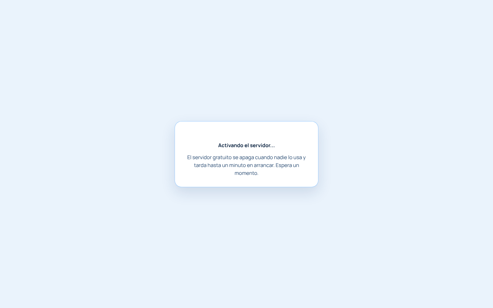

### RNF-04

**Usabilidad, accesibilidad y diseño adaptable** · No funcional · Estado: Hecho

**Como** usuario de computador o celular, **quiero** una interfaz clara que funcione en cualquier pantalla, **para** usarla cómodamente donde esté.

**Descripción.** Navegación con una barra inferior con su ícono: Inicio, Historial, Medir, Cuidado y Plan para las personas, e Inicio, Historial, Medir, Plan y Admin para el administrador (que abre Cuidado desde el botón del lugar); igual en celular y computador. Arriba, el botón del lugar cambia de lugar y lleva a «Crear, editar o compartir lugares» (con los Perfiles de uso); el menú de la cuenta tiene «Mi cuenta», «Configuración» (con Medidor y Actividad y sesiones) y «Cerrar sesión», y solo un menú de arriba está abierto a la vez. Los Datos oficiales están en la Biblioteca normativa de Aqua. Las funciones de Aqua se agrupan en «Analizar mi agua», «Más herramientas» y «Análisis avanzado»; «Consumo y costos» es solo para administradores. Aqua saluda «Hola, (nombre)» la primera vez que se abre en cada sesión y después con frases cortas al azar. Tema claro predeterminado y oscuro (negros, blancos y grises, con brillos cian), que también se elige antes de iniciar sesión. La sesión se cierra solo desde el menú del usuario (la inicial o el nombre, arriba a la derecha). Navegación por teclado y lector de pantalla. Revisión con axe-core (19 nov 2026): 0 hallazgos en 36 pantallas y vistas (acceso, registro, recorrido, panel y chat de Aqua, hoja «Medir», menús de la cuenta y del lugar, ventana de alarma y todas las pantallas), en tema claro y oscuro, en computador y teléfono.

**Criterios de aceptación**

- [x] Todas las pantallas se usan en un celular sin desplazamiento horizontal.
- [x] Cada control tiene nombre accesible y foco visible.
- [x] El contraste cumple en ambos temas.

**MockUp30** · Inicio en un celular

**MockUp37** · Menú de la cuenta (Mi cuenta, Configuración y Cerrar sesión) y la barra de pestañas

**MockUp46** · Inicio en tema oscuro (negros y grises con brillos cian)

**MockUp47** · Inicio de sesión en tema oscuro, con el botón claro/oscuro arriba

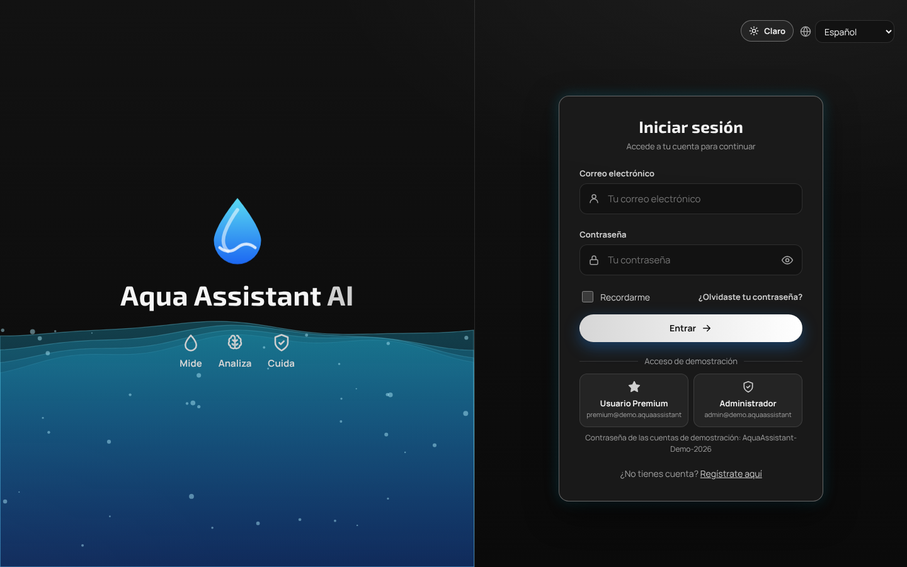

### RNF-05

**Privacidad de los datos** · No funcional · Estado: Hecho

**Como** usuario, **quiero** que mis datos personales no salgan del sistema, **para** confiar en la app.

**Descripción.** A los modelos de IA solo se envían valores de pH, fechas y datos del perfil de agua, nunca nombres ni correos. Para traducir la interfaz solo se envían los textos de la app: lo que escribe la persona (nombres, notas, chats) se marca para no traducirse. La foto de perfil es privada y sin metadatos. El administrador de demostración ve enmascarados los datos de las cuentas reales. Los datos simulados nunca se presentan como mediciones reales.

**Criterios de aceptación**

- [x] Las solicitudes a la IA no incluyen nombre ni correo del usuario.
- [x] Las cuentas reales aparecen enmascaradas para el administrador de demostración.
- [x] Cada medición indica su origen (manual, medidor, foto).

**MockUp31** · Datos enmascarados para el administrador de demostración

### RNF-06

**Mantenibilidad y calidad del código** · No funcional · Estado: Hecho

**Como** desarrollador del proyecto, **quiero** un código organizado, documentado y con pruebas automáticas, **para** cambiarlo sin romper lo que funciona.

**Descripción.** Cuatro repositorios: el frontend (HTML, CSS y JavaScript con módulos, sin frameworks), el backend y el servicio de IA en Spring Boot por capas (controlador, servicio, repositorio) organizados por módulo, y la base de datos (DBPatSft), cuyas migraciones Flyway GitHub Actions prueba en una base vacía y aplica a Neon. Catálogo de patrones de diseño (docs/DesignPatterns.md del backend). Pruebas automáticas: backend (111) y servicio de IA (119) con JUnit y H2, frontend (56) con node:test y el firmware del medidor con pruebas en el computador; GitHub Actions las ejecuta en cada cambio.

**Criterios de aceptación**

- [x] Las pruebas automáticas pasan antes de publicar.
- [x] Cada patrón de diseño documentado indica su función y su prueba.
- [x] El README explica cómo instalar, configurar y desplegar.

_Requerimiento sin pantalla propia: se comprueba con las pruebas automáticas y la documentación del repositorio._

### RNF-07

**Compatibilidad e instalación** · No funcional · Estado: Hecho

**Como** usuario, **quiero** usar la app en mi navegador o instalarla como aplicación, **para** tenerla a mano.

**Descripción.** Aplicación web progresiva (instalable en computador y celular). El medidor por cable o Bluetooth requiere Chrome o Edge (Web Serial); el resto funciona en navegadores actuales. Interfaz en español.

**Criterios de aceptación**

- [x] El navegador ofrece instalar la app (manifiesto con íconos).
- [x] En navegadores sin Web Serial, la app explica qué navegador usar para el medidor.

**MockUp32** · Inicio de sesión en un celular

## Índice de MockUps

| MockUp | Pantalla | Requerimiento |
|---|---|---|
| [MockUp1](mockups/MockUp1.png) | Inicio de sesión | RF-01 |
| [MockUp2](mockups/MockUp2.png) | Crear cuenta | RF-01 |
| [MockUp3](mockups/MockUp3.png) | Recuperar contraseña | RF-02 |
| [MockUp4](mockups/MockUp4.png) | Botones de acceso de demostración | RF-03 |
| [MockUp5](mockups/MockUp5.png) | Inicio (panel principal) con la barra inferior y Aqua | RF-04 |
| [MockUp6](mockups/MockUp6.png) | Registro manual de una medición | RF-05 |
| [MockUp7](mockups/MockUp7.png) | Historial con gráfica (30 días) | RF-06 |
| [MockUp8](mockups/MockUp8.png) | Medidor, dentro de Configuración | RF-07 |
| [MockUp9](mockups/MockUp9.png) | Perfiles de uso, dentro de Lugares | RF-08 |
| [MockUp10](mockups/MockUp10.png) | Detección de anomalías | RF-09 |
| [MockUp11](mockups/MockUp11.png) | Aprendizaje automático (Isolation Forest) | RF-09 |
| [MockUp12](mockups/MockUp12.png) | Predicción de tendencias | RF-10 |
| [MockUp13](mockups/MockUp13.png) | Red neuronal LSTM (sin datos suficientes) | RF-10 |
| [MockUp14](mockups/MockUp14.png) | Diagnóstico y recomendaciones con fuentes | RF-11 |
| [MockUp15](mockups/MockUp15.png) | Biblioteca normativa (Normas y Datos oficiales) | RF-11 |
| [MockUp16](mockups/MockUp16.png) | Simulador de escenarios | RF-12 |
| [MockUp17](mockups/MockUp17.png) | Agente de informes | RF-13 |
| [MockUp18](mockups/MockUp18.png) | Asistente IA (respuesta completa) | RF-14 |
| [MockUp19](mockups/MockUp19.png) | Lectura de pH por foto | RF-15 |
| [MockUp20](mockups/MockUp20.png) | Plan y pagos (PayU en modo de pruebas) | RF-16 |
| [MockUp21](mockups/MockUp21.png) | Configuración con Medidor y Actividad arriba | RF-17 |
| [MockUp22](mockups/MockUp22.png) | Foto de perfil | RF-18 |
| [MockUp23](mockups/MockUp23.png) | Actividad y sesiones, dentro de Configuración | RF-19 |
| [MockUp24](mockups/MockUp24.png) | Datos oficiales del USGS, dentro de la Biblioteca | RF-20 |
| [MockUp25](mockups/MockUp25.png) | Administración (cuentas reales difuminadas) | RF-21 |
| [MockUp26](mockups/MockUp26.png) | Consumo y costos de IA | RF-21 |
| [MockUp27](mockups/MockUp27.png) | Bloqueo tras 5 intentos fallidos | RNF-01 |
| [MockUp28](mockups/MockUp28.png) | Asistente escribiendo la respuesta en vivo | RNF-02 |
| [MockUp29](mockups/MockUp29.png) | Aviso mientras el servidor arranca | RNF-03 |
| [MockUp30](mockups/MockUp30.png) | Inicio en un celular | RNF-04 |
| [MockUp31](mockups/MockUp31.png) | Datos enmascarados para el administrador de demostración | RNF-05 |
| [MockUp32](mockups/MockUp32.png) | Inicio de sesión en un celular | RNF-07 |
| [MockUp33](mockups/MockUp33.png) | Recorrido guiado: Aqua señala el botón Medir | RF-22 |
| [MockUp34](mockups/MockUp34.png) | Panel de Aqua con el chat y las funciones agrupadas | RF-22 |
| [MockUp35](mockups/MockUp35.png) | Chat con Aqua dentro de su panel (celular) | RF-14 |
| [MockUp36](mockups/MockUp36.png) | Medir: las tres formas de registrar el pH | RF-04 |
| [MockUp37](mockups/MockUp37.png) | Menú del usuario con «Cerrar sesión» y la barra de pestañas | RNF-04 |
| [MockUp38](mockups/MockUp38.png) | Lugares con el cuadro «¿Para qué sirven?» | RF-23 |
| [MockUp39](mockups/MockUp39.png) | Compartir un lugar con un código | RF-26 |
| [MockUp40](mockups/MockUp40.png) | Calculadora de dosis con resultado | RF-24 |
| [MockUp41](mockups/MockUp41.png) | Tratamientos y recordatorios | RF-24 |
| [MockUp42](mockups/MockUp42.png) | Otros parámetros del agua en Inicio | RF-23 |
| [MockUp43](mockups/MockUp43.png) | Historial de calibraciones | RF-27 |
| [MockUp44](mockups/MockUp44.png) | Idioma y voz de Aqua en Configuración | RF-28 |
| [MockUp45](mockups/MockUp45.png) | La app en inglés | RF-28 |
