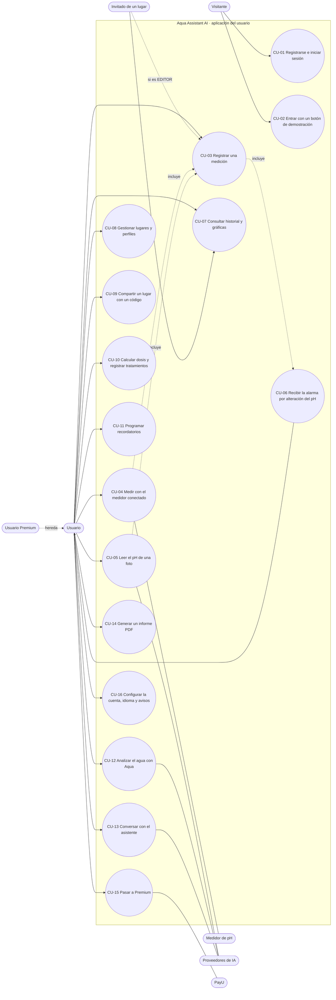
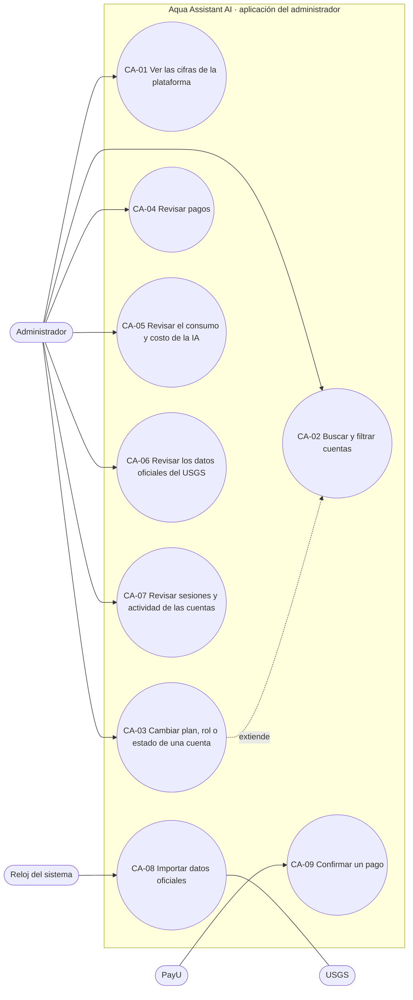

# 1. Actores y casos de uso

## Actores

| Actor | Tipo | Descripción |
|---|---|---|
| **Visitante** | Humano | Persona sin sesión: se registra, inicia sesión, recupera su contraseña o entra con un botón de demostración. |
| **Usuario (plan gratuito)** | Humano | Mide y cuida el agua de sus lugares. Tiene los límites del plan: 20 consultas de IA al día y análisis de los últimos 30 días. |
| **Usuario Premium** | Humano | Todo lo del usuario, con 200 consultas de IA al día y análisis de hasta 365 días. Hereda los casos de uso del usuario. |
| **Invitado de un lugar** | Humano | Usuario que se unió a un lugar ajeno con un código: «solo ver» (VIEWER) o «ver y medir» (EDITOR). |
| **Administrador** | Humano | Trabaja para la empresa dueña de la plataforma. Gestiona cuentas, planes, pagos, consumo de IA, datos oficiales y sesiones. **No mide el pH**: el backend rechaza sus mediciones (H-061). |
| **Medidor de pH** | Sistema | ESP32 con PH-4502C (firmware propio), Atlas EZO-pH o medidor de texto, por USB o Bluetooth (Web Serial). |
| **Proveedores de IA** | Sistema externo | Google Gemini (principal) y Groq (respaldo); sin ellos, Aqua responde con reglas. |
| **USGS** | Sistema externo | Servicio Geológico de EE. UU.: el backend importa cada 3 horas el pH real de sus estaciones. |
| **PayU** | Sistema externo | Pasarela de pago (modo de pruebas). Confirma los pagos por *webhook*. |
| **Servicio de correo** | Sistema externo | Envía recuperación de contraseña, alertas y recordatorios. |
| **Reloj del sistema** | Tiempo | Dispara la importación del USGS, los recordatorios, el vencimiento de Premium y la limpieza de sesiones. |

## Diagrama de casos de uso: usuario

## Diagrama de casos de uso: administrador

> El administrador no tiene «Medir», lugares, alertas de agua ni a Aqua. Si abre una pantalla de usuario, la app lo lleva a su Panel (`js/core/Roles.js`).

## Especificación de casos de uso principales

### CU-03 · Registrar una medición

| Campo | Contenido |
|---|---|
| Actor principal | Usuario (o invitado EDITOR) |
| Precondición | Sesión iniciada con una cuenta de usuario (no administrador). |
| Disparador | El usuario pulsa **Medir** y elige «Escribir el valor», el medidor o una foto. |
| Flujo básico | 1. Escribe el pH (0–14) y, si quiere, la temperatura y otros parámetros. 2. El backend valida la lectura con la cadena de validadores. 3. La clasifica con el perfil del lugar (óptimo, precaución, crítico). 4. La guarda y publica el evento. 5. Las reglas de anomalía crean alertas. 6. La app muestra el resultado. |
| Flujos alternativos | 2a. Validación rechazada (fuera de 0–14, fecha futura, temperatura imposible): 422 con el motivo. 4a. El lugar activo es «solo ver»: la medición se guarda en un lugar propio, que pasa a ser el activo (H-053). 1a. La cuenta es de administrador: 403 «no registra mediciones» (H-061). |
| Postcondición | La medición queda en el historial del lugar; las alertas y la alarma (CU-06) se generan si corresponde. |
| Requisitos | RF-05, RF-08, RF-09, RF-23, RF-30 |

### CU-05 · Leer el pH de una foto

| Campo | Contenido |
|---|---|
| Actor principal | Usuario |
| Actores secundarios | Proveedores de IA (visión) |
| Flujo básico | 1. Elige tira reactiva o pantalla del medidor. 2. Elige una foto de la galería o la toma con la cámara. 3. El navegador la convierte a JPEG. 4. El servicio de IA la sanea y la envía al modelo de visión; en pantallas lee **solo el número marcado «pH»** (H-054). 5. Valida la respuesta y, en tiras, pide una segunda opinión a otro modelo. 6. Muestra valor, margen y confianza. 7. El usuario confirma o corrige. 8. El servicio de IA envía la lectura al backend por la ruta interna, que sigue CU-03. |
| Flujos alternativos | 4a. La foto no permite leer: «no se pudo leer», sin inventar un valor. 4b. Sin cuota de IA: aviso con la cuota del día. |
| Requisitos | RF-15, RF-05 |

### CU-06 · Recibir la alarma por alteración del pH

| Campo | Contenido |
|---|---|
| Actor principal | Usuario (y los demás miembros del lugar) |
| Disparador | Una medición cambia 0,5 o más frente a cualquiera de la última hora, o entra en nivel crítico (también sin mediciones recientes, H-056). |
| Flujo básico | 1. `PhAlterationRule` crea la alerta `PH_ALTERATION` (crítica si es peligrosa). 2. `Notifier` envía el aviso urgente al celular (Web Push) y el correo. 3. La app, que consulta las alertas cada 15 s, suena la sirena, muestra la ventana y Aqua lo dice en voz alta. 4. «Aqua explica» amplía con IA las causas y qué hacer. 5. El usuario pulsa «Entendido». |
| Postcondición | La alerta queda leída; la misma alerta no se repite en 30 minutos. |
| Requisitos | RF-09, RF-25, RF-29, RF-30 |

### CU-15 · Pasar a Premium

| Campo | Contenido |
|---|---|
| Actor principal | Usuario con plan gratuito |
| Actor secundario | PayU |
| Flujo básico | 1. Pulsa «Pagar con PayU». 2. El backend crea el pago `PENDING` y firma el formulario. 3. El navegador va a la página segura de PayU. 4. PayU confirma por *webhook* y el usuario vuelve a la app. 5. El backend verifica el estado con la API de PayU y, si está aprobado, activa Premium por 30 días **una sola vez** (bloqueo pesimista, H-001). |
| Flujos alternativos | 4a. Rechazado o vencido: el pago queda `DECLINED`/`EXPIRED` y el plan no cambia. |
| Requisitos | RF-16 |

### CA-03 · Cambiar plan, rol o estado de una cuenta

| Campo | Contenido |
|---|---|
| Actor principal | Administrador |
| Precondición | Rol ADMIN. El administrador de demostración solo actúa sobre cuentas de demostración y de ejemplo; las cuentas reales se ven enmascaradas. |
| Flujo básico | 1. Busca la cuenta. 2. Abre su detalle. 3. Cambia el plan, el rol o el estado. 4. El backend aplica las reglas (no desactivarse a sí mismo, no quitar el último administrador, no tocar el administrador configurado). 5. Registra la acción en la auditoría y avisa por correo a la persona. |
| Requisitos | RF-21 |
