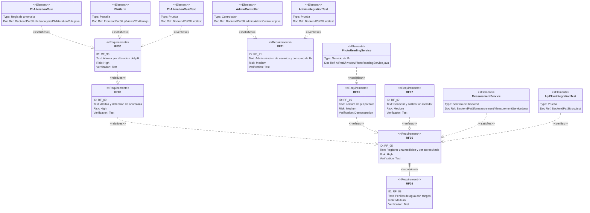
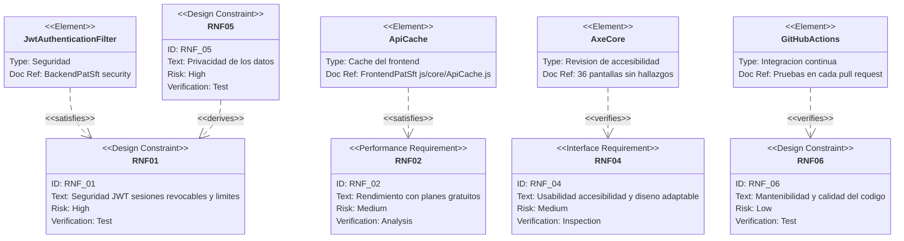

# 2. Requisitos

La especificación completa (historia de usuario, criterios de aceptación y MockUp) está en [`docs/Requerimientos.md`](../Requerimientos.md). Aquí se ven como modelo: qué requisito deriva o refina a otro y con qué elemento se satisface o verifica.

## Diagrama de requisitos funcionales (núcleo)

## Requisitos no funcionales

## Clasificación (MoSCoW)

| Prioridad | Requisitos |
|---|---|
| **Debe tener** | RF-01, RF-04, RF-05, RF-06, RF-08, RF-09, RF-30, RF-21, RNF-01, RNF-05 |
| **Debería tener** | RF-07, RF-11, RF-14, RF-15, RF-16, RF-20, RF-23, RF-24, RF-25, RNF-02, RNF-03, RNF-04 |
| **Podría tener** | RF-10, RF-12, RF-13, RF-22, RF-26, RF-27, RF-28, RF-29, RNF-06, RNF-07 |
| **No tendrá (por ahora)** | Avisos por WhatsApp (se construyó y se quitó a pedido del dueño, H-060) |
