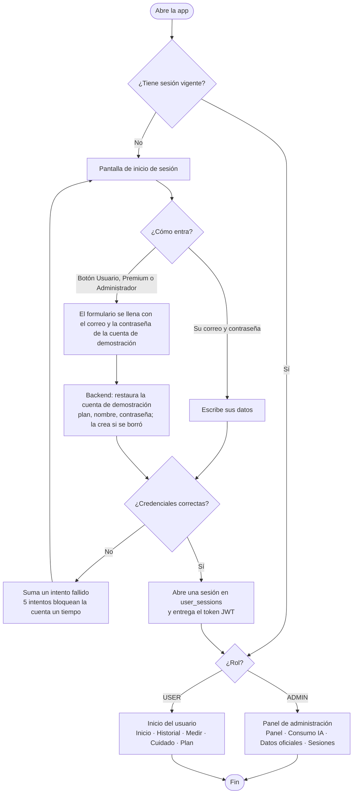
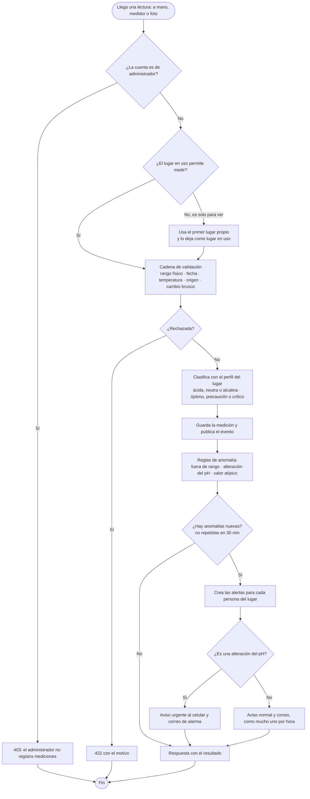
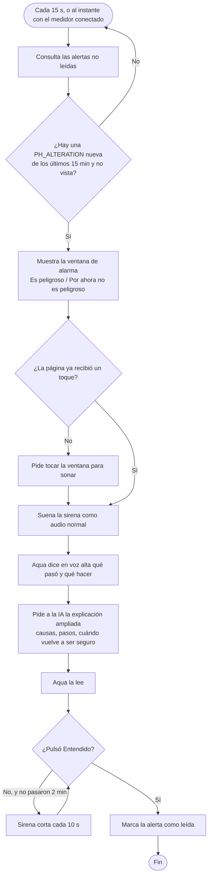
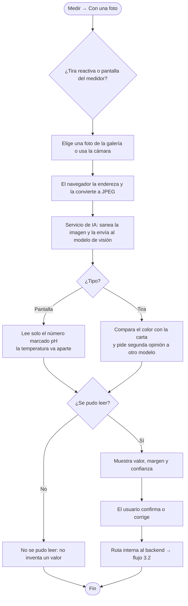
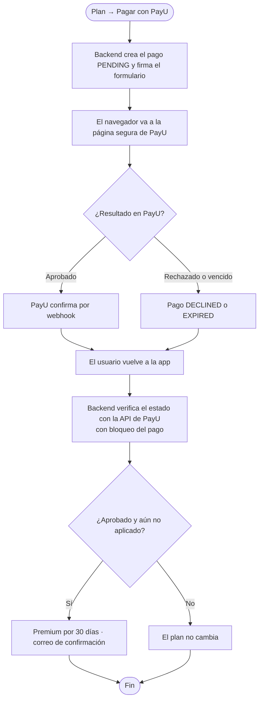
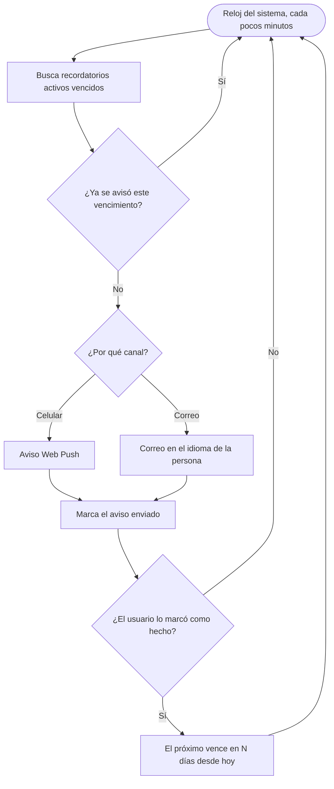

# 3. Diagramas de flujo (actividad)

## 3.1 Inicio de sesión y entrada según el rol

## 3.2 Registrar una medición (backend)

## 3.3 La alarma en la app

## 3.4 Lectura del pH por foto

## 3.5 Pago de Premium

## 3.6 Recordatorios

