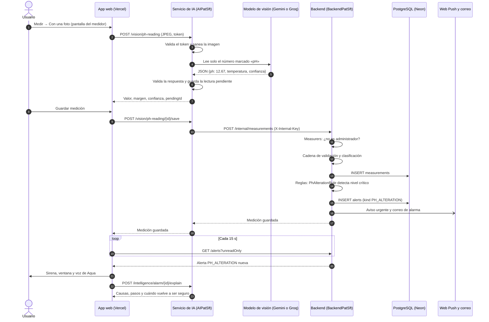
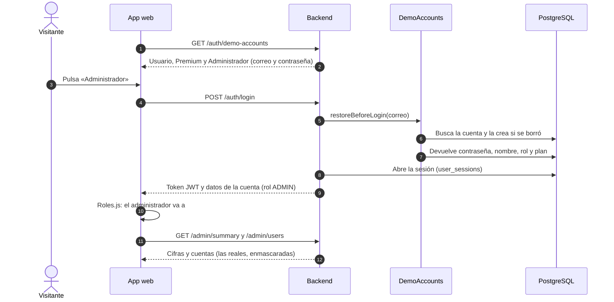
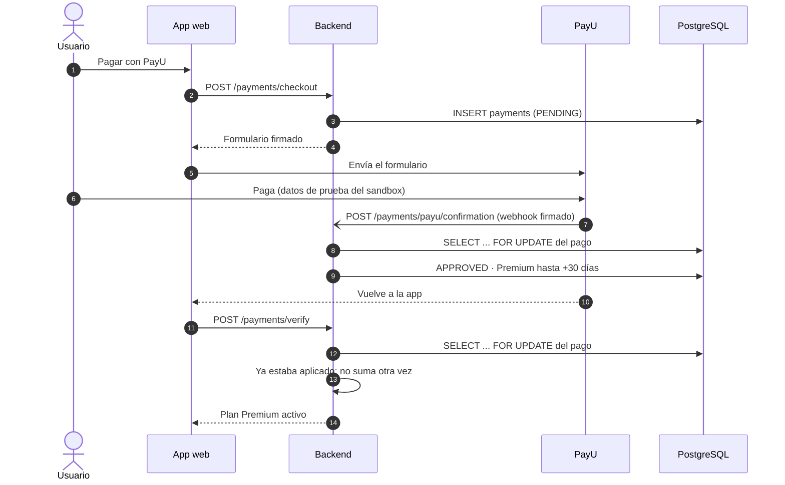
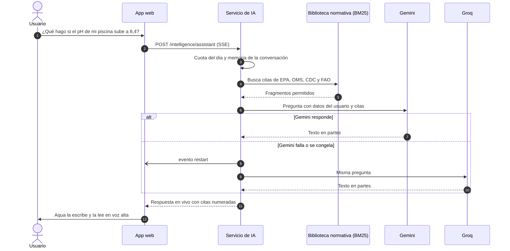

# 4. Diagramas de secuencia

## 4.1 Medición con foto y alarma (tres servicios)

## 4.2 Inicio de sesión con un botón de demostración

## 4.3 Pago de Premium con PayU

## 4.4 Pregunta al asistente con respuesta en vivo

