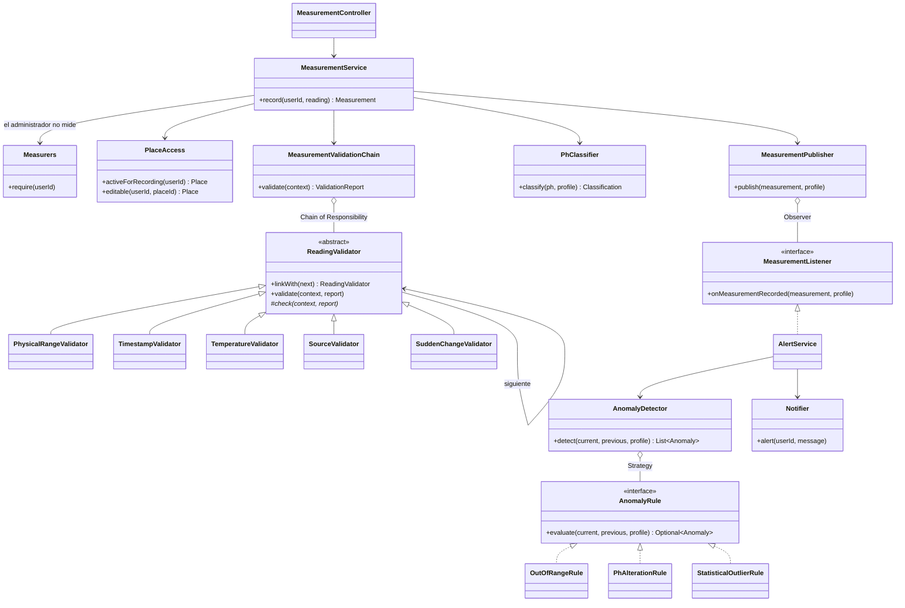
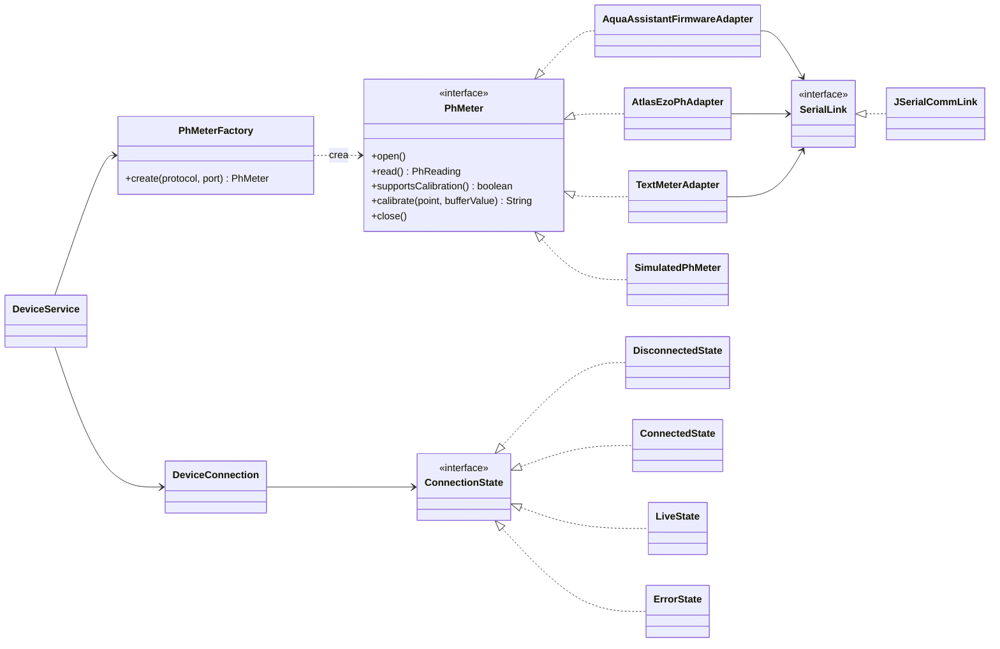
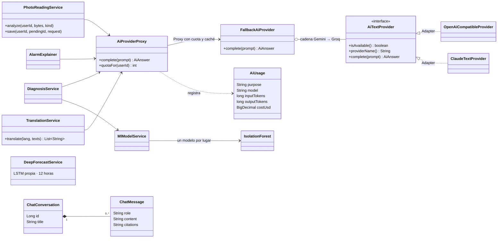

# 5. Diagrama de clases

## 5.1 Modelo de dominio (backend)

Entidades JPA del backend (`BackendPatSft/src/main/java/com/aquaassistant`). Las relaciones son por identificador (`userId`, `placeId`…), como en el código; aquí se muestran como asociaciones.

```mermaid
classDiagram
    direction LR
    class User {
        Long id
        String email
        String fullName
        Role role
        Plan plan
        Instant premiumUntil
        boolean enabled
        boolean demo
        int tokenVersion
        +changePlan(plan, until)
        +promoteToAdmin()
        +disable(reason, at)
    }
    class Role {
        <<enumeration>>
        USER
        ADMIN
    }
    class Plan {
        <<enumeration>>
        FREE
        PREMIUM
    }
    class UserSettings {
        Long userId
        Theme theme
        String language
        Long activePlaceId
        boolean notificationsEnabled
        boolean emailAlerts
        boolean voiceEnabled
    }
    class UserSession {
        Long id
        Instant startedAt
        Instant expiresAt
        Instant endedAt
        EndReason endReason
        boolean rememberMe
    }
    class Place {
        Long id
        String name
        PlaceKind kind
        Double volumeLiters
        String shareCode
        PlaceRole shareRole
    }
    class PlaceMember {
        Long id
        PlaceRole role
        Instant joinedAt
    }
    class PlaceRole {
        <<enumeration>>
        OWNER
        EDITOR
        VIEWER
    }
    class WaterProfile {
        Long id
        String name
        ProfileType type
        double idealMin
        double idealMax
        double cautionMin
        double cautionMax
        boolean systemProfile
        +copyFor(owner) WaterProfile
    }
    class Measurement {
        Long id
        double ph
        Double temperatureC
        Instant measuredAt
        MeasurementSource source
        PhNature nature
        PhStatus status
        ValidationStatus validationStatus
        Double freeChlorine
        Double totalAlkalinity
        Double calciumHardness
        Double cyanuricAcid
    }
    class MeasurementSource {
        <<enumeration>>
        REAL
        SIMULATED
        MANUAL
        PHOTO
        OFFICIAL
    }
    class PhStatus {
        <<enumeration>>
        OPTIMAL
        CAUTION
        CRITICAL
    }
    class Alert {
        Long id
        String kind
        String severity
        String title
        String message
        boolean read
    }
    class Device {
        Long id
        String name
        MeterProtocol protocol
        String port
    }
    class Calibration {
        Long id
        String point
        Double bufferValue
        Double reading
        boolean success
    }
    class Treatment {
        Long id
        TreatmentProduct product
        Double amount
        String unit
        Instant appliedAt
    }
    class Reminder {
        Long id
        ReminderKind kind
        int everyDays
        Instant nextDue
        boolean byEmail
        boolean byPush
        boolean active
    }
    class Payment {
        Long id
        String referenceCode
        BigDecimal amount
        String currency
        int periodDays
        PaymentStatus status
        boolean testMode
    }
    class PushSubscription {
        Long id
        String endpoint
        String deviceLabel
    }
    class AuditEntry {
        Long id
        String action
        String detail
        Instant createdAt
    }
    class ReferenceStation {
        String id
        String name
        String state
        BigDecimal lastPh
        boolean featured
    }
    class ReferenceReading {
        Long id
        Instant measuredAt
        BigDecimal ph
        String approvalStatus
    }

    User "1" --> "1" Role
    User "1" --> "1" Plan
    User "1" *-- "1" UserSettings
    User "1" *-- "0..*" UserSession
    User "1" --> "0..*" Place : es dueño
    User "1" --> "0..*" PlaceMember : se une
    Place "1" *-- "0..*" PlaceMember
    PlaceMember --> PlaceRole
    Place "0..*" --> "1" WaterProfile : usa
    User "1" --> "0..*" WaterProfile : crea perfiles propios
    Place "1" *-- "0..*" Measurement
    Measurement --> MeasurementSource
    Measurement --> PhStatus
    Measurement "0..*" --> "0..1" Device
    Measurement "1" --> "0..*" Alert : genera
    User "1" --> "0..*" Alert : recibe
    User "1" --> "0..*" Device
    User "1" --> "0..*" Calibration
    Place "1" *-- "0..*" Treatment
    Place "1" *-- "0..*" Reminder
    User "1" --> "0..*" Payment
    User "1" --> "0..*" PushSubscription
    User "1" --> "0..*" AuditEntry
    ReferenceStation "1" *-- "0..*" ReferenceReading
```

## 5.2 Medición, validación y alertas (patrones)

## 5.3 Medidores (Adapter, Factory Method y State)

## 5.4 Servicio de IA

Catálogo completo de patrones, con la prueba de cada uno: [`docs/DesignPatterns.md` de BackendPatSft](https://github.com/WillC372/BackendPatSft/blob/main/docs/DesignPatterns.md).
