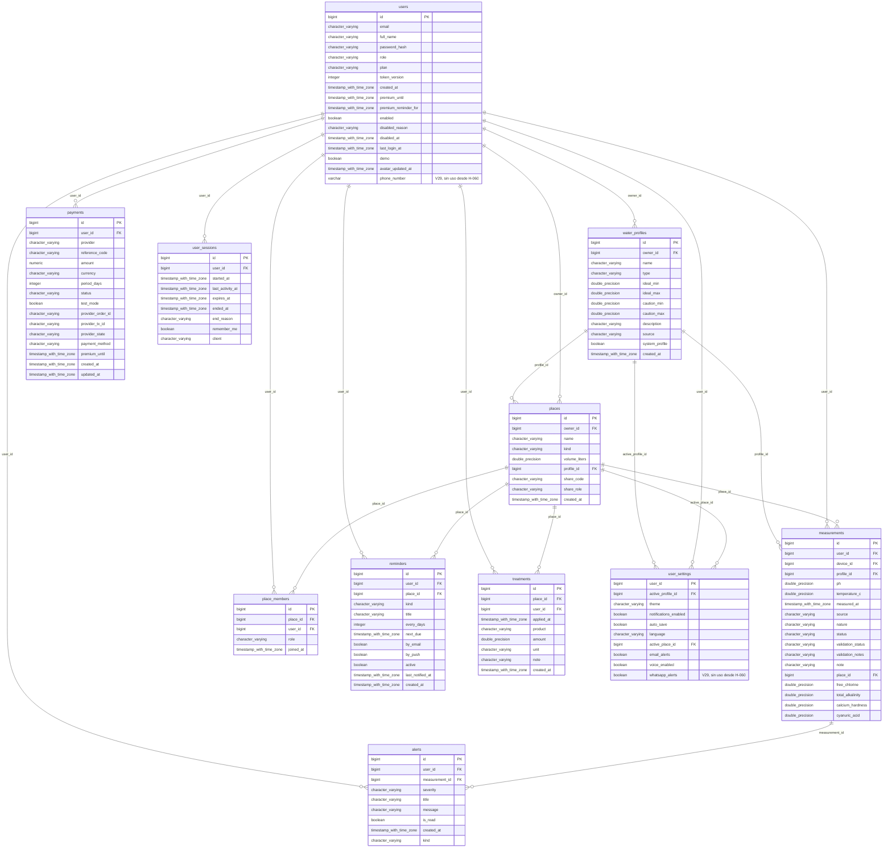

# 6. Modelo entidad-relación

La base de datos es una sola, compartida por el backend y el servicio de IA (PostgreSQL en Neon), y su esquema lo controla el repositorio [DBPatSft](https://github.com/WillC372/DBPatSft) con migraciones Flyway (V1 a V29).

El modelo completo, con las 27 tablas, quién escribe cada una y cómo se generó, está en [`docs/Esquema.md` de DBPatSft](https://github.com/WillC372/DBPatSft/blob/main/docs/Esquema.md). Se generó aplicando las migraciones a una base vacía y leyendo `information_schema`.

## 6.1 Núcleo del dominio

Las tablas de las mediciones, los lugares y las cuentas, con sus columnas.

## 6.2 Modelo completo

Todas las tablas. `phone_number` y `whatsapp_alerts` (V29) quedaron sin uso cuando se quitó WhatsApp (H-060); no se borran porque borrar columnas sería un cambio destructivo.

```mermaid
erDiagram
    users ||--o{ agent_reports : "user_id"
    users ||--o{ ai_diagnoses : "user_id"
    users ||--o{ ai_usage : "user_id"
    measurements ||--o{ alerts : "measurement_id"
    users ||--o{ alerts : "user_id"
    user_sessions ||--o{ audit_log : "session_id"
    users ||--o{ audit_log : "user_id"
    users ||--o{ calibrations : "user_id"
    users ||--o{ chat_conversations : "user_id"
    chat_conversations ||--o{ chat_messages : "conversation_id"
    users ||--o{ devices : "owner_id"
    devices ||--o{ measurements : "device_id"
    places ||--o{ measurements : "place_id"
    users ||--o{ measurements : "user_id"
    water_profiles ||--o{ measurements : "profile_id"
    users ||--o{ password_reset_tokens : "user_id"
    users ||--o{ payments : "user_id"
    places ||--o{ place_members : "place_id"
    users ||--o{ place_members : "user_id"
    users ||--o{ places : "owner_id"
    water_profiles ||--o{ places : "profile_id"
    users ||--o{ push_subscriptions : "user_id"
    reference_stations ||--o{ reference_readings : "station_id"
    places ||--o{ reminders : "place_id"
    users ||--o{ reminders : "user_id"
    places ||--o{ treatments : "place_id"
    users ||--o{ treatments : "user_id"
    users ||--o{ user_avatars : "user_id"
    users ||--o{ user_sessions : "user_id"
    places ||--o{ user_settings : "active_place_id"
    users ||--o{ user_settings : "user_id"
    water_profiles ||--o{ user_settings : "active_profile_id"
    users ||--o{ water_profiles : "owner_id"
    agent_reports {
        bigint id PK
        bigint user_id FK
        character_varying source
        character_varying provider
        character_varying model
        integer period_days
        character_varying title
        character_varying payload
        timestamp_with_time_zone created_at
    }
    ai_diagnoses {
        bigint id PK
        bigint user_id FK
        character_varying source
        character_varying provider
        character_varying model
        character_varying risk_level
        character_varying payload
        timestamp_with_time_zone created_at
    }
    ai_usage {
        bigint id PK
        bigint user_id FK
        character_varying purpose
        character_varying model
        bigint input_tokens
        bigint output_tokens
        boolean cached
        timestamp_with_time_zone created_at
        character_varying provider
        bigint latency_ms
        boolean success
        character_varying error
        numeric cost_usd
    }
    alerts {
        bigint id PK
        bigint user_id FK
        bigint measurement_id FK
        character_varying severity
        character_varying title
        character_varying message
        boolean is_read
        timestamp_with_time_zone created_at
        character_varying kind
    }
    app_keys {
        character_varying key_name PK
        character_varying key_value
        timestamp_with_time_zone created_at
    }
    audit_log {
        bigint id PK
        bigint user_id FK
        character_varying action
        character_varying detail
        timestamp_with_time_zone created_at
        bigint session_id FK
    }
    calibrations {
        bigint id PK
        bigint user_id FK
        character_varying device_name
        character_varying protocol
        character_varying point
        double_precision buffer_value
        double_precision reading
        character_varying response
        boolean success
        timestamp_with_time_zone created_at
    }
    chat_conversations {
        bigint id PK
        bigint user_id FK
        character_varying title
        timestamp_with_time_zone created_at
        timestamp_with_time_zone updated_at
    }
    chat_messages {
        bigint id PK
        bigint conversation_id FK
        character_varying role
        character_varying content
        character_varying model
        character_varying citations
        timestamp_with_time_zone created_at
    }
    devices {
        bigint id PK
        bigint owner_id FK
        character_varying name
        character_varying protocol
        character_varying port
        boolean simulated
        timestamp_with_time_zone last_connected_at
        timestamp_with_time_zone created_at
    }
    measurements {
        bigint id PK
        bigint user_id FK
        bigint device_id FK
        bigint profile_id FK
        double_precision ph
        double_precision temperature_c
        timestamp_with_time_zone measured_at
        character_varying source
        character_varying nature
        character_varying status
        character_varying validation_status
        character_varying validation_notes
        character_varying note
        bigint place_id FK
        double_precision free_chlorine
        double_precision total_alkalinity
        double_precision calcium_hardness
        double_precision cyanuric_acid
    }
    password_reset_tokens {
        bigint id PK
        bigint user_id FK
        character_varying token_hash
        timestamp_with_time_zone expires_at
        timestamp_with_time_zone used_at
        character_varying purpose
    }
    payments {
        bigint id PK
        bigint user_id FK
        character_varying provider
        character_varying reference_code
        numeric amount
        character_varying currency
        integer period_days
        character_varying status
        boolean test_mode
        character_varying provider_order_id
        character_varying provider_tx_id
        character_varying provider_state
        character_varying payment_method
        timestamp_with_time_zone premium_until
        timestamp_with_time_zone created_at
        timestamp_with_time_zone updated_at
    }
    place_members {
        bigint id PK
        bigint place_id FK
        bigint user_id FK
        character_varying role
        timestamp_with_time_zone joined_at
    }
    places {
        bigint id PK
        bigint owner_id FK
        character_varying name
        character_varying kind
        double_precision volume_liters
        bigint profile_id FK
        character_varying share_code
        character_varying share_role
        timestamp_with_time_zone created_at
    }
    push_subscriptions {
        bigint id PK
        bigint user_id FK
        character_varying endpoint
        character_varying p256dh
        character_varying auth
        character_varying device_label
        timestamp_with_time_zone created_at
        timestamp_with_time_zone last_sent_at
    }
    reference_imports {
        bigint id PK
        timestamp_with_time_zone started_at
        timestamp_with_time_zone finished_at
        integer stations
        integer readings
        boolean success
        character_varying message
    }
    reference_readings {
        bigint id PK
        character_varying station_id FK
        timestamp_with_time_zone measured_at
        numeric ph
        character_varying approval_status
    }
    reference_stations {
        character_varying id PK
        character_varying agency
        character_varying name
        character_varying state
        character_varying site_type
        double_precision latitude
        double_precision longitude
        numeric last_ph
        timestamp_with_time_zone last_time
        character_varying approval_status
        boolean featured
        timestamp_with_time_zone updated_at
    }
    reminders {
        bigint id PK
        bigint user_id FK
        bigint place_id FK
        character_varying kind
        character_varying title
        integer every_days
        timestamp_with_time_zone next_due
        boolean by_email
        boolean by_push
        boolean active
        timestamp_with_time_zone last_notified_at
        timestamp_with_time_zone created_at
    }
    treatments {
        bigint id PK
        bigint place_id FK
        bigint user_id FK
        timestamp_with_time_zone applied_at
        character_varying product
        double_precision amount
        character_varying unit
        character_varying note
        timestamp_with_time_zone created_at
    }
    ui_translations {
        character_varying id PK
        character_varying lang
        character_varying source_text
        character_varying target_text
        timestamp_with_time_zone created_at
    }
    user_avatars {
        bigint user_id PK
        binary_varying image
        timestamp_with_time_zone updated_at
    }
    user_sessions {
        bigint id PK
        bigint user_id FK
        timestamp_with_time_zone started_at
        timestamp_with_time_zone last_activity_at
        timestamp_with_time_zone expires_at
        timestamp_with_time_zone ended_at
        character_varying end_reason
        boolean remember_me
        character_varying client
    }
    user_settings {
        bigint user_id PK
        bigint active_profile_id FK
        character_varying theme
        boolean notifications_enabled
        boolean auto_save
        character_varying language
        bigint active_place_id FK
        boolean email_alerts
        boolean voice_enabled
        boolean whatsapp_alerts "V29, sin uso desde H-060"
    }
    users {
        bigint id PK
        character_varying email
        character_varying full_name
        character_varying password_hash
        character_varying role
        character_varying plan
        integer token_version
        timestamp_with_time_zone created_at
        timestamp_with_time_zone premium_until
        timestamp_with_time_zone premium_reminder_for
        boolean enabled
        character_varying disabled_reason
        timestamp_with_time_zone disabled_at
        timestamp_with_time_zone last_login_at
        boolean demo
        timestamp_with_time_zone avatar_updated_at
        varchar phone_number "V29, sin uso desde H-060"
    }
    water_profiles {
        bigint id PK
        bigint owner_id FK
        character_varying name
        character_varying type
        double_precision ideal_min
        double_precision ideal_max
        double_precision caution_min
        double_precision caution_max
        character_varying description
        character_varying source
        boolean system_profile
        timestamp_with_time_zone created_at
    }
```

## 6.3 Reglas de integridad principales

| Regla | Dónde |
|---|---|
| El pH está entre 0 y 14 | `CHECK` en `measurements.ph` y validador `PhysicalRangeValidator` |
| El origen de una medición es REAL, SIMULATED, MANUAL, PHOTO u OFFICIAL | `CHECK` en `measurements.source` (V27) |
| Un lugar tiene un solo dueño y cada persona se une una vez | `places.owner_id` y la clave única `(place_id, user_id)` de `place_members` |
| Una traducción por texto e idioma | Clave primaria de `ui_translations` |
| Borrar una cuenta borra sus datos | `ON DELETE CASCADE` desde `users`; los lugares ajenos que usaban sus perfiles pasan al perfil general (H-002) |
