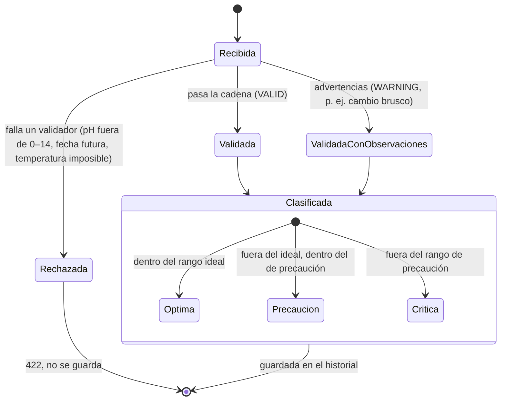
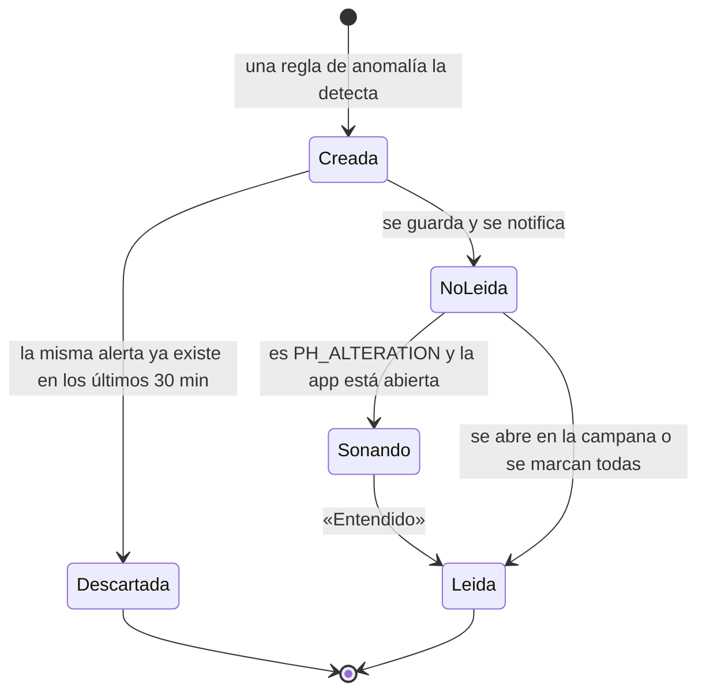
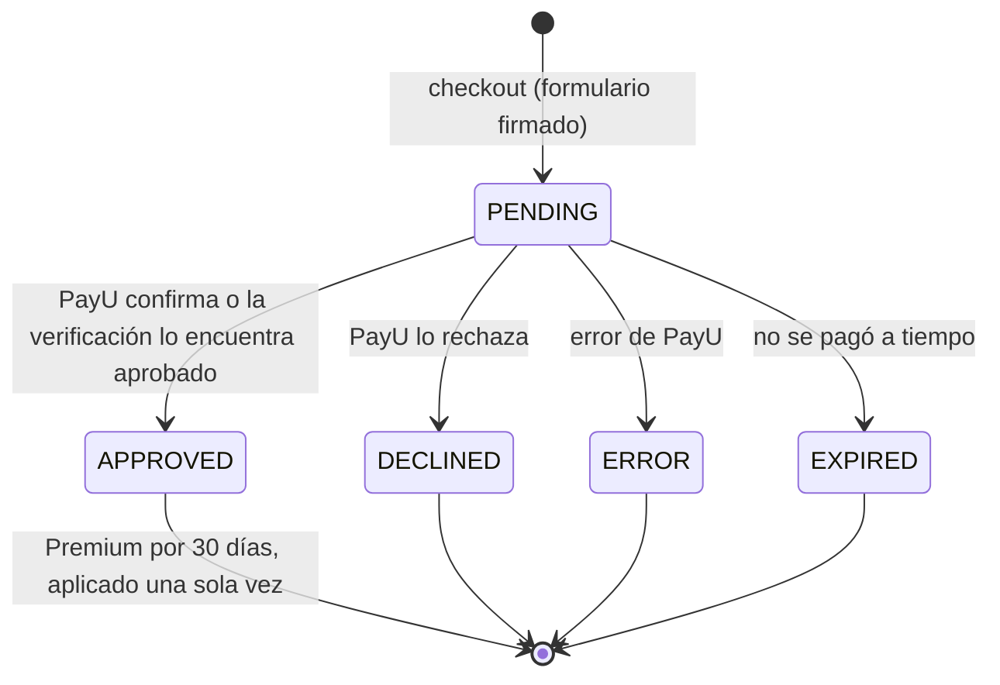
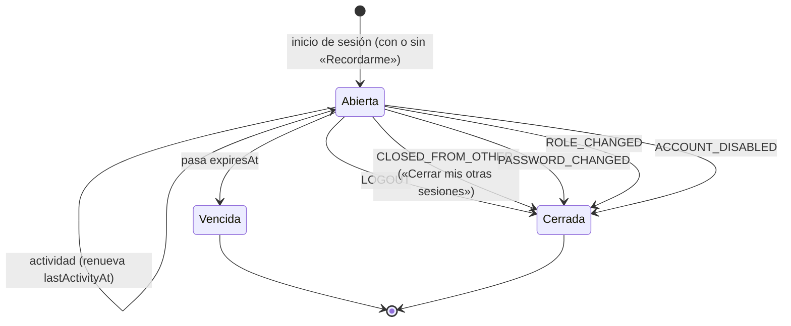
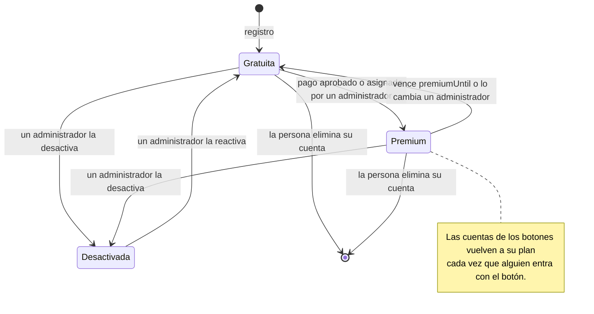
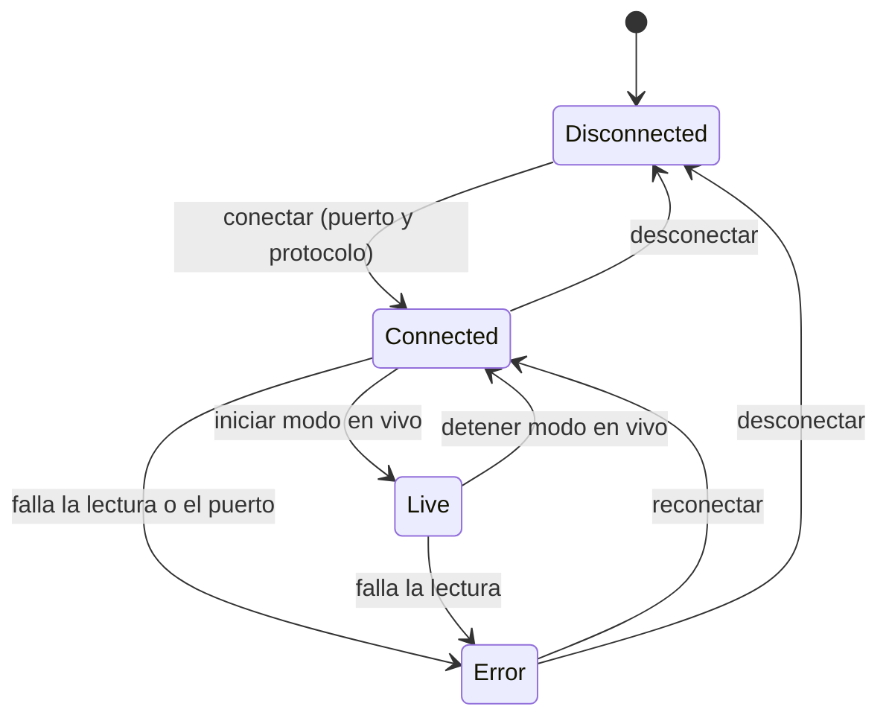

# 7. Diagramas de estados

## 7.1 Medición

Una lectura pasa por la validación y luego queda clasificada según el perfil del lugar. La clasificación no cambia después de guardarse.

## 7.2 Alerta

## 7.3 Pago

## 7.4 Sesión

## 7.5 Cuenta y plan

## 7.6 Medidor conectado al servidor (patrón State)

