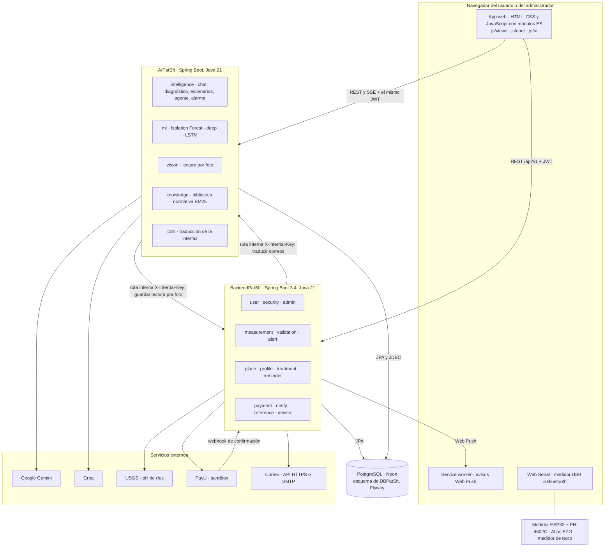
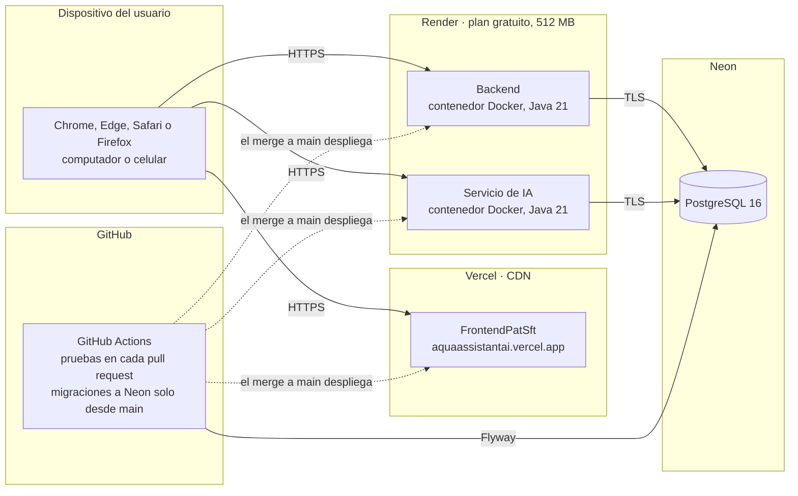

# 8. Arquitectura: componentes y despliegue

## 8.1 Componentes

## 8.2 Despliegue

| Componente | Repositorio | Dónde corre | Cómo se publica |
|---|---|---|---|
| App web | FrontendPatSft | Vercel | Merge a `main` (cada rama tiene vista previa) |
| Backend | BackendPatSft | Render (Docker) | Merge a `main` |
| Servicio de IA | AIPatSft | Render (Docker) | Merge a `main` |
| Esquema | DBPatSft | Neon | GitHub Actions aplica las migraciones desde `main` |
| Medidor casero | FrontendPatSft (`hardware/`) | ESP32 | Firmware Arduino, probado en GitHub Actions |

## 8.3 Decisiones de arquitectura

| Decisión | Motivo | Consecuencia |
|---|---|---|
| Separar la IA en su propio servicio | El backend gratuito de 512 MB no aguantaba los modelos y la IA | Dos servicios que comparten base de datos, JWT y rutas internas |
| Una sola base de datos compartida | Evitar duplicar cuentas, lugares y mediciones | Las migraciones viven en un repositorio aparte y cada servicio usa una copia en sus pruebas |
| Frontend sin frameworks ni compilación | Publicar en Vercel sin pasos de construcción | Módulos ES, pruebas con `node:test` |
| La IA nunca contradice al sistema | El veredicto lo calculan reglas comprobables | La IA explica y recomienda; el estado del agua lo decide el backend |
| El administrador ve otra aplicación | Trabaja para la empresa, no mide agua (H-061) | `Roles.js` en el frontend y `Measurers` en el backend |
