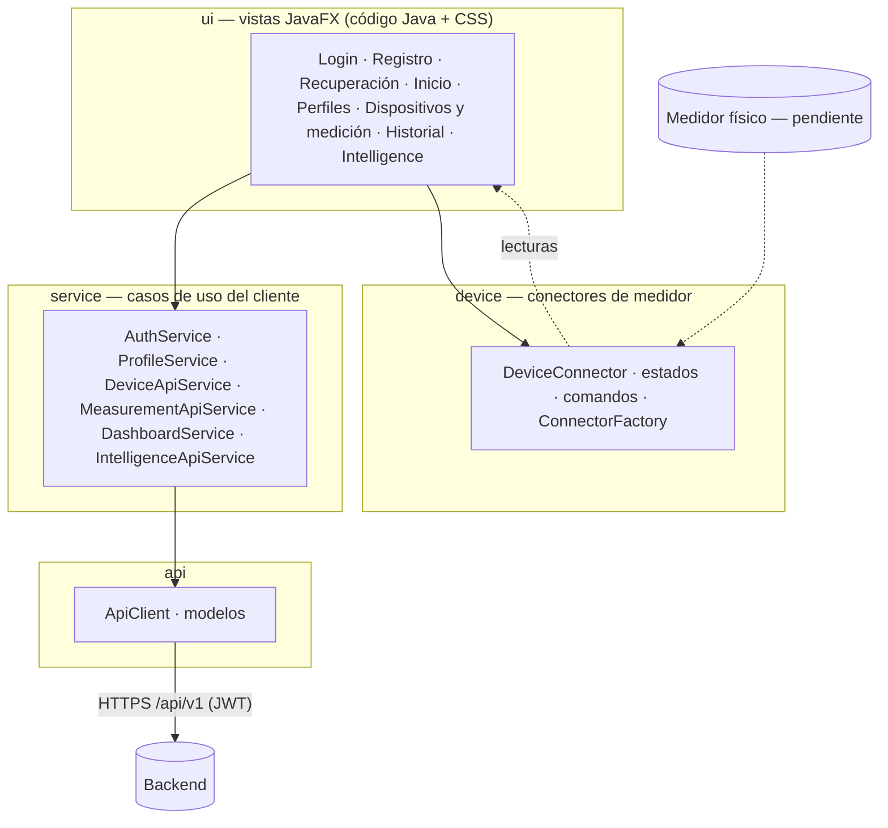

# Arquitectura del cliente

## Capas y responsabilidades

| Capa | Responsabilidad | Reglas |
|---|---|---|
| `ui` | Pantallas, navegación, tema | No llama a HTTP directamente: usa `service`. La E/S va en hilos de fondo (`Async`) y la actualización de pantalla vuelve al hilo de JavaFX. |
| `service` | Un servicio por área funcional | Traduce a las llamadas REST. |
| `api` | `ApiClient` (HTTP/JSON, renovación de token, errores) y modelos del contrato | Convierte errores del servidor en `ApiException` con mensajes en español. |
| `device` | Abstracción de medidores | Independiente de la interfaz y de la red. |
| `session` | Estado de la sesión y token recordado | El token recordado se guarda con permisos de solo el propietario. |

`AppContext` es la raíz de composición: crea los objetos y los entrega. No es un Singleton estático.

## Decisión: por qué la capa de dispositivos está en el cliente

El medidor (Bluetooth o USB) está junto al usuario. El cliente lo lee, y envía la lectura al servidor, que la valida, la clasifica y decide si es real o simulada según el dispositivo registrado. El cliente no puede declarar una medición como real.

## Regla de las gráficas

Tras medir, la pantalla muestra valor, clasificación, estado del dispositivo y explicación, con las opciones **Guardar** y **Descartar**; **no** dibuja gráficas. Las gráficas solo se generan cuando el usuario pulsa "Ver gráfica de evolución" en el Historial, y exigen al menos 3 mediciones (`HistoryView.MIN_POINTS_FOR_CHART`, probado).

## Diseño visual

Azules, turquesa y cian sobre blanco; indicador circular de pH dibujado en un `Canvas`; tema claro por defecto y oscuro, definidos en `light.css` y `dark.css` mediante variables CSS. No se usa FXML ni JavaScript. Los textos están en español dentro del código (la internacionalización queda pendiente).
