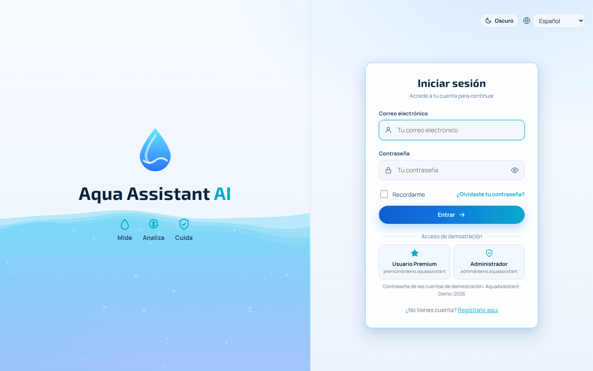
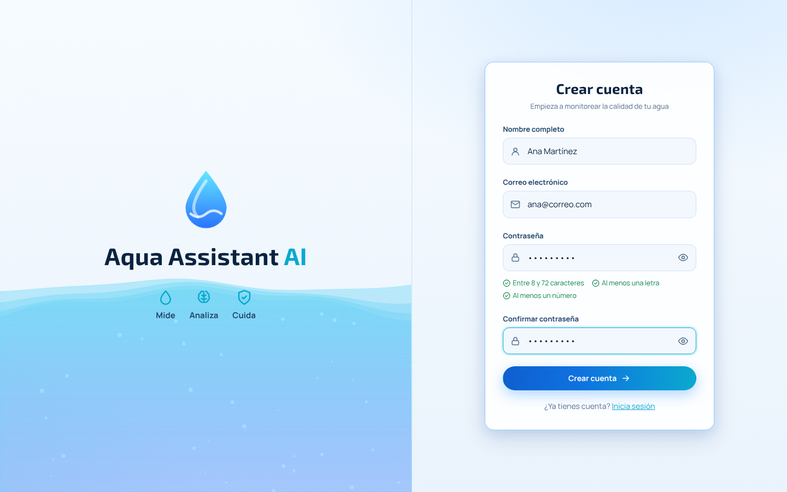

# RF-01 · Registro, inicio y cierre de sesión
<!-- etiquetas: requerimiento funcional, historia de usuario, estado: hecho -->

## Historia de usuario

**Como** visitante, **quiero** crear una cuenta e iniciar sesión con mi correo y contraseña, con la opción «Recordarme», **para** guardar mis mediciones y verlas desde cualquier equipo.

## Descripción

Pantallas de registro e inicio de sesión. La contraseña se valida (mínimo 8 caracteres, letras y números) y se puede mostrar u ocultar. «Recordarme» mantiene la sesión al cerrar el navegador. Cerrar sesión termina solo la sesión actual.

## Criterios de aceptación

- [x] Con datos válidos se crea la cuenta y se entra al Inicio.
- [x] Un correo ya registrado o una contraseña débil muestran el error junto al campo.
- [x] Con «Recordarme» la sesión sigue al reabrir el navegador; sin él, termina al cerrarlo.
- [x] «Cerrar sesión» invalida el token de esa sesión y vuelve a la pantalla de inicio de sesión.

## MockUp

**MockUp1** · Inicio de sesión

**MockUp2** · Crear cuenta

---
**Requerimiento:** RF-01 · **Tipo:** Funcional · **Estado:** Hecho · Detalle en [docs/Requerimientos.md](https://github.com/WillC372/FrontendPatSft/blob/main/docs/Requerimientos.md#rf-01)
