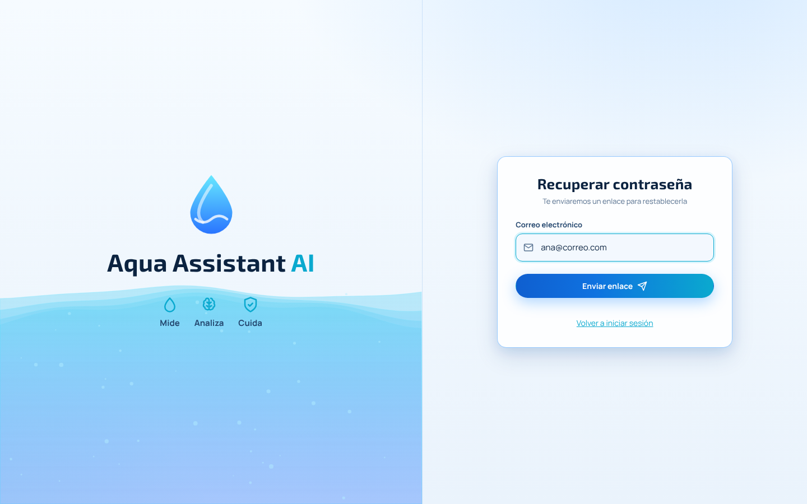

# RF-02 · Recuperación de contraseña por correo
<!-- etiquetas: requerimiento funcional, historia de usuario, estado: hecho -->

## Historia de usuario

**Como** usuario que olvidó su contraseña, **quiero** recibir un enlace por correo para crear una nueva, **para** recuperar el acceso sin perder mis datos.

## Descripción

Se pide el correo; si existe, se envía un enlace de un solo uso que vence en 30 minutos. La respuesta es la misma exista o no la cuenta, para no revelar qué correos están registrados.

## Criterios de aceptación

- [x] El mensaje en pantalla es el mismo para correos registrados y no registrados.
- [x] El enlace sirve una sola vez y vence a los 30 minutos.
- [x] Al cambiar la contraseña se cierran las sesiones abiertas de la cuenta.

## MockUp

**MockUp3** · Recuperar contraseña

---
**Requerimiento:** RF-02 · **Tipo:** Funcional · **Estado:** Hecho · Detalle en [docs/Requerimientos.md](https://github.com/WillC372/FrontendPatSft/blob/main/docs/Requerimientos.md#rf-02)
