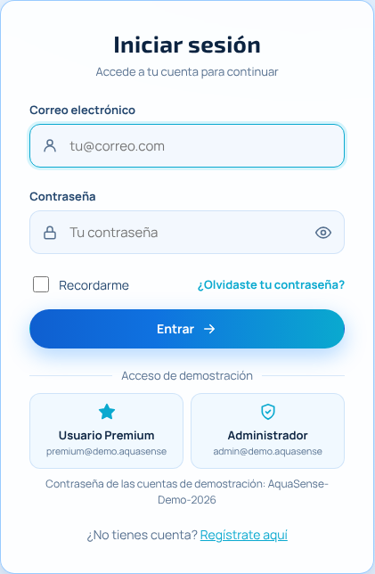

# RF-03 · Acceso de demostración por rol
<!-- etiquetas: requerimiento funcional, historia de usuario, estado: hecho -->

## Historia de usuario

**Como** profesor o evaluador, **quiero** entrar con un botón como Usuario, Premium o Administrador, **para** revisar toda la aplicación sin crear una cuenta.

## Descripción

El inicio de sesión muestra tres botones con su correo y la contraseña visible: Usuario (plan gratuito, con sus límites), Premium y Administrador. Son cuentas reales que pueden hacer todo lo de su rol (pagar en el sandbox, cambiar nombre, foto y contraseña, compartir lugares, eliminar la cuenta). Cada inicio de sesión con el botón deja la cuenta como se ofrece, así el botón siempre funciona. El administrador de demostración gestiona las cuentas de demostración y las de ejemplo; las de personas reales se ven enmascaradas.

## Criterios de aceptación

- [x] Cada botón inicia sesión con su cuenta en un clic.
- [x] Usuario tiene los límites del plan gratuito; Premium y Administrador, los de su plan y rol.
- [x] La cuenta de demostración puede cambiar su nombre, foto y contraseña, pagar y eliminarse, y el botón sigue funcionando.
- [x] El administrador de demostración cambia plan, rol y estado de las cuentas de demostración y de ejemplo; las cuentas reales siguen privadas.

## MockUp

**MockUp4** · Botones de acceso de demostración

---
**Requerimiento:** RF-03 · **Tipo:** Funcional · **Estado:** Hecho · Detalle en [docs/Requerimientos.md](https://github.com/WillC372/FrontendPatSft/blob/main/docs/Requerimientos.md#rf-03)
