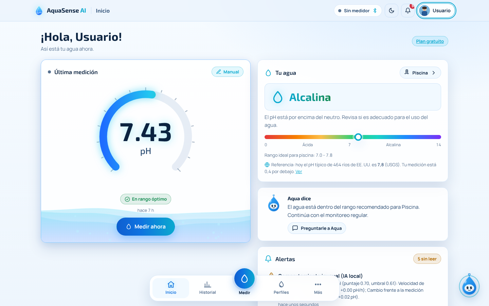

# RF-04 · Inicio (panel principal)
<!-- etiquetas: requerimiento funcional, historia de usuario, estado: hecho -->

## Historia de usuario

**Como** usuario, **quiero** ver en una pantalla el último pH, su estado, mi perfil activo y las alertas, **para** saber de un vistazo si mi agua está bien.

## Descripción

Indicador de pH con color por estado, perfil de agua activo, último diagnóstico de IA, alertas recientes, accesos a medir (medidor, foto o registro manual) y la referencia oficial del USGS.

## Criterios de aceptación

- [x] El indicador muestra la última medición y su estado según el perfil activo.
- [x] Si no hay mediciones, se muestra cómo registrar la primera.
- [x] Desde el Inicio se puede medir con el medidor, por foto o con registro manual.

## MockUp

**MockUp5** · Inicio (panel principal)

---
**Requerimiento:** RF-04 · **Tipo:** Funcional · **Estado:** Hecho · Detalle en [docs/Requerimientos.md](https://github.com/WillC372/FrontendPatSft/blob/main/docs/Requerimientos.md#rf-04)
