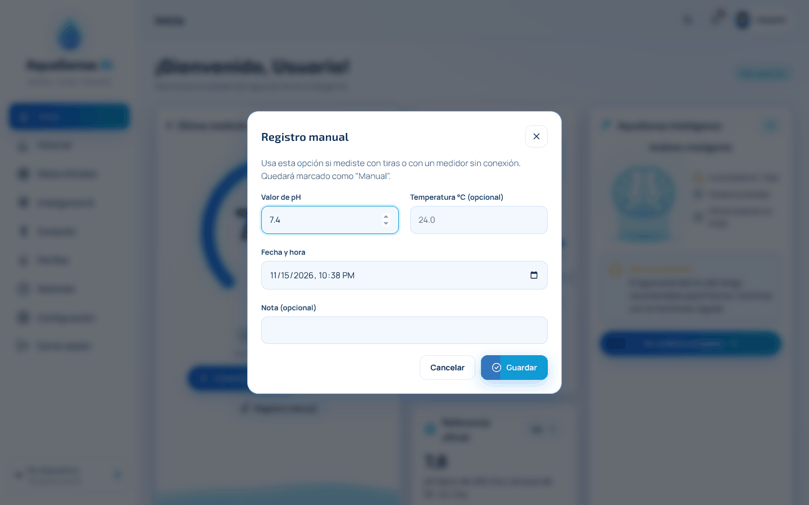

# RF-05 · Registrar una medición y ver su resultado
<!-- etiquetas: requerimiento funcional, historia de usuario, estado: hecho -->

## Historia de usuario

**Como** usuario, **quiero** registrar un valor de pH (y opcionalmente la temperatura), **para** saber si está en rango y guardarlo en mi historial.

## Descripción

El registro manual pide pH, fecha y hora y temperatura opcional, y se guarda con origen «manual». Al medir con el medidor, el resultado muestra la clasificación según el perfil, una explicación y la validación del valor, y el usuario decide guardarlo o descartarlo.

## Criterios de aceptación

- [x] Valores fuera de 0–14 o fechas futuras se rechazan con un mensaje claro.
- [x] El resultado indica el estado (óptimo, precaución o crítico) y por qué.
- [x] Lo guardado aparece en el historial con su origen (manual, medidor o foto).

## MockUp

**MockUp6** · Registro manual de una medición

---
**Requerimiento:** RF-05 · **Tipo:** Funcional · **Estado:** Hecho · Detalle en [docs/Requerimientos.md](https://github.com/WillC372/FrontendPatSft/blob/main/docs/Requerimientos.md#rf-05)
