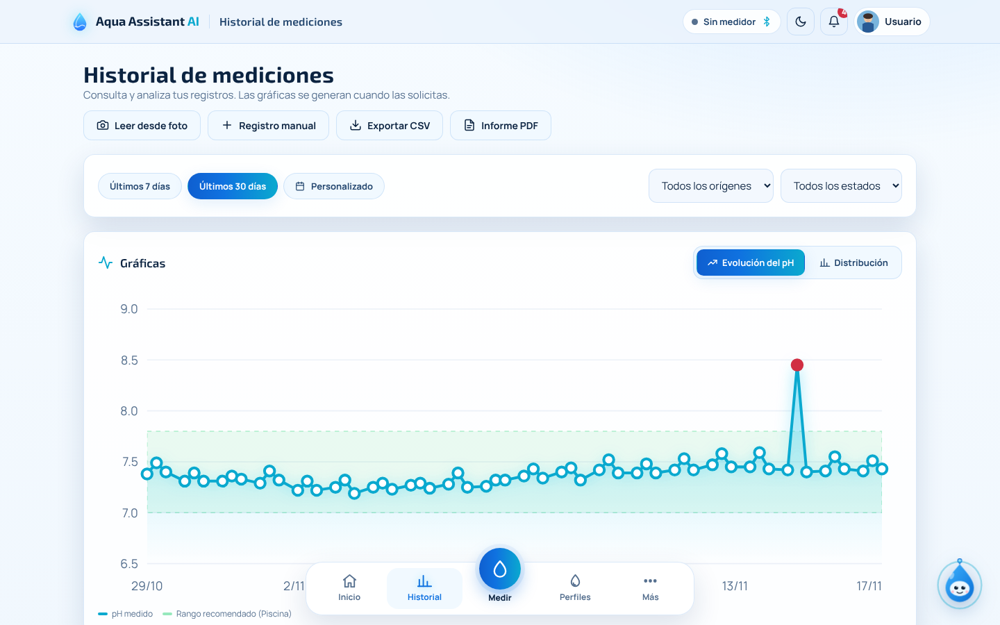

# RF-06 · Historial, gráficas y exportación
<!-- etiquetas: requerimiento funcional, historia de usuario, estado: hecho -->

## Historia de usuario

**Como** usuario, **quiero** filtrar mis mediciones por periodo, origen y estado, verlas en gráfica y exportarlas, **para** analizar cómo cambia mi agua con el tiempo.

## Descripción

Tabla paginada con filtros (últimos 7 o 30 días o un rango personalizado, origen y estado), gráficas de línea a petición, detalle de cada medición y exportación a CSV de lo que muestra la tabla. Recuerda el periodo y los filtros al volver.

## Criterios de aceptación

- [x] Los filtros cambian la tabla, la gráfica y el CSV de la misma forma.
- [x] Con pocos datos, la gráfica avisa que no son suficientes.
- [x] El CSV descargado contiene exactamente las filas filtradas.

## MockUp

**MockUp7** · Historial con gráfica (30 días)

---
**Requerimiento:** RF-06 · **Tipo:** Funcional · **Estado:** Hecho · Detalle en [docs/Requerimientos.md](https://github.com/WillC372/FrontendPatSft/blob/main/docs/Requerimientos.md#rf-06)
