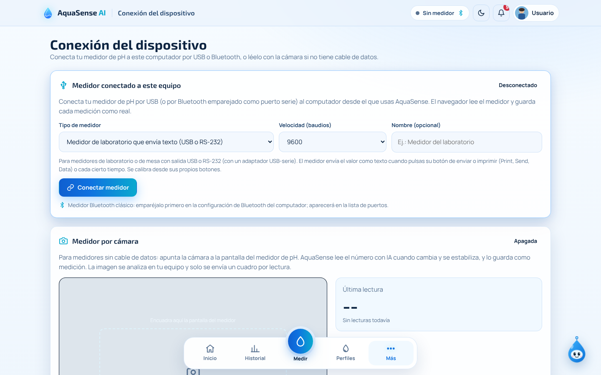

# RF-07 · Conectar y calibrar un medidor de pH
<!-- etiquetas: requerimiento funcional, historia de usuario, estado: parcial -->

## Historia de usuario

**Como** usuario con un medidor, **quiero** conectarlo al computador por USB o Bluetooth y calibrarlo desde la app, **para** que las mediciones lleguen solas y sean exactas.

## Descripción

Desde Chrome o Edge (Web Serial) la app abre el puerto del medidor y admite tres protocolos: firmware AquaSense (ESP32), Atlas Scientific EZO-pH y medidores de laboratorio que envían texto. La calibración usa el valor de cada solución buffer (por ejemplo 6.86 y 4.00). Para medidores sin cable, la lectura por cámara.

## Criterios de aceptación

- [x] La app detecta si el navegador no admite puertos serie y lo explica.
- [x] Con el medidor conectado, «Medir ahora» guarda la lectura con origen REAL.
- [x] La calibración envía el punto y el valor del buffer y muestra la respuesta del medidor.
- [ ] Pendiente: probarlo con un medidor físico (hasta ahora con puerto simulado).

## MockUp

**MockUp8** · Conexión del medidor

---
**Requerimiento:** RF-07 · **Tipo:** Funcional · **Estado:** Parcial · Detalle en [docs/Requerimientos.md](https://github.com/WillC372/FrontendPatSft/blob/main/docs/Requerimientos.md#rf-07)
