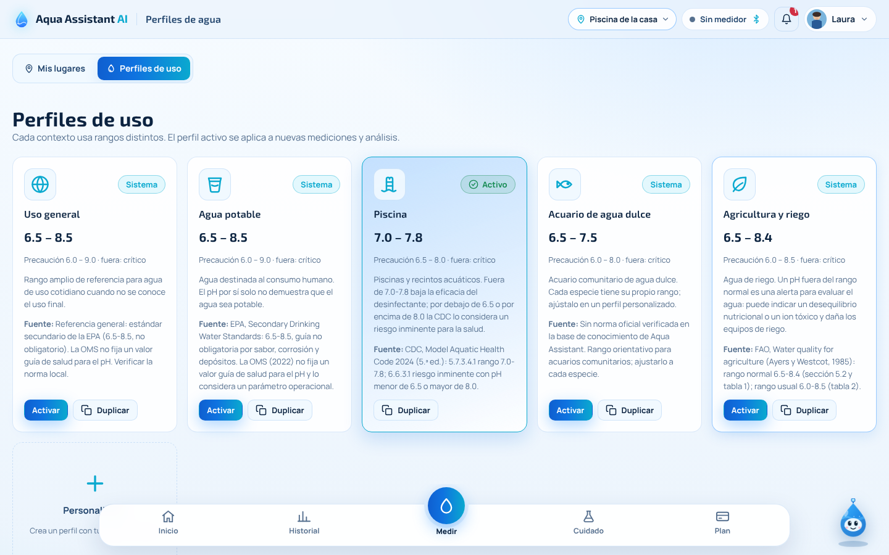

# RF-08 · Perfiles de agua con rangos
<!-- etiquetas: requerimiento funcional, historia de usuario, estado: hecho -->

## Historia de usuario

**Como** usuario, **quiero** elegir el tipo de agua (piscina, acuario, potable, hidroponía…) o crear un perfil propio, **para** que el estado de cada medición use los rangos correctos.

## Descripción

Perfiles predefinidos con su fuente y rangos ideal y crítico; perfiles personalizados (crear, duplicar, editar) con validación de los rangos. Aviso de que el pH por sí solo no demuestra potabilidad.

## Criterios de aceptación

- [x] Solo hay un perfil activo y el Inicio lo muestra.
- [x] El formulario rechaza rangos incoherentes (mínimo mayor que máximo, fuera de 0–14).
- [x] Los perfiles predefinidos muestran la fuente de sus rangos.

## MockUp

**MockUp9** · Perfiles de agua

---
**Requerimiento:** RF-08 · **Tipo:** Funcional · **Estado:** Hecho · Detalle en [docs/Requerimientos.md](https://github.com/WillC372/FrontendPatSft/blob/main/docs/Requerimientos.md#rf-08)
