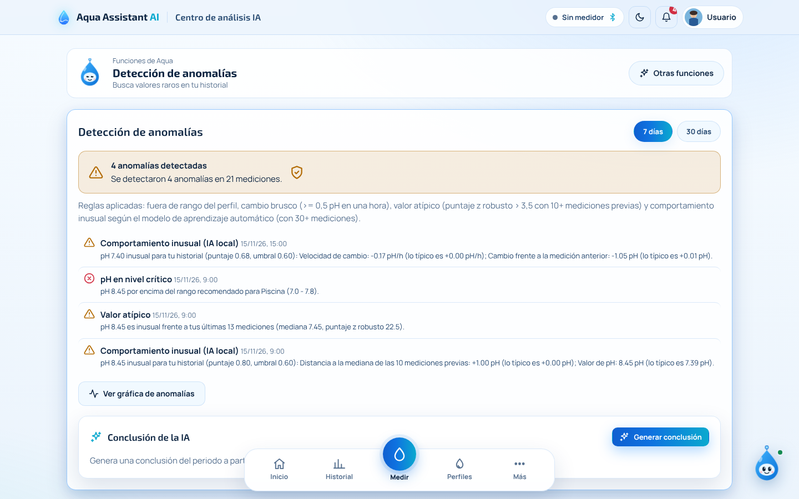
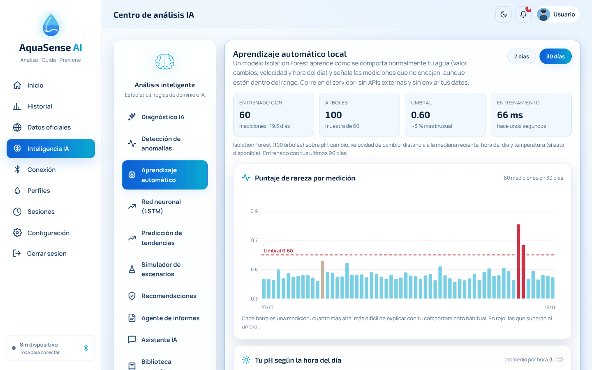

# RF-09 · Alertas y detección de anomalías
<!-- etiquetas: requerimiento funcional, historia de usuario, estado: hecho -->

## Historia de usuario

**Como** usuario, **quiero** recibir alertas cuando una medición se sale de rango o es inusual, **para** actuar antes de que el problema crezca.

## Descripción

Tres reglas (fuera de rango, cambio brusco, valor atípico estadístico) y un modelo de aprendizaje automático (Isolation Forest por usuario) explicado por variable.

## Criterios de aceptación

- [x] Una medición fuera del rango crítico genera una alerta visible en el Inicio.
- [x] Cada anomalía indica qué regla o variable la produjo.
- [x] El modelo se reentrena cuando llegan mediciones nuevas.

## MockUp

**MockUp10** · Detección de anomalías

**MockUp11** · Aprendizaje automático (Isolation Forest)

---
**Requerimiento:** RF-09 · **Tipo:** Funcional · **Estado:** Hecho · Detalle en [docs/Requerimientos.md](https://github.com/WillC372/FrontendPatSft/blob/main/docs/Requerimientos.md#rf-09)
