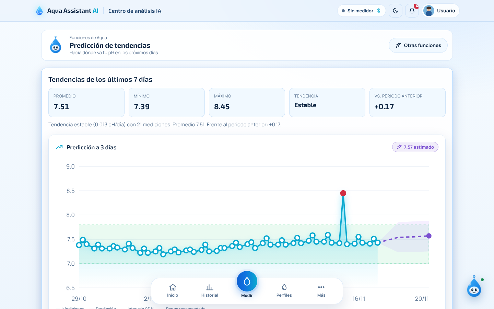
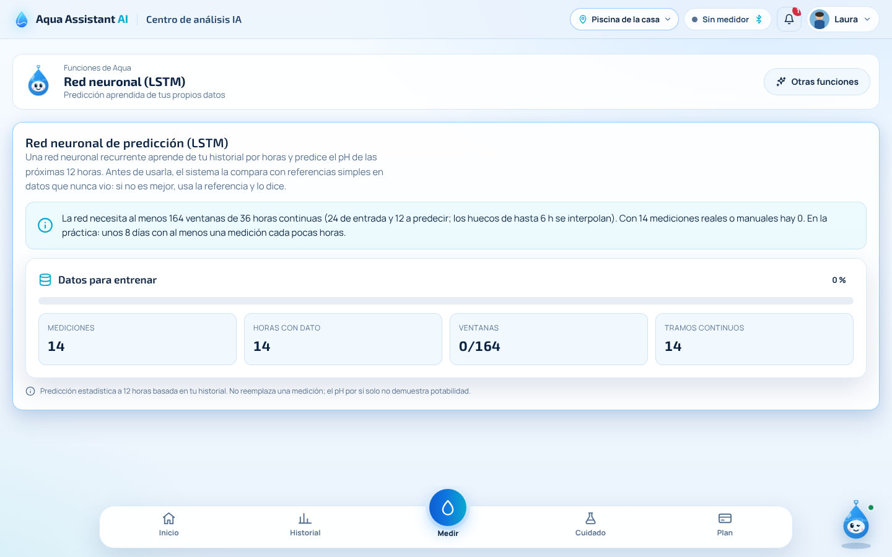

# RF-10 · Tendencias y predicción del pH
<!-- etiquetas: requerimiento funcional, historia de usuario, estado: hecho -->

## Historia de usuario

**Como** usuario, **quiero** ver hacia dónde va el pH en las próximas horas o días, **para** anticipar correcciones.

## Descripción

Regresión con intervalo de confianza del 95 % y red neuronal LSTM a 12 horas, que se compara con métodos simples y solo se usa si los supera. Con pocos datos, la app lo dice en lugar de inventar una predicción. Para ver la red funcionando sin esperar unos 8 días de mediciones propias, se puede entrenar con la serie real de un río del USGS (cada 15 minutos, hasta 30 días, que el servidor ya importa); la pantalla avisa que son datos oficiales y no las mediciones de la persona.

## Criterios de aceptación

- [x] La predicción muestra el intervalo de incertidumbre.
- [x] Sin datos suficientes (unos 8 días de mediciones frecuentes para la LSTM) se muestra el aviso.
- [x] El horizonte depende del plan (Gratuito o Premium).
- [x] La LSTM se entrena y se evalúa con datos reales de un río del USGS, marcados como datos oficiales y no como mediciones propias.

## MockUp

**MockUp12** · Predicción de tendencias

**MockUp13** · Red neuronal LSTM (sin datos suficientes)

---
**Requerimiento:** RF-10 · **Tipo:** Funcional · **Estado:** Hecho · Detalle en [docs/Requerimientos.md](https://github.com/WillC372/FrontendPatSft/blob/main/docs/Requerimientos.md#rf-10)
