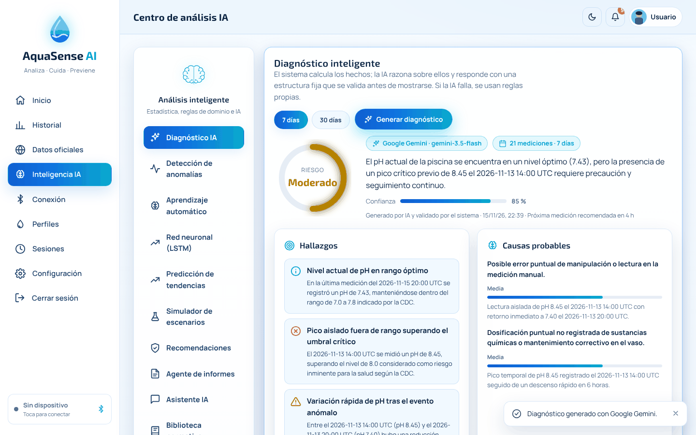
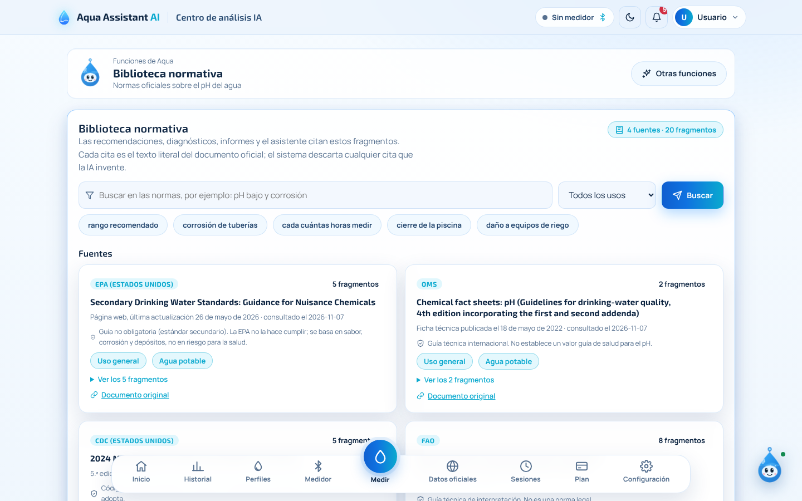

# RF-11 · Diagnóstico y recomendaciones con IA y fuentes
<!-- etiquetas: requerimiento funcional, historia de usuario, estado: hecho -->

## Historia de usuario

**Como** usuario, **quiero** un diagnóstico de mi agua con recomendaciones respaldadas por normas, **para** saber qué hacer y en qué se basa.

## Descripción

Diagnóstico estructurado (JSON validado) con causas, acciones y citas literales de la EPA, la OMS, la CDC y la FAO tomadas de una biblioteca normativa. El servidor descarta citas que no entregó. Si la IA falla, se usa un diagnóstico por reglas y se indica.

## Criterios de aceptación

- [x] Cada recomendación muestra su cita y la fuente.
- [x] No aparecen citas que no estén en la biblioteca normativa.
- [x] Si la IA no responde, el diagnóstico por reglas se marca como tal.

## MockUp

**MockUp14** · Diagnóstico IA con fuentes

**MockUp15** · Biblioteca normativa

---
**Requerimiento:** RF-11 · **Tipo:** Funcional · **Estado:** Hecho · Detalle en [docs/Requerimientos.md](https://github.com/WillC372/FrontendPatSft/blob/main/docs/Requerimientos.md#rf-11)
