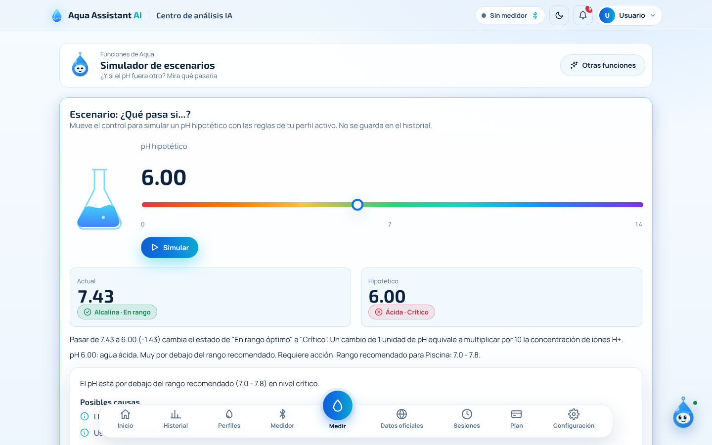

# RF-12 · Simulador de escenarios
<!-- etiquetas: requerimiento funcional, historia de usuario, estado: hecho -->

## Historia de usuario

**Como** usuario, **quiero** probar qué pasaría con el pH si cambio una condición, **para** decidir una corrección antes de aplicarla.

## Descripción

Escenarios hipotéticos sobre el historial del usuario, con su explicación. Los resultados se muestran como simulación, nunca como mediciones.

## Criterios de aceptación

- [x] El resultado se identifica como escenario simulado.
- [x] Los escenarios no se guardan como mediciones.

## MockUp

**MockUp16** · Simulador de escenarios

---
**Requerimiento:** RF-12 · **Tipo:** Funcional · **Estado:** Hecho · Detalle en [docs/Requerimientos.md](https://github.com/WillC372/FrontendPatSft/blob/main/docs/Requerimientos.md#rf-12)
