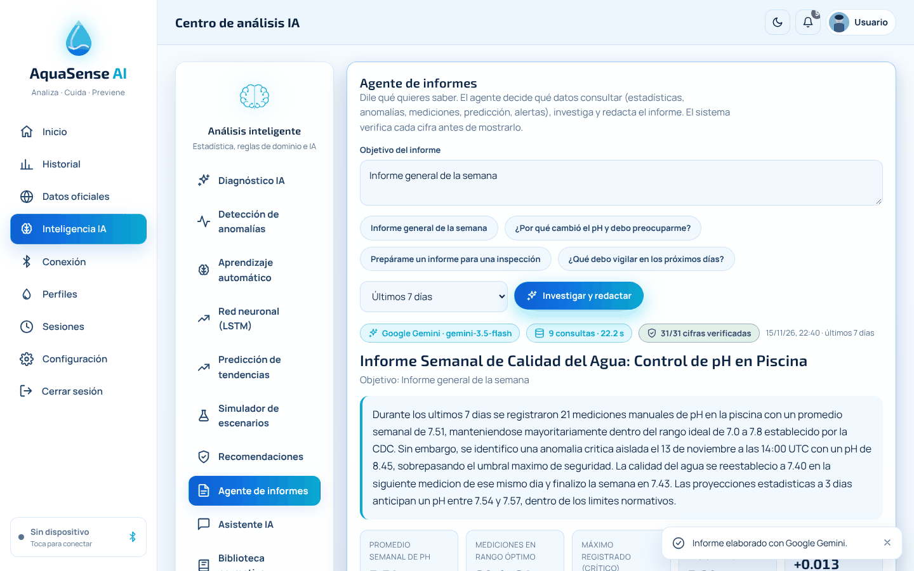

# RF-13 · Informes inteligentes y PDF
<!-- etiquetas: requerimiento funcional, historia de usuario, estado: hecho -->

## Historia de usuario

**Como** usuario, **quiero** pedir un informe del estado de mi agua en un periodo y descargarlo en PDF, **para** compartirlo o guardarlo.

## Descripción

Un agente de IA consulta el sistema con herramientas (sin acceso directo a la base de datos) y redacta el informe con cifras verificadas; el PDF incluye gráficas y fuentes.

## Criterios de aceptación

- [x] El informe se elabora en segundo plano y muestra su avance.
- [x] Las cifras del informe coinciden con las del historial.
- [x] El PDF se descarga con gráficas y fuentes.

## MockUp

**MockUp17** · Agente de informes

---
**Requerimiento:** RF-13 · **Tipo:** Funcional · **Estado:** Hecho · Detalle en [docs/Requerimientos.md](https://github.com/WillC372/FrontendPatSft/blob/main/docs/Requerimientos.md#rf-13)
