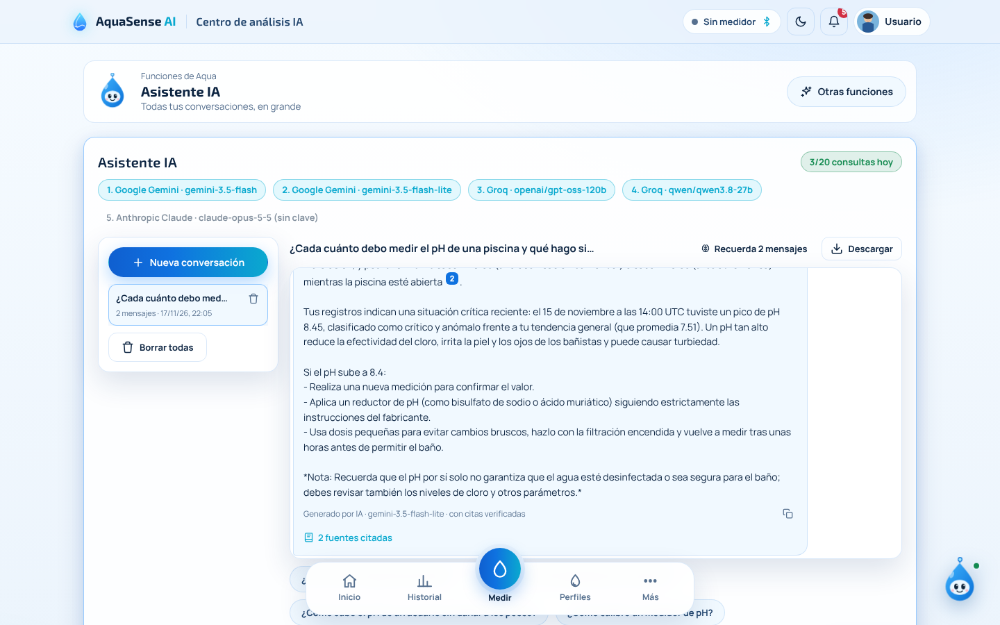
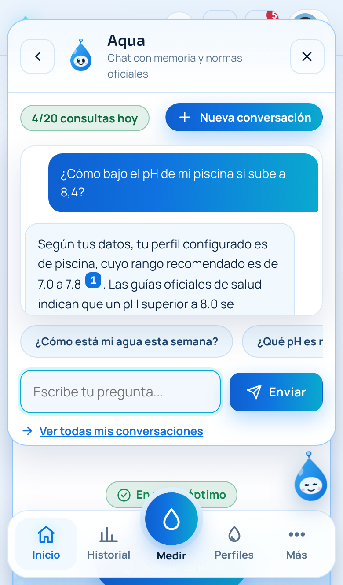

# RF-14 · Asistente IA con respuesta en vivo
<!-- etiquetas: requerimiento funcional, historia de usuario, estado: hecho -->

## Historia de usuario

**Como** usuario, **quiero** hacer preguntas sobre el pH y el cuidado del agua y ver la respuesta mientras se escribe, **para** resolver dudas sin esperar.

## Descripción

Se abre desde Aqua, el robot, en cualquier pantalla (chat dentro de su panel) o en pantalla completa con la lista de conversaciones. Chat con memoria por conversación, citas, botones Detener, Copiar y Descargar, y respuesta en vivo (Server-Sent Events). Si un modelo no empieza o se congela, otro reescribe la respuesta. Rechaza temas ajenos al agua.

## Criterios de aceptación

- [x] El texto empieza a aparecer mientras el modelo escribe.
- [x] «Detener» corta la respuesta; «Copiar» y «Descargar» funcionan.
- [x] Una pregunta ajena al tema se rechaza con un mensaje amable.
- [x] Se respeta la cuota diaria de consultas del plan.

## MockUp

**MockUp18** · Asistente IA (respuesta completa)

**MockUp35** · Chat con Aqua dentro de su panel (celular)

---
**Requerimiento:** RF-14 · **Tipo:** Funcional · **Estado:** Hecho · Detalle en [docs/Requerimientos.md](https://github.com/WillC372/FrontendPatSft/blob/main/docs/Requerimientos.md#rf-14)
