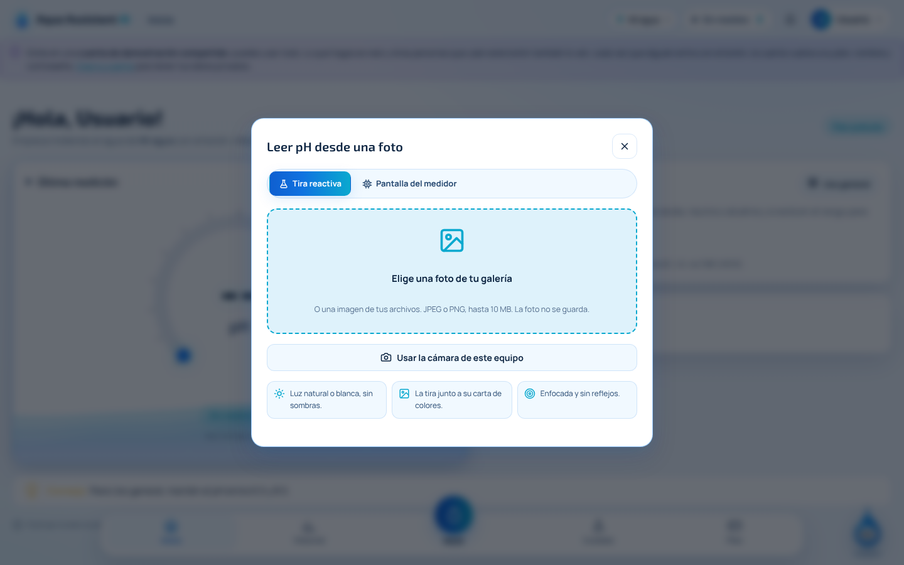

# RF-15 · Lectura de pH por foto
<!-- etiquetas: requerimiento funcional, historia de usuario, estado: parcial -->

## Historia de usuario

**Como** usuario sin medidor electrónico, **quiero** tomar una foto de una tira reactiva o de la pantalla de mi medidor, **para** registrar el pH sin escribirlo.

## Descripción

La IA con visión lee la foto, da un valor o un rango con su confianza y una segunda opinión de otro modelo; el usuario confirma antes de guardar.

## Criterios de aceptación

- [x] Fotos borrosas o sin carta de colores se rechazan con la causa.
- [x] El resultado muestra el valor, la confianza y el acuerdo entre modelos.
- [x] Nada se guarda sin confirmación del usuario.
- [x] En el celular se puede elegir una foto ya tomada (galería) o usar la cámara.
- [x] En la pantalla de un medidor se lee solo el número marcado «pH».
- [ ] Pendiente: medir la precisión con fotos reales de tiras.

## MockUp

**MockUp19** · Lectura de pH por foto

---
**Requerimiento:** RF-15 · **Tipo:** Funcional · **Estado:** Parcial · Detalle en [docs/Requerimientos.md](https://github.com/WillC372/FrontendPatSft/blob/main/docs/Requerimientos.md#rf-15)
