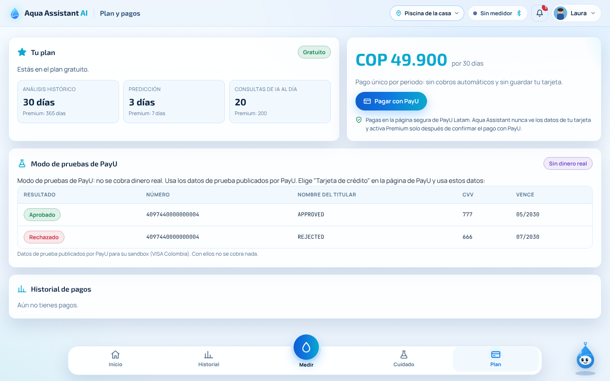

# RF-16 · Planes Gratuito y Premium con pagos
<!-- etiquetas: requerimiento funcional, historia de usuario, estado: parcial -->

## Historia de usuario

**Como** usuario, **quiero** pasar a Premium pagando en línea, **para** tener más días de análisis y más consultas de IA.

## Descripción

Gratuito: 30 días de análisis y 20 consultas de IA al día. Premium: 365 días y 200 consultas. Pago por periodo con PayU (COP 49.900 por 30 días) en modo de pruebas; el servidor verifica la orden en PayU antes de activar Premium.

## Criterios de aceptación

- [x] Los límites se aplican en el servidor, no solo en la pantalla.
- [x] Premium se activa una sola vez por pago aprobado, aunque se verifique varias veces.
- [x] Un pago rechazado no cambia el plan.
- [ ] Pendiente: cobrar dinero real exige registrar un comercio en PayU.

## MockUp

**MockUp20** · Plan y pagos (PayU en modo de pruebas)

---
**Requerimiento:** RF-16 · **Tipo:** Funcional · **Estado:** Parcial · Detalle en [docs/Requerimientos.md](https://github.com/WillC372/FrontendPatSft/blob/main/docs/Requerimientos.md#rf-16)
