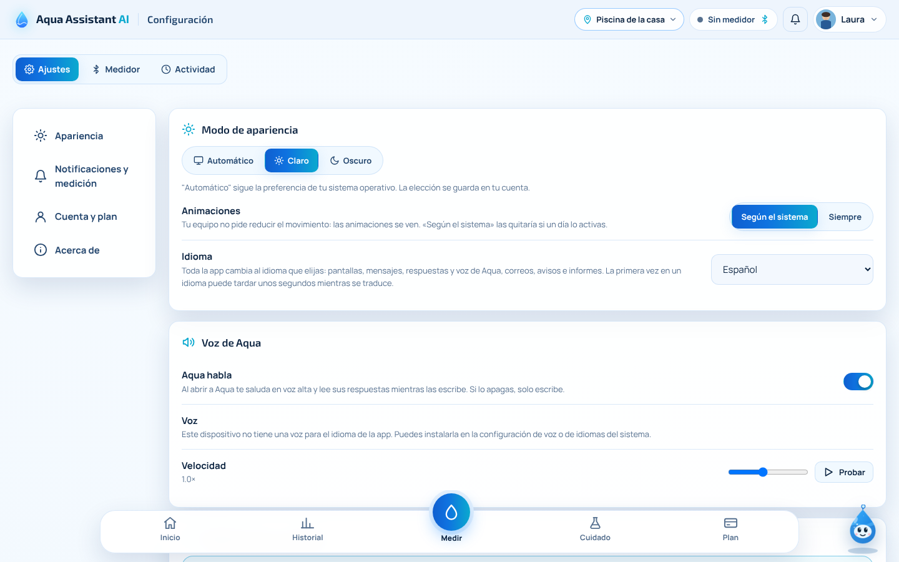

# RF-17 · Configuración de la cuenta
<!-- etiquetas: requerimiento funcional, historia de usuario, estado: hecho -->

## Historia de usuario

**Como** usuario, **quiero** elegir el tema (claro, oscuro o automático) y las notificaciones, **para** usar la app a mi gusto.

## Descripción

Preferencias guardadas en el servidor. El tema claro es el predeterminado. En Apariencia, tres interruptores por dispositivo: animación del agua (olas), animación de la gota (Aqua y la gota del acceso) y otras animaciones (empiezan según la opción del sistema «reducir movimiento»). La app está en el idioma que elija la persona.

## Criterios de aceptación

- [x] El tema claro es el predeterminado para cuentas nuevas y para quien no ha iniciado sesión.
- [x] El cambio de tema se aplica al instante y se conserva al volver a entrar.
- [x] Cada animación (agua, gota y las demás) se enciende o apaga por separado en el dispositivo.

## MockUp

**MockUp21** · Configuración con sus secciones: Ajustes, Medidor y Actividad

---
**Requerimiento:** RF-17 · **Tipo:** Funcional · **Estado:** Hecho · Detalle en [docs/Requerimientos.md](https://github.com/WillC372/FrontendPatSft/blob/main/docs/Requerimientos.md#rf-17)
