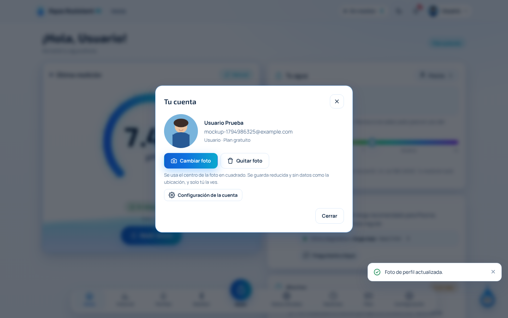

# RF-18 · Foto de perfil, nombre y contraseña
<!-- etiquetas: requerimiento funcional, historia de usuario, estado: hecho -->

## Historia de usuario

**Como** usuario, **quiero** poner mi foto, cambiar mi nombre y mi contraseña, **para** personalizar y proteger mi cuenta.

## Descripción

Foto privada reducida a 256 px y sin metadatos (como la ubicación). Al cambiar la contraseña se cierran las demás sesiones y la actual sigue abierta.

## Criterios de aceptación

- [x] La foto aparece en la barra superior y solo la ve su dueño.
- [x] Con la contraseña actual incorrecta, el cambio se rechaza junto al campo.
- [x] Tras cambiar la contraseña, las otras sesiones quedan cerradas.

## MockUp

**MockUp22** · Foto de perfil

---
**Requerimiento:** RF-18 · **Tipo:** Funcional · **Estado:** Hecho · Detalle en [docs/Requerimientos.md](https://github.com/WillC372/FrontendPatSft/blob/main/docs/Requerimientos.md#rf-18)
