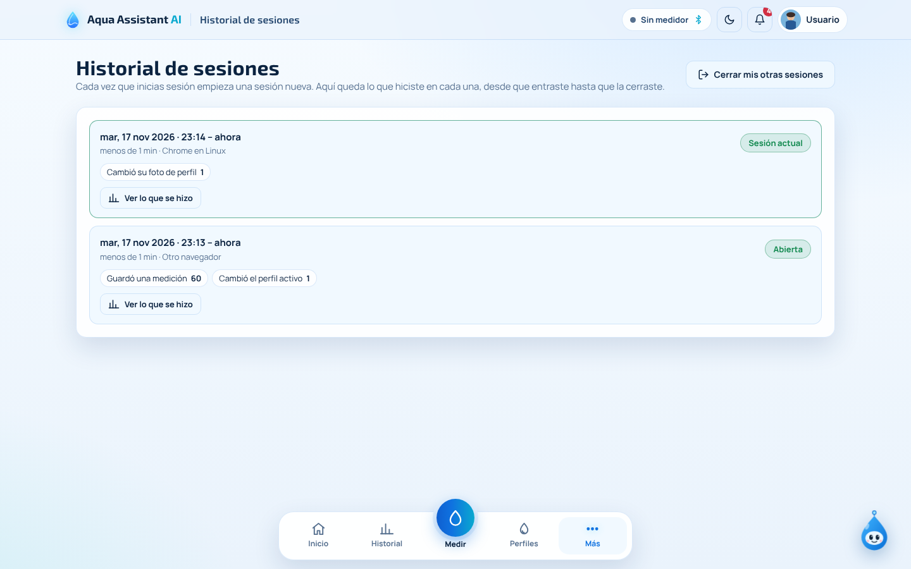

# RF-19 · Historial de sesiones y de operaciones
<!-- etiquetas: requerimiento funcional, historia de usuario, estado: hecho -->

## Historia de usuario

**Como** usuario, **quiero** ver mis sesiones (inicio, fin, duración, navegador) y lo que hice en cada una, **para** detectar accesos que no reconozco.

## Descripción

Lista de sesiones con su estado y acciones; «Cerrar mis otras sesiones» las termina. Cada operación queda ligada a la sesión en que se hizo. El administrador puede ver las de cualquier cuenta.

## Criterios de aceptación

- [x] La sesión actual se identifica y no puede cerrarse desde la lista.
- [x] «Cerrar mis otras sesiones» invalida los demás tokens al instante.
- [x] El detalle de una sesión muestra sus acciones en orden.

## MockUp

**MockUp23** · Historial de sesiones

---
**Requerimiento:** RF-19 · **Tipo:** Funcional · **Estado:** Hecho · Detalle en [docs/Requerimientos.md](https://github.com/WillC372/FrontendPatSft/blob/main/docs/Requerimientos.md#rf-19)
