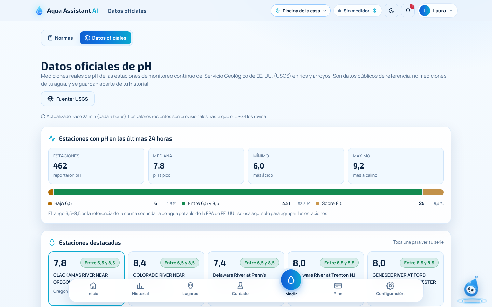

# RF-20 · Datos oficiales de referencia (USGS)
<!-- etiquetas: requerimiento funcional, historia de usuario, estado: hecho -->

## Historia de usuario

**Como** usuario, **quiero** comparar mi pH con mediciones oficiales de estaciones de agua, **para** tener una referencia real.

## Descripción

Importación periódica (cada 3 horas) de datos de pH del Servicio Geológico de EE. UU. (USGS), guardados aparte de las mediciones del usuario, con estaciones y series.

## Criterios de aceptación

- [x] Los datos oficiales nunca se mezclan con las mediciones del usuario.
- [x] Se muestra la fecha de la última importación terminada.
- [x] Si el USGS no responde, se conservan los datos anteriores y se reintenta.

## MockUp

**MockUp24** · Datos oficiales del USGS, dentro de la Biblioteca

---
**Requerimiento:** RF-20 · **Tipo:** Funcional · **Estado:** Hecho · Detalle en [docs/Requerimientos.md](https://github.com/WillC372/FrontendPatSft/blob/main/docs/Requerimientos.md#rf-20)
