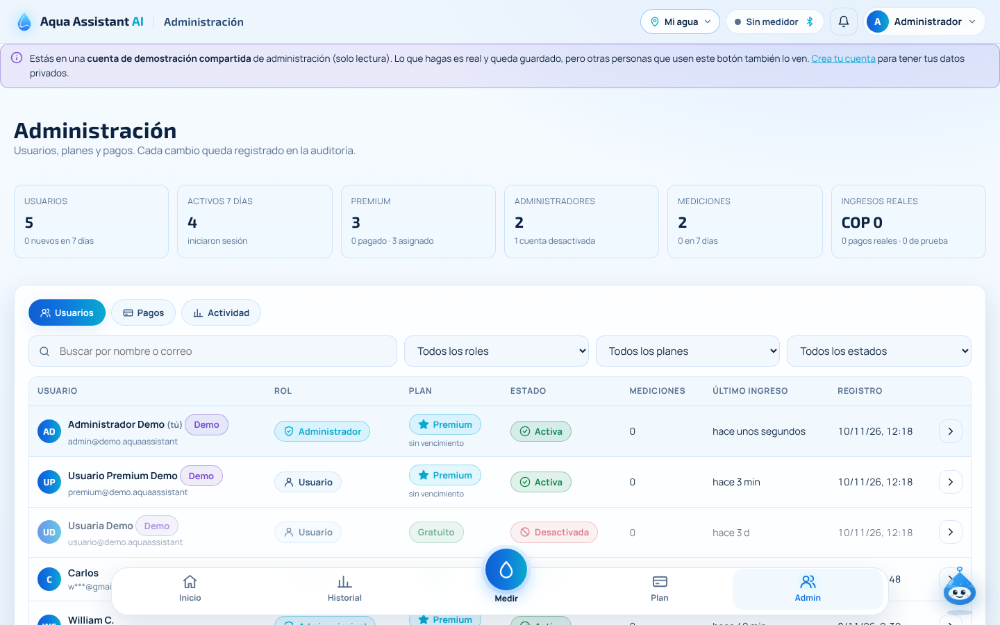
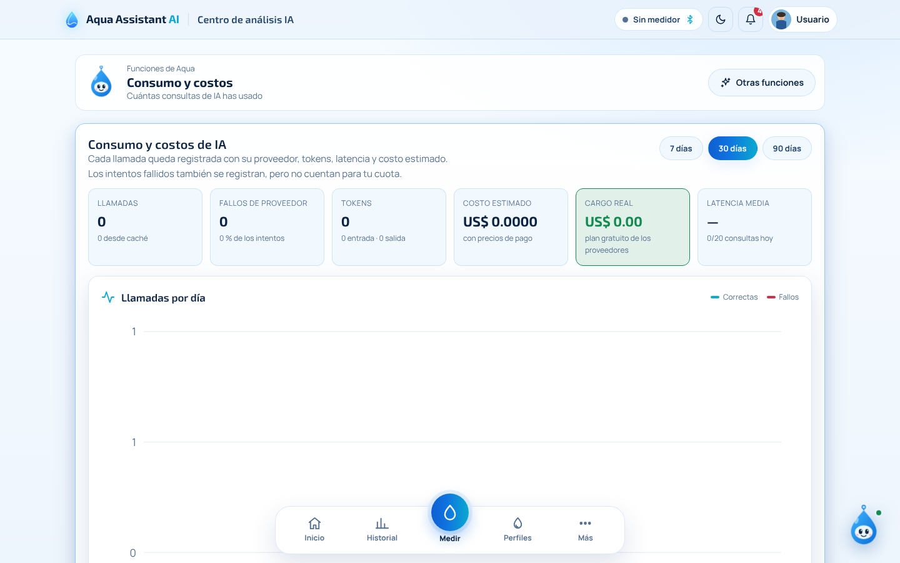

# RF-21 · Administración de usuarios y consumo de IA
<!-- etiquetas: requerimiento funcional, historia de usuario, estado: hecho -->

## Historia de usuario

**Como** administrador, **quiero** gestionar cuentas (plan, rol, estado) y ver el consumo y costo de la IA, **para** controlar el sistema y sus gastos.

## Descripción

Búsqueda y filtros de usuarios, detalle con pagos, actividad y sesiones, cambios de plan, rol y estado con aviso por correo, y reporte de consumo de IA por modelo, función y día con costo estimado.

## Criterios de aceptación

- [x] Solo el rol administrador entra a Administración.
- [x] No se puede dejar el sistema sin administradores activos.
- [x] El consumo muestra llamadas, tokens y costo estimado por modelo.
- [x] Los precios estimados vienen de fuentes de terceros y deben confirmarse en las páginas oficiales.

## MockUp

**MockUp25** · Administración (cuentas reales difuminadas)

**MockUp26** · Consumo y costos de IA

---
**Requerimiento:** RF-21 · **Tipo:** Funcional · **Estado:** Hecho · Detalle en [docs/Requerimientos.md](https://github.com/WillC372/FrontendPatSft/blob/main/docs/Requerimientos.md#rf-21)
