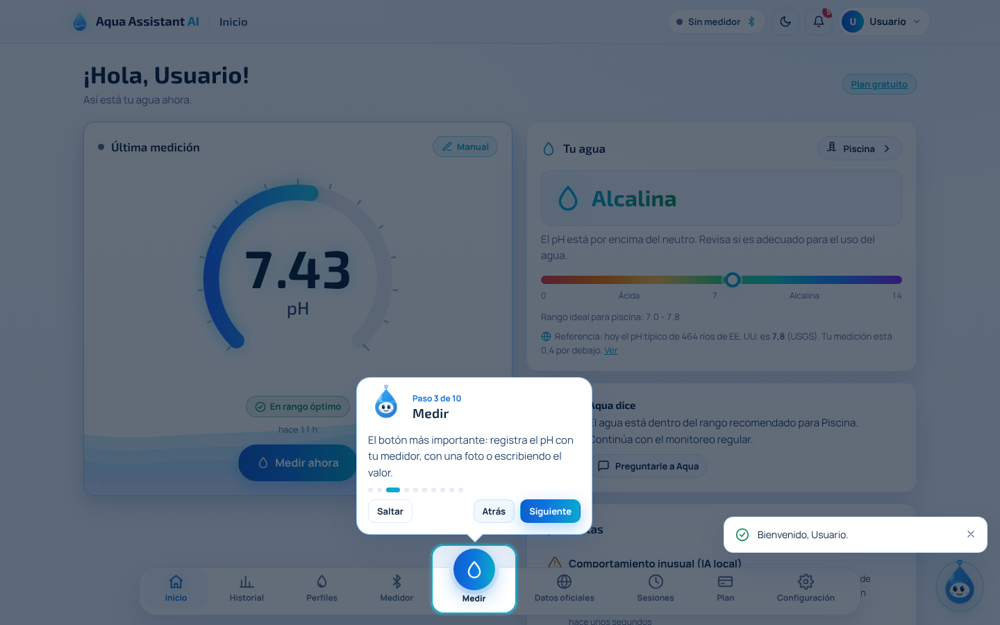
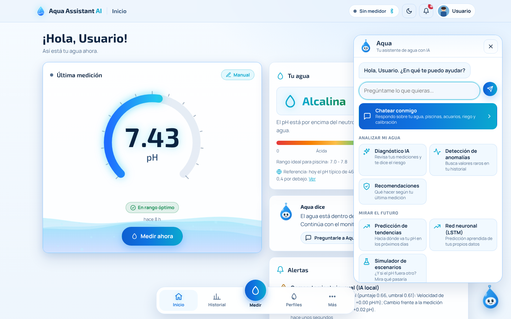

# RF-22 · Aqua: robot de la IA y recorrido guiado
<!-- etiquetas: requerimiento funcional, historia de usuario, estado: hecho -->

## Historia de usuario

**Como** usuario nuevo, **quiero** que un asistente me explique para qué sirve cada parte y me deje usar la IA desde cualquier pantalla, **para** aprender a usar la app sin manual y encontrar las funciones de IA en un solo lugar.

## Descripción

Aqua, un robot con forma de gota, flota en todas las pantallas y es la única entrada a la inteligencia artificial: su panel permite preguntar, chatear y abrir el diagnóstico, las anomalías, las recomendaciones, la predicción, la red neuronal, los escenarios, el aprendizaje automático, los informes, la biblioteca normativa, el consumo y la lectura por foto. La primera vez que una persona entra, Aqua hace un recorrido guiado señalando cada botón con un globo de texto, y al abrir cada pantalla dice en una frase para qué sirve.

## Criterios de aceptación

- [x] Aqua aparece en todas las pantallas de la sesión y la IA no aparece en el menú.
- [x] Desde el panel de Aqua se abre cada función de IA y el chat.
- [x] El recorrido sale solo la primera vez, se puede saltar y se repite desde Aqua o desde «Más».
- [x] El recorrido y el panel se usan con teclado (flechas, Tab y Esc) y con lector de pantalla.
- [x] Los consejos de Aqua al cambiar de pantalla se pueden desactivar.

## MockUp

**MockUp33** · Recorrido guiado: Aqua señala el botón Medir

**MockUp34** · Panel de Aqua con el chat y las funciones de IA

---
**Requerimiento:** RF-22 · **Tipo:** Funcional · **Estado:** Hecho · Detalle en [docs/Requerimientos.md](https://github.com/WillC372/FrontendPatSft/blob/main/docs/Requerimientos.md#rf-22)
