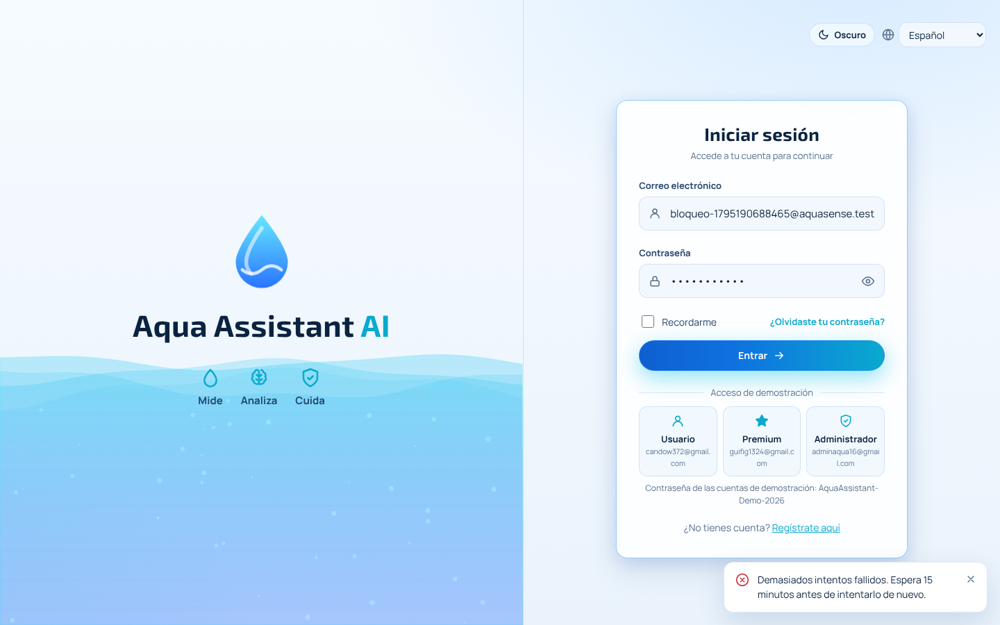

# RNF-01 · Seguridad
<!-- etiquetas: requerimiento no funcional, historia de usuario, estado: hecho -->

## Historia de usuario

**Como** usuario, **quiero** que mi contraseña y mi sesión estén protegidas, **para** que nadie más vea ni cambie mis datos.

## Descripción

Contraseñas con Argon2id; tokens JWT ligados a una sesión que se puede revocar; límite de 10 intentos por minuto por dirección y bloqueo de una cuenta por 15 minutos tras 5 inicios fallidos; CORS solo para el dominio de la app; cabeceras de seguridad (política de contenido, sin incrustación en otros sitios); documentación de la API desactivada en producción; cada usuario solo accede a sus datos.

## Criterios de aceptación

- [x] Tras 5 contraseñas incorrectas la cuenta responde «Demasiados intentos» durante 15 minutos.
- [x] Un token de una sesión cerrada responde 401.
- [x] Un usuario no puede leer ni modificar datos de otro (403/404).
- [x] /v3/api-docs y /swagger-ui.html no están publicados en producción.

## MockUp

**MockUp27** · Bloqueo tras 5 intentos fallidos

---
**Requerimiento:** RNF-01 · **Tipo:** No funcional · **Estado:** Hecho · Detalle en [docs/Requerimientos.md](https://github.com/WillC372/FrontendPatSft/blob/main/docs/Requerimientos.md#rnf-01)
