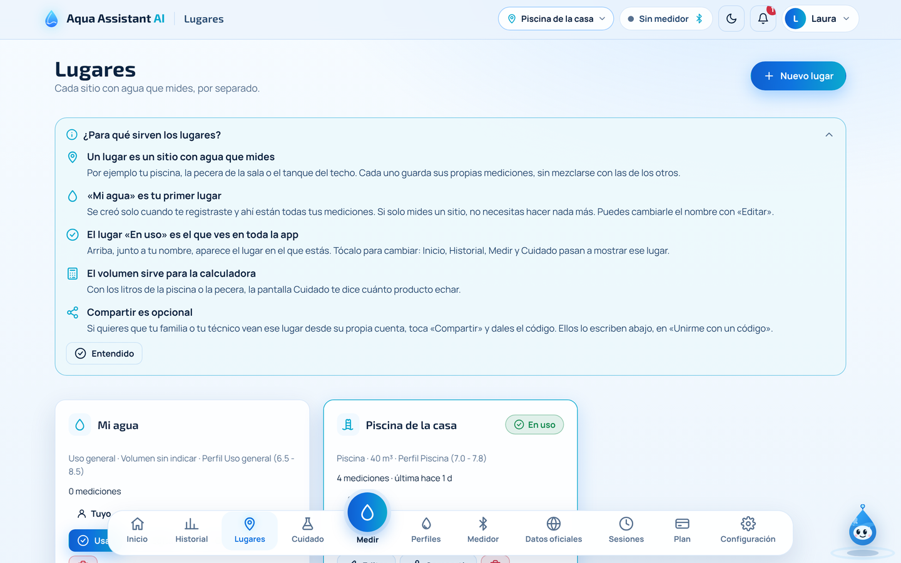
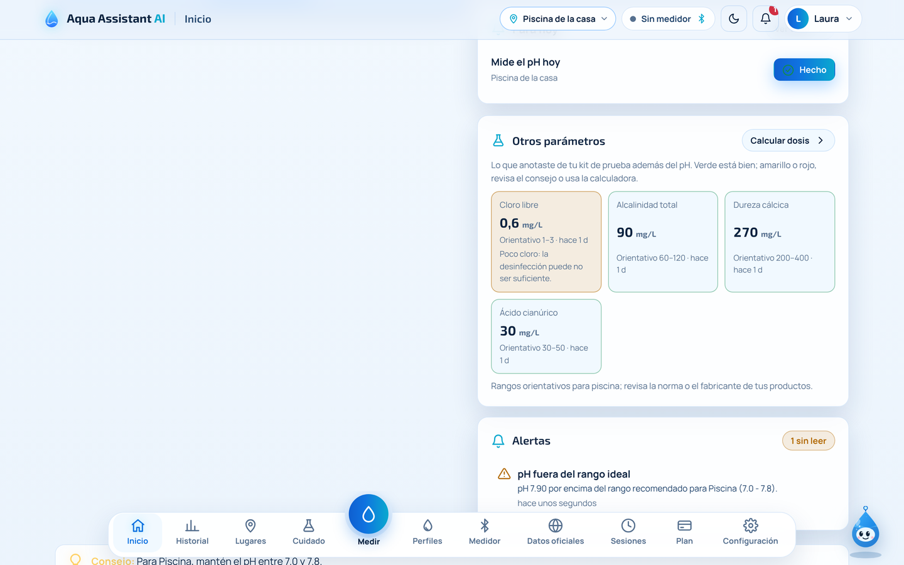

# RF-23 · Varios lugares y otros parámetros del agua
<!-- etiquetas: requerimiento funcional, historia de usuario, estado: hecho -->

## Historia de usuario

**Como** persona con piscina y acuario, **quiero** llevar cada agua por separado y anotar también cloro, alcalinidad, dureza y ácido cianúrico, **para** que sus mediciones no se mezclen y ver el estado completo del agua.

## Descripción

Cada lugar (piscina, acuario, estanque, tanque, agua potable, riego, hidroponía u otro) tiene su historial, su perfil y su volumen. «Mi agua» se crea sola al registrarse. Arriba, junto al nombre, se ve el lugar en uso y se cambia con un toque; Inicio, Historial, Medir, Cuidado y la IA pasan a ese lugar. La medición manual tiene una sección opcional «Otros parámetros» (cloro libre, alcalinidad total, dureza cálcica y ácido cianúrico) con rangos orientativos según el tipo de lugar. Cada pantalla nueva explica en un cuadro «¿Para qué sirve?» con ejemplos.

## Criterios de aceptación

- [x] Las mediciones de un lugar no aparecen en otro.
- [x] Al cambiar de lugar arriba, toda la app muestra ese lugar sin recargar.
- [x] Los otros parámetros se guardan con la medición y el Inicio los muestra con su estado (bien, bajo o alto).
- [x] Un lugar se puede crear, renombrar, cambiar de volumen y borrar (con sus datos) por su dueño.

## MockUp

**MockUp38** · Lugares con el cuadro «¿Para qué sirven?»

**MockUp42** · Otros parámetros del agua en Inicio

---
**Requerimiento:** RF-23 · **Tipo:** Funcional · **Estado:** Hecho · Detalle en [docs/Requerimientos.md](https://github.com/WillC372/FrontendPatSft/blob/main/docs/Requerimientos.md#rf-23)
