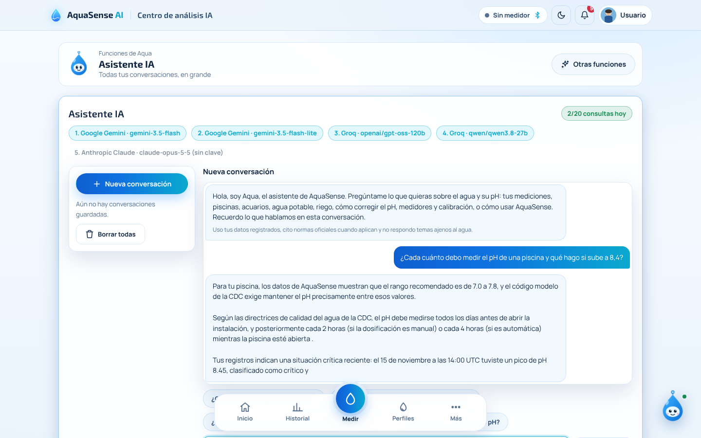

# RNF-02 · Rendimiento
<!-- etiquetas: requerimiento no funcional, historia de usuario, estado: hecho -->

## Historia de usuario

**Como** usuario, **quiero** que la app y el asistente respondan rápido, **para** no quedarme esperando.

## Descripción

Respuestas de IA en vivo; cambio automático de modelo si uno no empieza en 8–12 s o se congela 6 s; caché de respuestas de IA; memoria que se limpia sola (modelos y cachés con vencimiento). En pruebas del asistente publicado, 12 preguntas respondieron completas en 10,8 s o menos.

## Criterios de aceptación

- [x] El asistente muestra texto antes de terminar la respuesta completa.
- [x] Una pregunta repetida se responde desde la caché sin gastar cuota.
- [x] Los modelos y cachés en memoria se liberan cuando no se usan.

## MockUp

**MockUp28** · Asistente escribiendo la respuesta en vivo

---
**Requerimiento:** RNF-02 · **Tipo:** No funcional · **Estado:** Hecho · Detalle en [docs/Requerimientos.md](https://github.com/WillC372/FrontendPatSft/blob/main/docs/Requerimientos.md#rnf-02)
