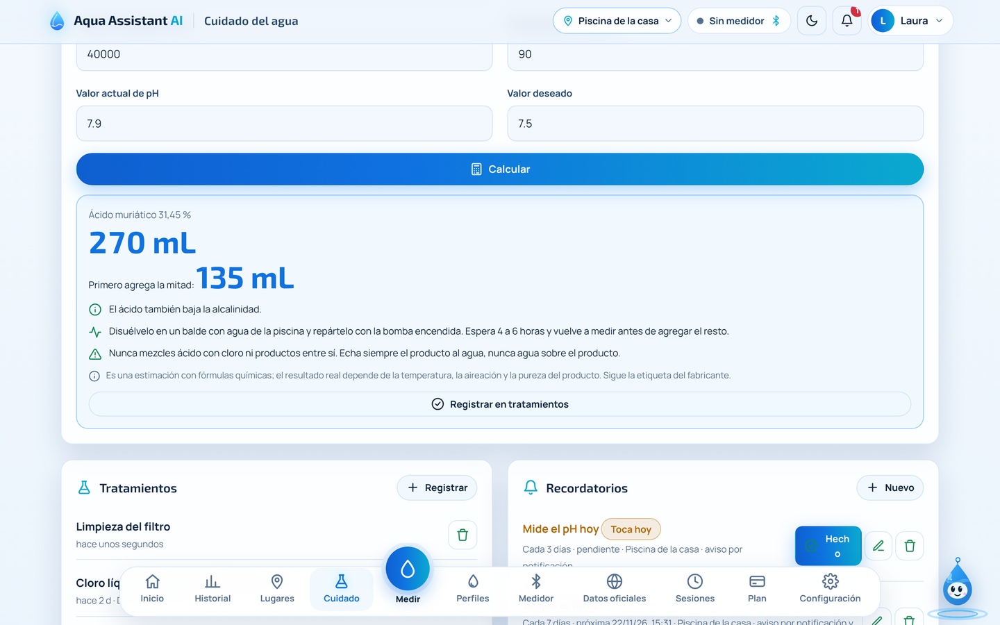
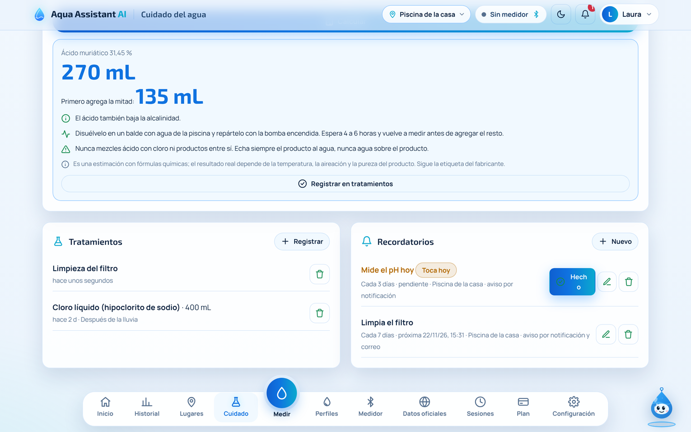

# RF-24 · Calculadora de dosis y registro de tratamientos
<!-- etiquetas: requerimiento funcional, historia de usuario, estado: hecho -->

## Historia de usuario

**Como** dueño de una piscina o acuario, **quiero** saber cuánto producto echar y anotar lo que le hago al agua, **para** corregirla sin pasarme y recordar qué hice.

## Descripción

La calculadora usa el volumen del lugar y las últimas mediciones: para el pH aplica el sistema carbonato del agua con la alcalinidad (corregida por el ácido cianúrico); para cloro, alcalinidad, dureza y estabilizador, balances de masa según la concentración del producto. Indica la cantidad total, pide agregar primero la mitad y avisa de los efectos secundarios. El resultado se registra con un toque como tratamiento; el registro guarda producto, cantidad, fecha, quién lo hizo y una nota.

## Criterios de aceptación

- [x] Bajar una piscina de 40 000 L de pH 7,9 a 7,5 con alcalinidad 90 mg/L indica unos 270 mL de ácido muriático al 31,45 %.
- [x] Sin alcalinidad, la calculadora pide el dato en lugar de inventar un resultado.
- [x] El resultado se presenta como estimación y recomienda medir antes de agregar el resto.
- [x] Los tratamientos se ven por lugar y quien solo puede ver el lugar no puede registrarlos.

## MockUp

**MockUp40** · Calculadora de dosis con resultado

**MockUp41** · Tratamientos y recordatorios

---
**Requerimiento:** RF-24 · **Tipo:** Funcional · **Estado:** Hecho · Detalle en [docs/Requerimientos.md](https://github.com/WillC372/FrontendPatSft/blob/main/docs/Requerimientos.md#rf-24)
