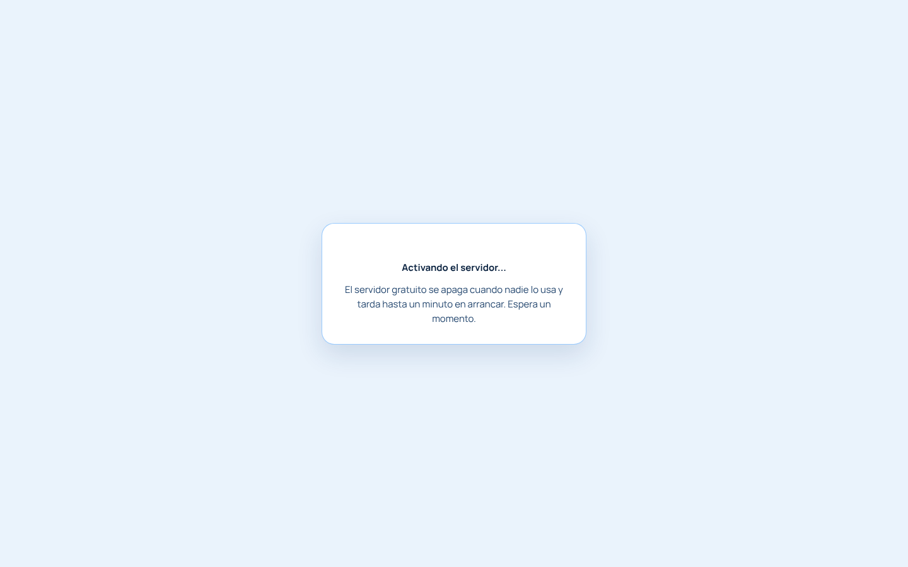

# RNF-03 · Disponibilidad
<!-- etiquetas: requerimiento no funcional, historia de usuario, estado: parcial -->

## Historia de usuario

**Como** usuario, **quiero** que la app esté disponible cuando la abra, **para** no esperar a que el servidor arranque.

## Descripción

Frontend en Vercel, API en Render y base PostgreSQL en Neon. Un monitor de UptimeRobot consulta /actuator/health/liveness cada 5 minutos para que el servidor gratuito no se apague; esa dirección no consulta la base de datos. Si el servidor estaba apagado, la app muestra «Activando el servidor…» mientras arranca.

## Criterios de aceptación

- [x] /actuator/health/liveness responde 200 sin iniciar sesión.
- [x] Tras 20 minutos sin uso, la API responde en menos de 2 segundos.
- [x] Si el servidor tarda, la app avisa en lugar de mostrar un error.
- [ ] Pendiente: confirmar que el monitor de UptimeRobot está activo (la prueba del 15 de noviembre encontró el servidor apagado).

## MockUp

**MockUp29** · Aviso mientras el servidor arranca

---
**Requerimiento:** RNF-03 · **Tipo:** No funcional · **Estado:** Parcial · Detalle en [docs/Requerimientos.md](https://github.com/WillC372/FrontendPatSft/blob/main/docs/Requerimientos.md#rnf-03)
