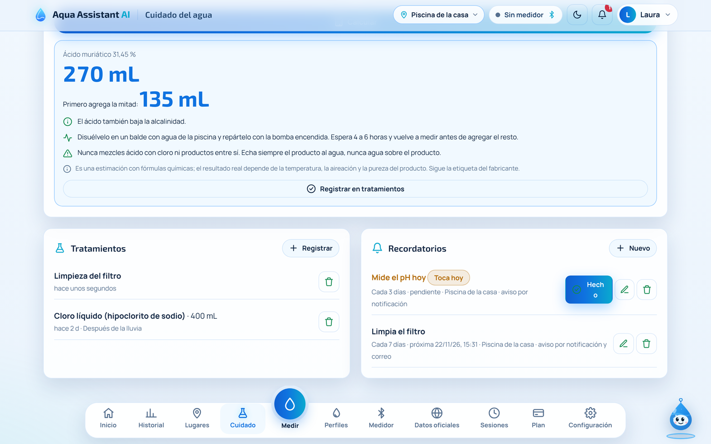

# RF-25 · Recordatorios y avisos fuera de la app
<!-- etiquetas: requerimiento funcional, historia de usuario, estado: parcial -->

## Historia de usuario

**Como** usuario, **quiero** que la app me recuerde medir o limpiar el filtro y me avise si el agua sale de rango aunque no la tenga abierta, **para** no olvidar el mantenimiento ni enterarme tarde de un problema.

## Descripción

Recordatorios que se repiten cada cierto número de días («Mide el pH hoy», «Limpia el filtro», cambio de agua, calibración o uno propio). Cuando toca, aparecen en Inicio en «Para hoy» con el botón «Hecho» y llegan como notificación al celular o computador (Web Push, cifrado según RFC 8291 y firmado con VAPID) y, si se marca, por correo. Las alertas de mediciones fuera de rango también llegan por notificación y por correo (como mucho uno por hora). Configuración permite activar los avisos en cada dispositivo y probarlos.

## Criterios de aceptación

- [x] Un recordatorio vencido aparece en «Para hoy» y se notifica una sola vez por vencimiento.
- [x] «Hecho» lo pasa a la siguiente fecha.
- [x] Con los avisos activos en un dispositivo, «Probar» muestra una notificación en él.
- [ ] Pendiente: confirmar la recepción en un celular real (el navegador de pruebas no tiene servicio de notificaciones).

## MockUp

**MockUp41** · Tratamientos y recordatorios

---
**Requerimiento:** RF-25 · **Tipo:** Funcional · **Estado:** Parcial · Detalle en [docs/Requerimientos.md](https://github.com/WillC372/FrontendPatSft/blob/main/docs/Requerimientos.md#rf-25)
