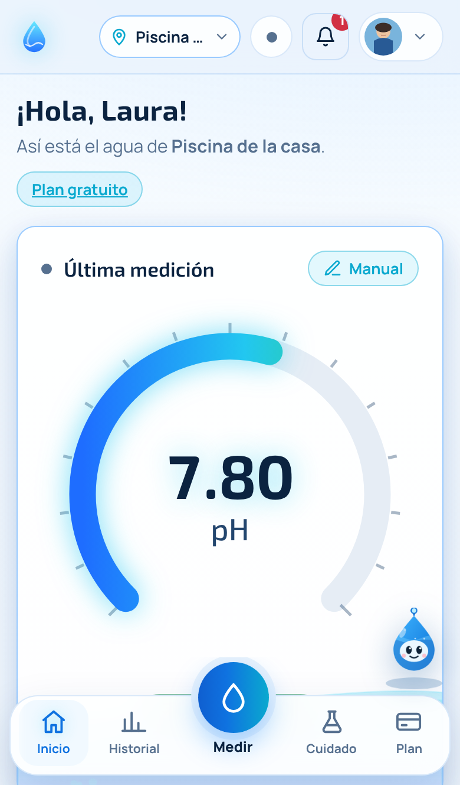

# RNF-04 · Usabilidad, accesibilidad y diseño adaptable
<!-- etiquetas: requerimiento no funcional, historia de usuario, estado: hecho -->

## Historia de usuario

**Como** usuario de computador o celular, **quiero** una interfaz clara que funcione en cualquier pantalla, **para** usarla cómodamente donde esté.

## Descripción

Diseño adaptable a celular y computador, tema claro predeterminado y oscuro opcional, navegación por teclado y lector de pantalla. Revisión con axe-core: 0 hallazgos en 16 pantallas, en tema claro y oscuro, en computador y teléfono.

## Criterios de aceptación

- [x] Todas las pantallas se usan en un celular sin desplazamiento horizontal.
- [x] Cada control tiene nombre accesible y foco visible.
- [x] El contraste cumple en ambos temas.

## MockUp

**MockUp30** · Inicio en un celular

---
**Requerimiento:** RNF-04 · **Tipo:** No funcional · **Estado:** Hecho · Detalle en [docs/Requerimientos.md](https://github.com/WillC372/FrontendPatSft/blob/main/docs/Requerimientos.md#rnf-04)
