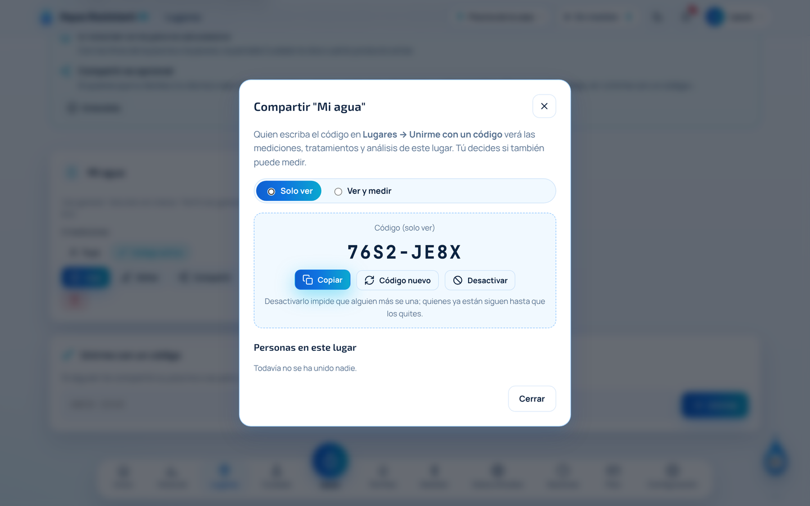

# RF-26 · Compartir un lugar con un código
<!-- etiquetas: requerimiento funcional, historia de usuario, estado: hecho -->

## Historia de usuario

**Como** dueño de un lugar, **quiero** compartirlo con mi familia o mi técnico mediante un código, **para** que lo vean o midan desde su propia cuenta.

## Descripción

El dueño genera un código de 8 caracteres y elige si quien se una solo puede ver o también medir y registrar. La otra persona lo escribe en «Unirme con un código». El dueño ve quién se unió, puede quitarlo o desactivar el código; quien se unió puede salir. Las alertas del lugar llegan a todas las personas con acceso.

## Criterios de aceptación

- [x] Con un código válido el lugar aparece en la otra cuenta con su rol.
- [x] Quien solo puede ver no puede medir ni registrar: el servidor lo rechaza.
- [x] Un código desactivado o inexistente muestra un mensaje claro.
- [x] Las cuentas de demostración no pueden compartir ni unirse.

## MockUp

**MockUp39** · Compartir un lugar con un código

---
**Requerimiento:** RF-26 · **Tipo:** Funcional · **Estado:** Hecho · Detalle en [docs/Requerimientos.md](https://github.com/WillC372/FrontendPatSft/blob/main/docs/Requerimientos.md#rf-26)
