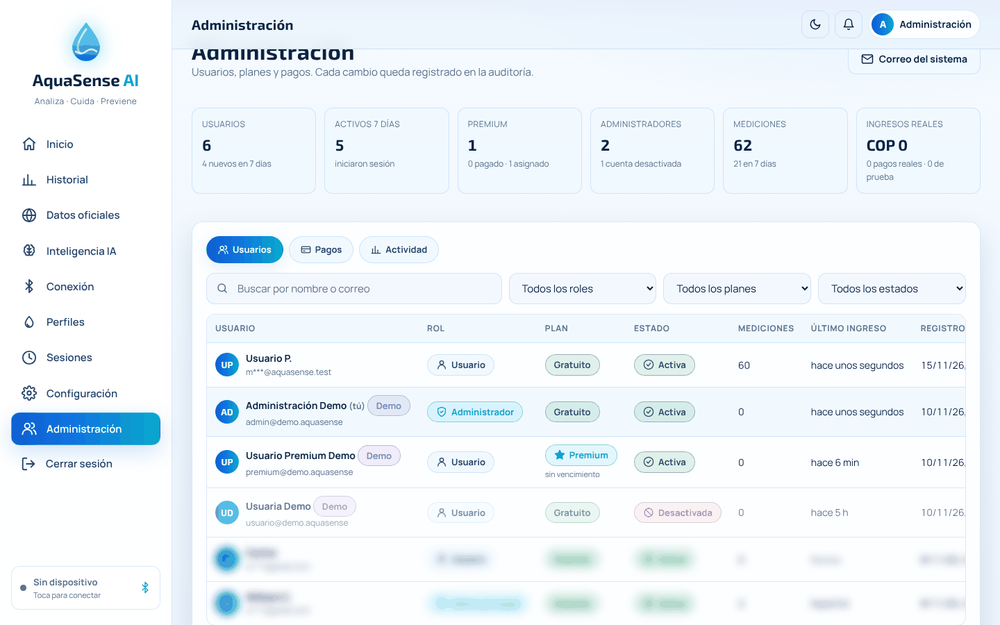

# RNF-05 · Privacidad de los datos
<!-- etiquetas: requerimiento no funcional, historia de usuario, estado: hecho -->

## Historia de usuario

**Como** usuario, **quiero** que mis datos personales no salgan del sistema, **para** confiar en la app.

## Descripción

A los modelos de IA solo se envían valores de pH, fechas y datos del perfil de agua, nunca nombres ni correos. La foto de perfil es privada y sin metadatos. El administrador de demostración ve enmascarados los datos de las cuentas reales. Los datos simulados nunca se presentan como mediciones reales.

## Criterios de aceptación

- [x] Las solicitudes a la IA no incluyen nombre ni correo del usuario.
- [x] Las cuentas reales aparecen enmascaradas para el administrador de demostración.
- [x] Cada medición indica su origen (manual, medidor, foto).

## MockUp

**MockUp31** · Datos enmascarados para el administrador de demostración

---
**Requerimiento:** RNF-05 · **Tipo:** No funcional · **Estado:** Hecho · Detalle en [docs/Requerimientos.md](https://github.com/WillC372/FrontendPatSft/blob/main/docs/Requerimientos.md#rnf-05)
