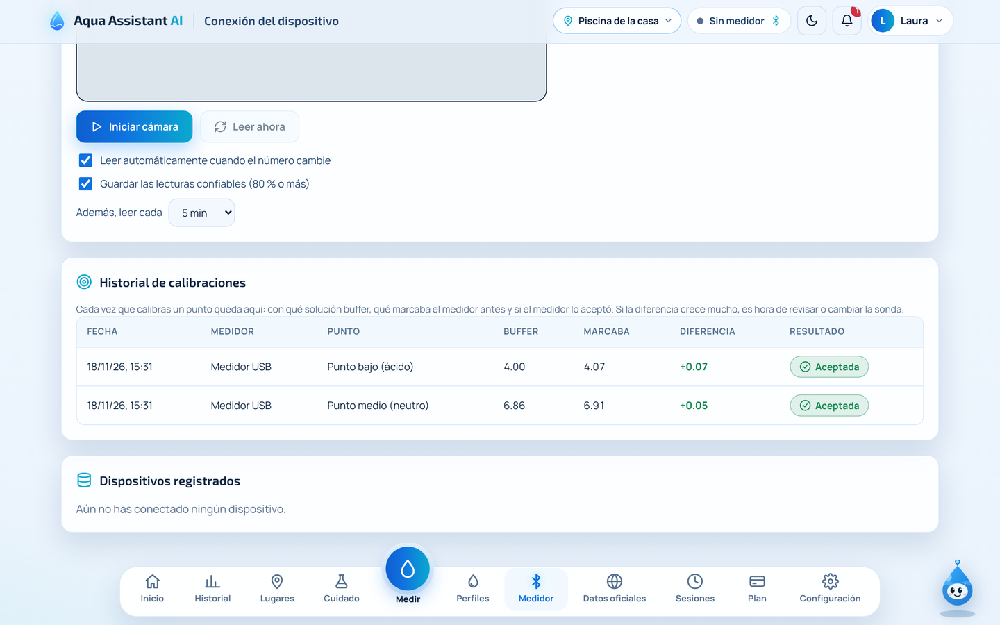

# RF-27 · Historial de calibraciones
<!-- etiquetas: requerimiento funcional, historia de usuario, estado: hecho -->

## Historia de usuario

**Como** usuario con medidor, **quiero** ver cada calibración que hice, **para** saber cuándo recalibrar o cambiar la sonda.

## Descripción

Cada punto calibrado (por USB o desde el ESP32) queda registrado con el medidor, la solución buffer, lo que marcaba antes, la diferencia y si el medidor lo aceptó. Se ve en la pantalla Medidor.

## Criterios de aceptación

- [x] Al calibrar un punto aparece una fila nueva con fecha, solución y lectura.
- [x] Los intentos fallidos también quedan registrados.

## MockUp

**MockUp43** · Historial de calibraciones

---
**Requerimiento:** RF-27 · **Tipo:** Funcional · **Estado:** Hecho · Detalle en [docs/Requerimientos.md](https://github.com/WillC372/FrontendPatSft/blob/main/docs/Requerimientos.md#rf-27)
