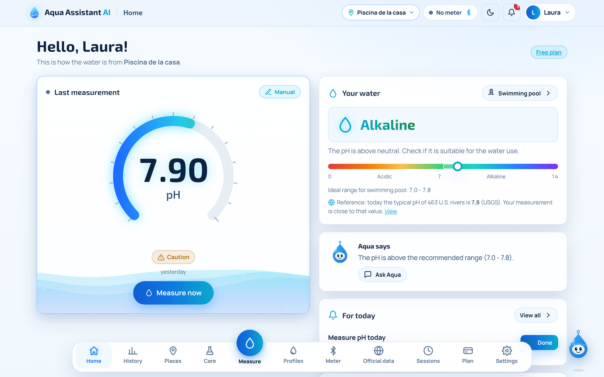

# RF-28 · Toda la app en el idioma elegido
<!-- etiquetas: requerimiento funcional, historia de usuario, estado: hecho -->

## Historia de usuario

**Como** usuario que no habla español, **quiero** elegir mi idioma entre 61 opciones y ver toda la app en él, **para** entender y usar todas las funciones.

## Descripción

Selector en Configuración y en la pantalla de inicio de sesión. Un traductor cambia cada texto, botón, etiqueta, mensaje y aviso de la pantalla, incluidos los que aparecen después. Cada texto se traduce una vez por idioma con la IA y el servidor lo guarda y comparte, así que después es inmediato; las negritas y los enlaces dentro de una frase se conservan con marcadores y los números viajan como {0}. Fechas, números y tiempos relativos usan el formato del idioma y el árabe, el hebreo, el persa y el urdu se muestran de derecha a izquierda. Las respuestas de la IA, los diagnósticos, los informes del agente, los correos y las notificaciones también salen en el idioma de la persona; el PDF del servidor, en los idiomas de escritura latina, griega o cirílica, y en los demás se imprime la pantalla ya traducida. Lo que escribe la persona (nombres, notas, chats) no se traduce.

## Criterios de aceptación

- [x] Al elegir un idioma la app se recarga en él y la elección queda en la cuenta.
- [x] En inglés, las pantallas principales no muestran textos en español (prueba automática en 17 pantallas).
- [x] Si la traducción de un texto falla, se muestra en español y se reintenta.
- [x] Las cuentas de demostración guardan el idioma solo en el navegador.
- [x] La primera vez en un idioma sin traducciones guardadas la pantalla tarda unos segundos en traducirse.

## MockUp

**MockUp44** · Idioma y voz de Aqua en Configuración

**MockUp45** · La app en inglés

---
**Requerimiento:** RF-28 · **Tipo:** Funcional · **Estado:** Hecho · Detalle en [docs/Requerimientos.md](https://github.com/WillC372/FrontendPatSft/blob/main/docs/Requerimientos.md#rf-28)
