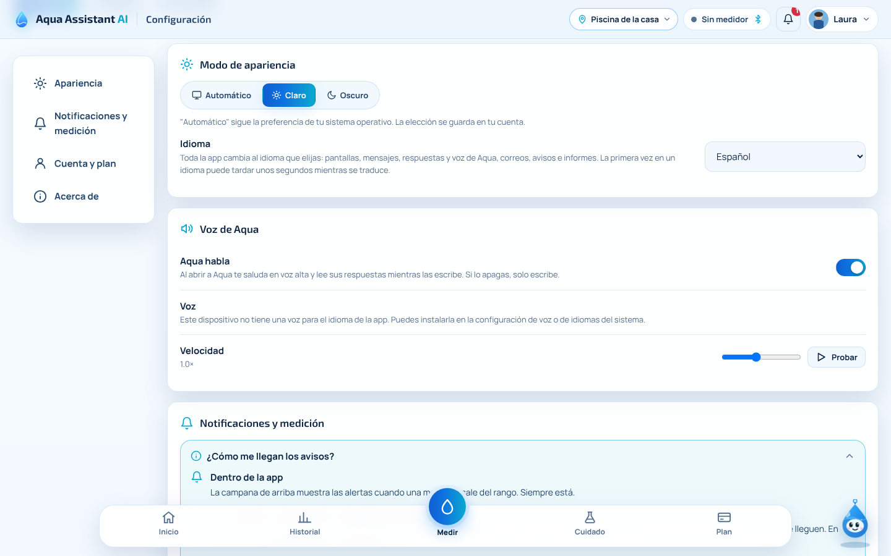

# RF-28 · Toda la app en el idioma elegido
<!-- etiquetas: requerimiento funcional, historia de usuario, estado: hecho -->

## Historia de usuario

**Como** usuario que no habla español, **quiero** elegir mi idioma (español, inglés, francés, alemán, italiano, chino o japonés) y ver toda la app en él, **para** entender y usar todas las funciones.

## Descripción

Selector en Configuración y en la pantalla de inicio de sesión. Un traductor cambia cada texto, botón, etiqueta, mensaje y aviso de la pantalla, incluidos los que aparecen después. Los 2130 textos de la app y de los mensajes del servidor se extraen del código y el servidor los mantiene traducidos de antemano con la IA, con el mismo tono en cada idioma (tuteo en francés, alemán e italiano; forma cortés en japonés), así que cambiar de idioma es inmediato; lo que aún no esté traducido se traduce al aparecer y queda guardado para todos; las negritas y los enlaces dentro de una frase se conservan con marcadores y los números viajan como {0}. Fechas, números y tiempos relativos usan el formato del idioma. Las respuestas de la IA, los diagnósticos, los informes del agente, los correos y las notificaciones también salen en el idioma de la persona; el PDF del servidor también, con una fuente propia para el chino y el japonés. Lo que escribe la persona (nombres, notas, chats) no se traduce.

## Criterios de aceptación

- [x] Al elegir un idioma la app se recarga en él y la elección queda en la cuenta.
- [x] En cada idioma, las pantallas y los diálogos principales no muestran textos en español (prueba automática).
- [x] Si la traducción de un texto falla, se muestra en español y se reintenta.
- [x] Las cuentas de demostración guardan el idioma solo en el navegador.
- [x] Un idioma que ya no se ofrece vuelve a español sin errores.
- [x] El PDF en chino y japonés muestra los caracteres (sin signos «?»).

## MockUp

**MockUp44** · Idioma y voz de Aqua en Configuración

**MockUp45** · La app en inglés

---
**Requerimiento:** RF-28 · **Tipo:** Funcional · **Estado:** Hecho · Detalle en [docs/Requerimientos.md](https://github.com/WillC372/FrontendPatSft/blob/main/docs/Requerimientos.md#rf-28)
