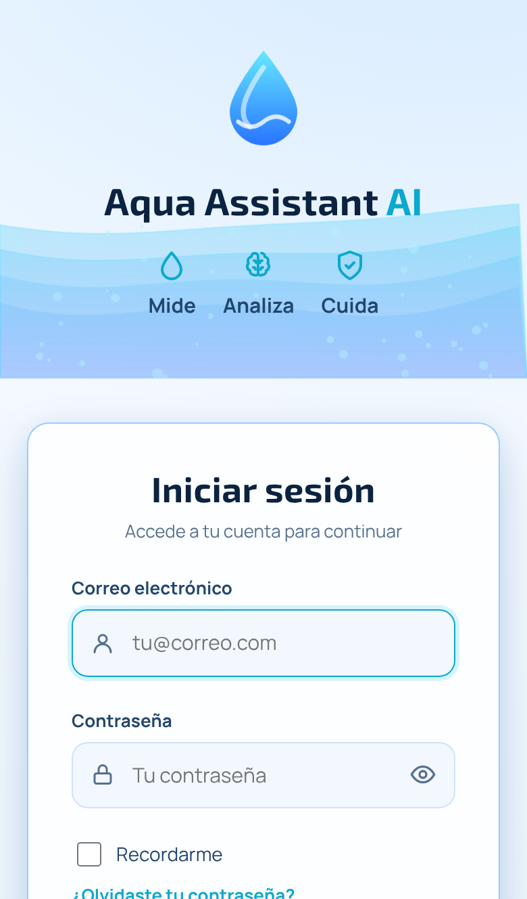

# RNF-07 · Compatibilidad e instalación
<!-- etiquetas: requerimiento no funcional, historia de usuario, estado: hecho -->

## Historia de usuario

**Como** usuario, **quiero** usar la app en mi navegador o instalarla como aplicación, **para** tenerla a mano.

## Descripción

Aplicación web progresiva (instalable en computador y celular). El medidor por cable o Bluetooth requiere Chrome o Edge (Web Serial); el resto funciona en navegadores actuales. Interfaz en español.

## Criterios de aceptación

- [x] El navegador ofrece instalar la app (manifiesto con íconos).
- [x] En navegadores sin Web Serial, la app explica qué navegador usar para el medidor.

## MockUp

**MockUp32** · Inicio de sesión en un celular

---
**Requerimiento:** RNF-07 · **Tipo:** No funcional · **Estado:** Hecho · Detalle en [docs/Requerimientos.md](https://github.com/WillC372/FrontendPatSft/blob/main/docs/Requerimientos.md#rnf-07)
