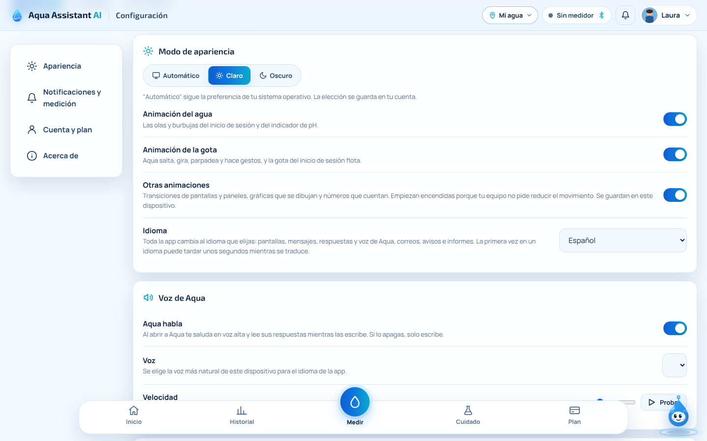

# RF-29 · Voz de Aqua
<!-- etiquetas: requerimiento funcional, historia de usuario, estado: hecho -->

## Historia de usuario

**Como** usuario, **quiero** que Aqua me salude y me lea sus respuestas con una voz natural, y poder apagarla, **para** usar el asistente sin tener que leer todo.

## Descripción

Al abrir a Aqua dice «Hola, (nombre). ¿En qué te puedo ayudar?» y lee cada respuesta frase por frase mientras la escribe, en el idioma de la app. Usa las voces del dispositivo y elige la más natural (voces neuronales de Edge, de Google en Chrome o mejoradas de iPhone y Android). Se apaga con el botón de altavoz del panel de Aqua o en Configuración, donde también se elige la voz y la velocidad; apagada, Aqua solo escribe. Mientras habla, mueve la boca.

## Criterios de aceptación

- [x] Con la voz activa, abrir a Aqua dice el saludo con el nombre de la persona.
- [x] Las respuestas se leen mientras llegan y se detienen al cerrar el panel.
- [x] Con la voz apagada no se dice nada y la elección queda en la cuenta.
- [x] La calidad de la voz depende de las voces instaladas en el dispositivo.

## MockUp

**MockUp44** · Apariencia (tema e interruptores de animación), idioma y voz de Aqua en Configuración

---
**Requerimiento:** RF-29 · **Tipo:** Funcional · **Estado:** Hecho · Detalle en [docs/Requerimientos.md](https://github.com/WillC372/FrontendPatSft/blob/main/docs/Requerimientos.md#rf-29)
